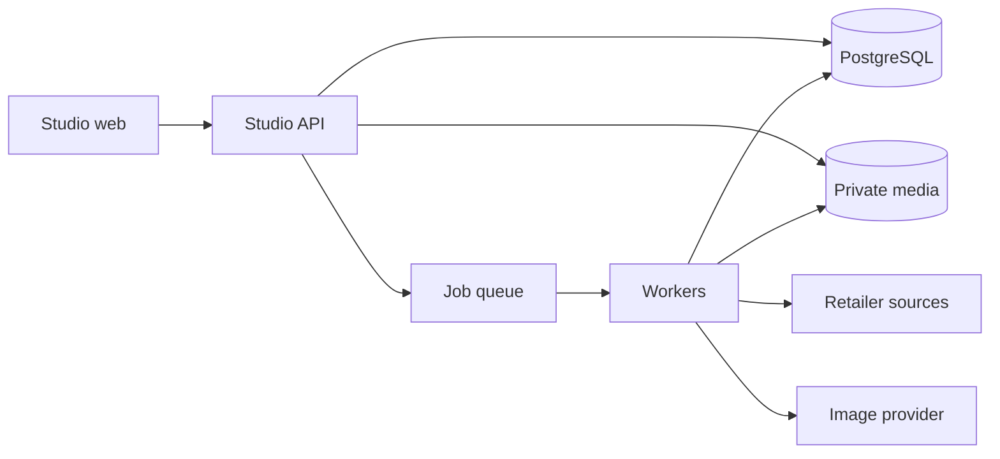
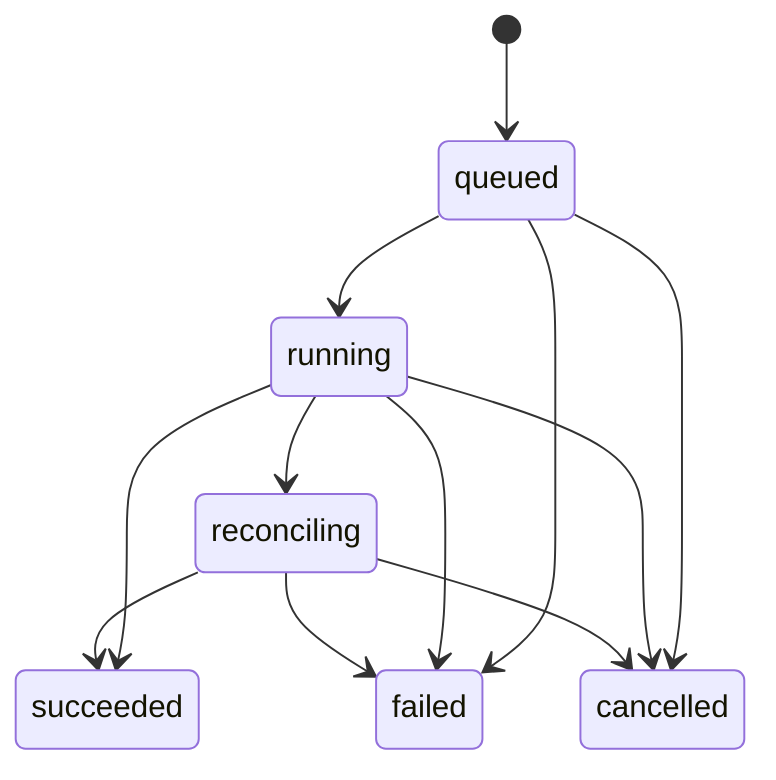

# AI Fashion Studio · Technical Design

**Version 1.0 · 24 November 2026**  
**Companion:** [AI_Fashion_Studio_Requirements.md](AI_Fashion_Studio_Requirements.md)  
**Implementation handoff:** [Copy-paste prompt](#14-copy-paste-prompt-for-your-coding-llm)

## 1. Architecture and repository integration

Inspect the target repository before writing migrations or selecting dependencies. Reuse its auth, UI, storage, queue, and deployment patterns where they support the contracts below. For a new repository, the suggested baseline is React/TypeScript web, Python/FastAPI and SQLAlchemy/Alembic, PostgreSQL, private S3-compatible object storage, and a Python worker with Redis as a queue transport. PostgreSQL owns durable jobs and billing state. Run web, API, worker, database, queue, and local object storage in a development environment with deterministic demo fixtures and a fake image provider.

| Component | Responsibilities |
| --- | --- |
| Web app | Avatar picker, wardrobe, product import confirmation, outfit editor, local 2D rendering, AI job progress and results, 3D viewer when enabled |
| API | Auth, ownership, media upload intents, item versions, outfit revisions, manifests, quotes, jobs, results, deletion, and credit transactions |
| Media worker | Inspect decoded uploads, normalize images, produce derivatives, propose layer preparation, and reconcile object deletion |
| Import worker | Resolve supported public retailer metadata through controlled egress, stage candidate images, and canonicalize confirmed provenance |
| Generation worker | Resolve immutable references, select provider preset, submit one image request, validate output, publish and settle transactionally |
| Asset tools | Author, stage, review, and promote versioned template and garment assets |
| Storage and queue | Keep media private and serve short-lived authorized access. Queue delivery is at least once. The database and outbox handle deduplication and recovery |



These are logical boundaries. Start with one API deployment and a worker deployment. Suggested modules for a new repository are `web/features/{avatar,wardrobe,outfits,preview}`, `api/{avatars,wardrobe,outfits,media,tryon,credits}`, `workers/{media,imports,generation}` and `fixtures/studio`. Keep provider-specific parameters inside adapters and use one shared contract for slots and statuses.

## 2. Domain model and invariants

Use opaque UUIDs, UTC timestamps in storage, and indexed ownership. All version rows are immutable except deletion markers and fields required to revoke access. The public API uses owner-scoped queries and returns `404` for resources outside the caller’s scope. Approved public demo assets are the explicit exception to private ownership.

| Table | Required fields and rules |
| --- | --- |
| `consent_events` | `owner_id, policy_version, purpose, accepted_at, revoked_at`. Purposes include processing a personal image. |
| `assets` | `id, owner_id` or public catalog scope, `kind, object_key, sha256, mime, bytes, width, height, status, expires_at, deleted_at`. `kind` covers normalized avatar, product reference, layer, mesh, or look. Never return storage IDs or object keys to ordinary clients. |
| `upload_intents` | `id, owner_id, purpose, staging_key, expected_content_type, expected_bytes, expires_at, asset_id`. Support idempotent completion and expiration. |
| `avatars / avatar_versions` | Avatar holds `owner_id, display_name, current_version_id, archived_at`. Version holds optional private photo asset, standard pose/template version, optional rig version, and consent reference. Enforce one owner default avatar with an atomic switch. |
| `wardrobe_items / item_versions` | Item holds `owner_id, current_version_id, archived_at, deleted_at`. Version holds `slot, label, color, tags, source_kind, source_url, source_variant, product_ref_asset_id`. Import jobs and prepared assets are separate. |
| `import_jobs / import_candidates` | Hold owner, canonical URL, job state, sanitized metadata, expiring candidate asset IDs, and a single confirmed version per confirmation key. |
| `template_versions` | Define neutral scene and garment layers, front occlusion masks, camera framing, dimensions, anchor specification, supported styles, and optional rig ID. |
| `item_representations` | Per item version and mode, record template or rig compatibility, state, media assets, alignment transforms, style flags, processor and review version. Unique approved representation per item version, target, mode, and variant. |
| `outfits / outfit_revisions / outfit_slots` | Outfit holds `owner_id, name, current_revision_id`. Revision holds sequence, avatar version, style mode, and creation time. Slots join immutable item versions. Unique `(revision_id, slot)`. |
| `tryon_jobs / tryon_attempts` | Job stores owner, outfit revision, canonical input manifest, preset and config versions, state, idempotency key and request digest, quote snapshot, deadline, claim token, result ID and error code. Attempt records provider dispatch, remote ID where known, attempt state, and provider cost. |
| `looks` | Owner, `source_job_id` unique, outfit revision, output asset, save/delete timestamps, feedback relation. Unsaved images expire; saved images follow the published retention policy. |
| `credit_accounts / credit_ledger` | Account tracks grant and paid balances if enabled. Each signed ledger entry has type, quantity and audit metadata. Unique per job and event type for reservation and settlement. Keep credit balances derivable from ledger totals. |
| `outbox / deletion_requests` | Durable publication and deletion tasks with state, deduplication keys and due times. Handle replay through atomic state transitions. |

Use real foreign keys and transactional services to keep owner and version relationships consistent. For outfit updates, ensure each wardrobe version belongs to the same owner or a published public catalog item and matches its assigned slot. Ownership is derived from the authenticated principal. A submitted job points to immutable inputs. Editing a default avatar, product photo, price, or template creates a new revision or version. Use soft archival for historical viewing, and separate permanent privacy deletion with tombstones for referential integrity.

## 3. API contract

Examples omit the existing auth/session details. Base path is `/api/v1`. Use JSON unless uploading a file to storage. Responses with destructive or paid actions require the normal authentication and request protections for the repository.

| Method and path | Request and result |
| --- | --- |
| `POST /media/uploads` | `purpose, content_type, bytes`. Return `upload_id, upload_url, headers, expires_at`. |
| `POST /media/uploads/{id}/complete` | Confirm upload, verify owner, inspect staging object, and schedule normalization. Return `202` with `asset_id, state`. Safe to repeat. |
| `GET /media/assets/{id}` | Return processing state and safe errors. Only ready assets receive authorized delivery links. |
| `GET/POST /avatars` | List or create a template/avatar record. For photo creation accept ready `photo_asset_id` and applicable `consent_event_id`. |
| `PATCH/DELETE /avatars/{id}` | Change default, name, or versioned reference. Delete revokes affected private media and initiates cleanup. |
| `POST /imports` | `url`. Return `202` with job ID. |
| `GET /imports/{id}` | Return state, candidate IDs, supported retailer metadata, candidate previews and fallback reason. |
| `POST /imports/{id}/confirm` | `candidate_id, slot, title, variant`. Confirm once per idempotency key, return an item/version, and promote only the chosen candidate. |
| `GET/POST /wardrobe/items` | Filter/paginate by category or create a version from a normalized owned asset, or save a curated catalog reference. |
| `PATCH/DELETE /wardrobe/items/{id}` | Update mutable item state or create a new version for media and metadata changes. Use explicit archive action for reversible removal, and `DELETE` for privacy deletion. |
| `GET/POST /outfits` | List drafts or create an outfit and its first revision. Return stable outfit ID and current revision. |
| `GET/PATCH /outfits/{id}` | Return current revision and selections. On write send `expected_revision_id` plus complete desired slot state. Return `409` with current revision ID on conflict. |
| `GET /outfits/{id}/revisions/{revision_id}/preview` | Return resolved compatibility, readiness, base asset, layer manifest, and capabilities for that revision. |
| `POST /tryon/quotes` | `outfit_id, revision_id, preset`. Validate availability and return `quote_id, credit_cost, expires_at` and any blocking reasons. |
| `POST /tryon/jobs` | `quote_id`, with an `Idempotency-Key` header. Return `202` and job status. Replays return the existing job before checking quote expiry. The same key with a different payload is a `409`. |
| `GET /tryon/jobs/{id}` | Return state, outfit revision, reason code, result ID and next polling delay when appropriate. |
| `POST /tryon/jobs/{id}/cancel` | Idempotent cancellation when job is active. A job already completed returns its completed state. |
| `GET /looks/{id}` | Get authorized metadata and current signed URL for an available result. |
| `PATCH/DELETE /looks/{id}` | Save a look or revoke it and schedule deletion. |
| `POST /looks/{id}/feedback` | Submit allowed issue codes such as `missing_item`, `identity_changed`, `pattern_changed`, or `artifact`. |
| `POST /privacy/deletion-requests` | Submit account-wide deletion with the app’s normal re-authentication method. Repeated requests return the existing operation. |

Example outfit update:

```json
{
  "expected_revision_id": "9aee2942-cef1-409c-94fb-c12750258d5d",
  "avatar_version_id": "d8fc419c-674d-44ab-a83a-f2ecb16fb428",
  "style": "tucked",
  "slots": {
    "top": "d032b7c3-4985-4578-a21b-ab97f1267d9f",
    "bottom": "1228b241-bcd4-435e-bac4-b7c8db16d813",
    "belt": null
  }
}
```

An outfit save checks the expected revision and persists the revision plus slots in one transaction. Use explicit `null` to clear a slot. Unknown keys or category mismatches are `422`. An unchanged payload returns the existing revision. Use a stable error envelope with `error.code`, `error.message`, `error.retryable`, and `request_id`. Example codes include `MEDIA_UNUSABLE`, `IMPORT_UNSUPPORTED`, `REVISION_CONFLICT`, `QUOTE_EXPIRED`, `INSUFFICIENT_CREDITS`, and `GENERATION_UNAVAILABLE`.

## 4. Media intake and product import

1. Client chooses purpose and obtains an upload intent. The service gives a short-lived, single-object upload target with size enforcement where storage supports it. Intent completion verifies once and then queues inspection.
2. Worker decodes the staged bytes, verifies the actual signature and pixel count, normalizes EXIF orientation and color space, strips metadata, and re-encodes. Initial proposed limits are 10 MiB and 24 megapixels per input. Accept JPEG, PNG, and WebP. Convert supported device formats before upload where appropriate or show a clear alternative.
3. Persist a bounded, ready reference image for AI and thumbnails for the UI. Keep transparent overlay binaries separate from the garment reference. Release resources and expire incomplete staging objects. Explicitly track `staged → validating → ready | rejected`.
4. For store imports, prefer approved API or feed connectors with allowed product-media use. For permitted metadata, parse structured product data or Open Graph in the configured connector. Run the fetcher in a restricted network context with an allowlist, public-destination validation including redirects, response/time limits, and no ambient credentials. Apply the same policy to image candidates. Use no login or CAPTCHA bypass.
5. Show title, candidate thumbnails and a category suggestion. Confirmation pins one normalized reference asset and provenance in the item version. Expire unconfirmed candidates. Importers whose terms or access cannot support this workflow fall back to uploads and the retailer link.
6. Prepare 2D assets independently. MVP supports prepared demo items and an operator review path for uploads. A later segmentation model may propose a mask, color or category. Always allow correction. Neither this preparation nor runtime layer swaps trigger paid image generation.

For personal photos, the backend records a current consent event before storage or provider use. The client guides a single standing subject with arms slightly clear of torso and full length visible. Validate technical properties deterministically. Any pose check is advisory unless it is measured and documented.

## 5. Quick-preview renderer

### Authoring contract

Use a versioned **1024 × 1536 design canvas** in a single front-facing pose as a suggested initial template. Store alpha layers as PNG or lossless WebP and author anchor coordinates in normalized canvas space. Author the base avatar, neutral top and trousers, and foreground hand/arm masks separately. Support only edited overlay material that can cover its corresponding base area. A casual full-body upload is used as an AI reference by default. Personalized 2D templates require their own alignment and masks.

The simplest authoring pipeline uses pre-aligned full-canvas layers with identity transforms. For cropped layers, a reviewer supplies a bounded normalized destination rectangle `[x, y, width, height]` plus a supported style. Anchor metadata describes shoulders, waist, inseam, or buckle alignment and helps review. M1 scales/translates according to the approved rectangle. It does not need warp or cloth simulation.

| Order | Layer |
| --- | --- |
| 0 | Base scene and avatar: head, skin base, default shoes, and scene background |
| 10 | Bottom layer or neutral bottom |
| 20 | Top layer or neutral top, with a validated tucked or untucked version |
| 30 | Belt when the active outfit and style make the waistband visible. A compatible belt may have a clipped mask where necessary |
| 40 | Foreground avatar occlusions such as hands, including approved masks for the active template |

Example layer entry:

```json
{
  "slot": "top",
  "item_version_id": "d032b7c3-4985-4578-a21b-ab97f1267d9f",
  "representation_id": "8fdbedc1-9617-41d1-9033-993109725efd",
  "status": "ready",
  "z": 20,
  "rect": [0.23, 0.18, 0.54, 0.37],
  "style": "tucked",
  "asset_url": "<short-lived authorized URL>"
}
```

The preview manifest also returns template/base/occlusion assets, per-slot readiness, fallback layer entries, and `capabilities.realistic` and `capabilities.three_d` state plus reason. Use the same deterministic ordering in the browser and any export renderer. Client may immediately swap preloaded layers using its local draft, then save the outfit and refresh server compatibility. If a layer is absent or invalid, draw its neutral replacement and mark the slot. A belt without suitable waist visibility is reported as hidden. Do not silently draw on top of an untucked shirt.

Use Canvas 2D or positioned image layers. Pre-decode and cache approved asset variants in memory for the current session. Load candidates asynchronously, bind them to their selection version, and ignore stale decodes. Enforce origin-safe media for canvas output. Avoid a server call whenever the selected preview layers are available locally. Render logs contain timings and IDs, without raw personal media or signed URLs.

## 6. Realistic AI generation

### Model interface and prompt

Use one provider adapter that supports a person reference plus three garment references with a single output. The same interface has a fake provider for CI and local development. A dedicated single-garment try-on API can be benchmarked separately. It may qualify for single-item presets if results meet the rubric. Simultaneous top, bottom, and belt generation must use a proven multi-reference preset.

```text
GenerateRequest {
  request_id, preset_id, prompt_version,
  references: [{role: person|top|bottom|belt, asset_id}],
  style: tucked|untucked,
  deadline_at
}

GenerateResult {
  provider_request_id?, image_bytes, media_type,
  model_id, usage_metadata
}
```

Reference position is deterministic: person first, then selected slots in the order top, bottom, belt. The prompt enumerates actual image positions dynamically, which prevents a missing top from shifting the mapping incorrectly. Use server-controlled prompt templates and approved style enum values. Product metadata is data and cannot modify instructions. Avoid including personal metadata in prompts.

Example with all three selected:

> Image 1 is the person and framing reference. Apply the shirt from image 2, trousers from image 3, and belt from image 4. Preserve the person's face, build, pose, background, footwear, and areas outside the selected garments. Match the item colors and visible patterns. Tuck the shirt so the belt and buckle are visible. Return one full-body outfit photo.

Provider integration reference: the [OpenAI Images guide](https://developers.openai.com/api/docs/guides/image-generation) documents image editing with multiple references. Choose and lock the real model ID, supported settings, and estimated cost during integration testing. Confirm the provider’s acceptance of four references and suitable output size. Do not infer character or product fidelity from API capability alone.

### Submit, retry, and settle

1. Quote validates immutable revision ownership, item count, role mapping, readiness, current photo consent, provider availability, and per-user rate limits. It returns the exact preset, estimated cost to the platform, and exact user credit cost internally. Public response omits the platform cost.
2. Submit in one transaction. Check the scoped idempotency key and canonical request hash first. Lock credit account, validate quote ownership and expiry, claim the quote for this job, write any credit hold, job and outbox event. A single quote creates one job. Replaying the same key returns the job. Spending twice on a deliberate regeneration requires a new quote and key.
3. Dispatch jobs via durable outbox. Worker claims with an expiring lease and fencing token. Re-check active inputs and consent immediately before provider dispatch. Attempt rows record dispatch intent, provider IDs, result and cost wherever available. Use provider idempotency where supported. If remote acceptance is unknown, reconcile by remote ID or expire at a bounded deadline. Avoid resubmitting an ambiguously accepted paid call automatically unless an idempotent provider path is verified.
4. Permit bounded backoff for confirmed transient failures where the prior request is known to be unaccepted or safe to replay. Handle user cancellation immediately at the application boundary, release the hold atomically and request upstream cancellation where supported. Any late output for a cancelled or expired job is discarded and cleaned up.
5. Validate result bytes, decode, and stage privately. In one transaction, check lease validity, live inputs, current job state and cancellation. Create one unique look, settle the credit hold and mark success. Clean abandoned staging files after the cut-off. If job publication fails, retry the transaction or recover from the staged asset. No user credit settles without a visible successful result. Record vendor spend separately, including failures.
6. Deliver status by authenticated polling with backoff or use existing live events as a UX enhancement. Start near two seconds, back off towards eight seconds, pause when hidden, and refresh on return. Server state remains authoritative. Output feedback can be submitted without re-generating.



Internal `reconciling` appears as processing. Under a row lock, terminal transitions settle or release one hold exactly once. Insert-only ledger entries use a unique job/event constraint. To calculate spendable credit, start with grants and top-ups minus consumed credits and live holds, plus any adjustments. Terminal success converts the held amount to consumed credit atomically. Operations that exceed a service deadline end with a retryable or terminal error code depending on reason. A cancelled, failed or deleted result never gets republished by a stale worker.

## 7. 3D pilot and future modes

Use a single approved static or skinned avatar geometry and prepared **GLB** assets using matching rig, scale, transforms, and slot rules. Blink, camera movement, or animation can be added later if compatible with garment skinning. Define catalog asset metadata with `rig_version, slot, style, glb_asset_id, garment_revision, review_state`, all from an approved source. Store asset provenance and rights. Use front/side/back presets and orbit controls in a web viewer. Implement lazy loading, reduced-motion handling, texture and polygon budgets, renderer disposal, and a 2D fallback on missing assets or graphics context. Keep the preview label honest when using a generic template texture and shape. See the [Khronos glTF specification and resources](https://www.khronos.org/gltf/).

Build an M3 proof of concept with one rig and two prepared garments per slot. Verify meshes, attachments, seams, clipping around the waist, foreground intersections, and mobile rendering. A future AR proof of concept should validate tracking and occlusion before committing to broad live clothing support. Static photos can feed AI references and draft textures, but use reviewed geometry or a template model for a complete rotatable view. Future outfit suggestions should return valid wardrobe item IDs with reasons and support schedule edits. Affiliate routing should check product eligibility and country and work independently of generation.

## 8. Privacy, deletion, and operations

- Use private object storage, audited account and operator authorization, and short-lived signed URLs. Prefer authenticated media delivery if the existing stack requires immediate token revocation. When using signed URLs, disclose and bound their residual validity, with an initial five-minute maximum. Keep URLs out of analytics and application logs. Protect object copies and thumbnails by the same owner rules.
- Minimize data sent to the generation provider. Supply only the normalized references required for the job. Confirm billing, retention, processing roles, and provider settings before enabling customer data. For internal tests use synthetic or authorized assets.
- The deletion transaction marks source and derived media unavailable, records a cleanup task, blocks new signed-link issuance, and prevents outstanding jobs from publishing affected results. Existing signed URLs can expire within their short TTL. Expire prompt/debug payloads, staging images, and provider-hosted files where provider controls allow. Preserve tombstones and minimized financial records only as permitted by policy. Apply configured backup expiry and reapply active deletion tombstones after any recovery restore.
- Initial operating defaults to approve before launch are 24 hours for unconfirmed uploads/candidates, 30 days for unsaved looks, and account-managed retention for saved assets. Document physical deletion and backup deadlines. Keep these settings configurable and verifiable with a cutoff test.
- Track results by correlation ID, job status, attempt number, renderer duration, provider latency, queue delay, quality preset, estimated versus actual cost, and success/error category. Request logs omit personal photos, prompts, full retailer URL query strings, and signed links.
- Set budgets and per-account concurrency caps. Offer provider kill switch and independent feature flags for real generation, each importer, access to 3D, and paid presets. M1 fallback should work with all provider features off.

## 9. Quality benchmark, monitoring, and budget

Build a rights-cleared pilot set of at least 60 cases for the proposed threshold. Stratify by avatars, skin tones, builds, photo conditions, garment types, patterned shirts, darker fabrics, and belt visibility. Include single-item and full-outfit cases. Include mismatched pose and missing asset cases in validation tests. A reviewer records: face resemblance, each selected item recognizable, appropriate belt visibility, retained non-target details, and severity of artifacts. Count a case as a quality pass only when face and all selected items are recognizable, required belt is visible, and no severe artifacts occur. Use a second reviewer on ambiguous cases. Record costs for every paid attempt, including failed attempts.

```text
provider cost per accepted preview =
  total provider charges for the evaluated cohort / count of quality-passing previews

run cost per accepted preview =
  (provider + preparation + storage/egress + worker costs attributable to the cohort)
  / count of quality-passing previews
```

Measure in the beta storefront and record the preset, hints, approval rate, p50/p95 latency, and reference count. Use the [requirements' pilot targets](AI_Fashion_Studio_Requirements.md#7-pilot-targets-and-open-decisions). Establish the INR budget from actual billed test runs and finance assumptions. Sustained queue lag, increased unknown remote dispatches, double-settlement incidents, and repeated deletion failures trigger investigation. Keep a count of normal quick-preview swaps with paid provider invocation count, which should remain zero.

## 10. Test plan

| Layer | Required tests |
| --- | --- |
| Unit | Slot mapping with missing slots, tucked/untucked belt rules, stable transform order, cache invalidation, media metadata stripping, version digest, provider input order |
| API and database | Owner scope, conflict handling, same-key same-content replays, same-key different-content rejection, quote expiry and single use, abort on any invalid item |
| Import and media | Curated approved-domain fixtures, blocked/failing fetch fallback, image/crop selection, invalid format and dimensions, sensitive metadata removal, candidate expiry |
| Worker and billing | Duplicate queue delivery, concurrent reservations at last credit, stale lease, completion race with cancellation, late provider response, recovery from lost dispatch acknowledgment, deletion while running, failed attempt recovery |
| Browser | Capture/upload flow, accessible picker and errors, three-item selection, item swap, reload, local rendering after cache, saved history, generation progress with fake provider, useful fallback |
| Visual | Baseline fixture snapshots on stable canvas dimensions, belt variants, occlusion masks, render comparison of unchanged layers, manual review of realistic outputs and 3D clipping |
| Operations | Restore with tombstones, remove expired objects, provider disabled switch, metric redaction, controlled data deletion with actual object checks |

Map the named acceptance criteria AC-01 through AC-12 to the release checklist. Mock the provider and retailer connectors in automated CI. Run paid smoke tests only in a configured test account with authorized inputs and an explicit budget.

## 11. Staged implementation plan

| Stage | Build order and handoff |
| --- | --- |
| 0 · Discovery | Inventory repo, auth, image storage, queue, API conventions and existing schemas. Document reused symbols in the implementation summary. Prepare one avatar and two choices for each slot with reviewed layers. |
| 1 · M1 vertical slice | Own avatar and wardrobe, media upload and validation, three slots, save/reopen, deterministic preview, sample demo and missing-layer fallbacks. Add the relevant acceptance tests before starting generation. |
| 2 · M2 sources | Add import contracts, one approved connector and fixture for an independent second source. Launch real multi-store imports after validating both approved connectors. Preserve manual fallback and provenance. |
| 3 · M2 AI | Add quote and job lifecycle, ledger, deterministic fake provider, saved looks, replay tests, cancellation and deletion. Integrate and benchmark real provider behind a flag. Start with one economical preset. |
| 4 · M2 beta | Check quality, cost and reliability gates, mobile accessibility, quota and privacy controls, alerting and support workflow. Use incremental cohort rollout and feature flags. |
| 5 · M3 | Prepare curated GLB assets, ship viewer behind flag, benchmark mobile experience, confirm fallback. Scope AR and wardrobe planning separately. |

## 12. Configuration and deploy notes

Use the existing deployment conventions. A greenfield local setup should have separate containers/processes for web, API, worker, PostgreSQL, Redis, and local object storage. The service may use signed URLs for media where supported with the expiry above. Database migrations should be forward-compatible during rolling deployment. Deploy additive schema first, then API and workers, then UI feature flags. Make worker shutdown and restart resilient to partially completed jobs. Validate object-store CORS, origins, retention, and backup recovery before staging rollout.

Typical configuration includes API origin, database connection, queue connection, object storage credentials, media limits, import connector allowlist, retention policy, provider type and model, prompt version, budget limits, and 3D flag. Set generation to fake or disabled by default in development and CI. Keep production secrets and provider keys exclusively server-side. Define thresholds centrally and show the current active policy to operators.

## 13. First delivery checklist

- One reproducible local demo: front-facing avatar, striped top, olive trousers, brown belt, alternative options, and at least one unavailable overlay.
- Authenticated save/reopen with immutable revisions and private media access.
- Deterministic 2D composition, zero generation calls on ordinary changes, visible compatibility states.
- Two independent source inputs represented in tests, with photo-upload fallback.
- One confirmed realistic request, one mapped reference per selected slot, one saved result, and one credit settlement under duplicate-replay tests.
- Reference deletion revokes access and replays safely. Deletion and cancellation tests include jobs running at the time of the request.
- Known capability gaps and measured quality/latency/cost recorded before pilot launch.

## 14. Copy-paste prompt for your coding LLM

```text
Implement AI Fashion Studio using these two attached specifications:
- AI_Fashion_Studio_Requirements.md
- AI_Fashion_Studio_Technical_Design.md

Goal: A shopper can save an avatar, independently add a top, bottom and belt,
mix items from different product URLs or photo uploads, see an inexpensive
quick preview, and explicitly request one realistic AI preview for a saved
outfit revision. Implement the next milestone based on what the repo contains.
If this is a new repo, use the greenfield stack in the design.

Start by inspecting the repository and its instructions. Reuse established
authentication, UI, API, object storage, queues and test conventions. Match
the feature to its ordinary entry points. Keep the rest of the repository
working. Summarize any contract change you need to make and why.

For the first implementation pass, deliver M1 end to end: template avatar,
wardrobe upload, curated prepared layers, three independent slots, local 2D
preview, outfit save/reopen, and visible fallback for unsupported overlays.
Use synthetic or authorized fixtures and make the demo runnable without any
image provider. Add the relevant acceptance tests, run them, and fix failures.
Report the exact commands, results and any unverified requirements.

Once M1 is verified and when implementing M2, add supported source import with
manual upload fallback. Then implement the quote, job, credit ledger, current
consent checks, immutable slot references and saved results with a fake
provider first. Test concurrent retries, cancel/complete races, and reference
deletion before enabling a real provider. Keep provider calls behind the
adapter and generation feature flag. No model call on item changes.

Treat 3D as the M3 pilot only. Use curated compatible assets and graceful 2D
fallback. Keep camera AR, VR, affiliate integration, and automated wardrobe
planning outside the initial implementation.

Deliver implementation changes and migrations, a runnable fixture, verified
tests mapped to acceptance criteria, and a short report of finished versus
remaining milestones. Use labeled mock mode where applicable. Avoid unrelated
refactors or deployments.
```
