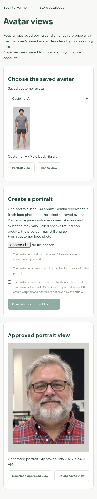

# Saved avatar views — J5

Web `0.20.0-alpha.5` adds an authenticated view workflow for saved customer avatars.
Staff can create and review a portrait or choose free sample hands, approve it,
and reopen it from the same store account on another browser. Original face
photos are not saved. Only approved derived views are stored.

## Enable and use

Keep account storage enabled and set `TRYON_JEWELLERY=1` in the server environment.
The existing account Compose override already passes this flag. Preserve the
account volume and all existing deployment overrides when rebuilding. The flag
is off by default; no production deployment was performed for this feature.

Sign in, open **Saved avatars → Manage views for [customer]**, or visit
`/avatar-views?avatar=AVATAR_ID`. Owners, managers and staff can manage views only
for avatars in their active store.

1. Choose the saved avatar and **Portrait view** or **Hands view**.
2. For a portrait, upload a fresh customer face photo. Confirm that the customer
   approved the selected full-body avatar and agrees to send both references to
   Google Gemini for **one AI credit**. Moving hair behind the ears requires its
   separate explicit customer agreement. Click **Generate portrait** once.
3. For hands, choose an illustrative tone and click **Preview sample hands — free**.
   These are the [J3 templates](JEWELLERY_HANDS.md), not a photograph of the customer's
   own hands. No provider key, AI call or credit is needed.
4. Review the face/complexion/framing or the sample hands. Confirm review and
   saving consent, then choose **Approve and save view**. Previews are not saved
   automatically. A new approval replaces that view kind for this avatar.
5. Reopen the approved view later without generation. Downloading and deleting
   a view are free. Deleting one view leaves the full-body avatar and the other
   view intact; deleting the avatar or customer cascades to its views.

The page keeps references and previews in memory, clears a face reference after
successful generation/cancellation, and clears private state when the session
expires or changes. Changing the avatar/view clears the active inputs and review
state. Re-entering or refreshing does not submit a generation. A failed approval
keeps the preview downloadable; do not generate another portrait just to save it.

Portrait creation requires Gemini with a configured image key. The existing
`TRYON_FEMALE_PROFILES=true` pilot flag also applies to paid female portraits;
female sample hands remain free regardless of that paid-generation flag.
Existing approved views can still be read/deleted when the image provider/key
changes, as long as account storage and the jewellery flag remain enabled.
Disabling the flag hides view access without deleting approved records.



This screenshot uses a prepared synthetic portrait and a stubbed generator to
exercise the web workflow. It is not a live Gemini generation or likeness result.

## APIs and approval proof

All endpoints require a store session and an owned avatar. Every write requires
the same website origin. Tenant/user/store identifiers come from the session,
never from request JSON. Another store's avatar returns 404 on every view route.

| Method and path | Behaviour |
| --- | --- |
| `GET /api/avatars/:id/views` | Approved view metadata, without image BLOBs |
| `POST /api/avatars/:id/views` | Create a signed, unapproved portrait or hands preview |
| `POST /api/avatars/:id/views/:kind/approve` | Review and save an authentic preview |
| `GET /api/avatars/:id/views/:kind` | Private, no-store approved PNG |
| `DELETE /api/avatars/:id/views/:kind` | Remove the view and invalidate outstanding previews |
| `GET /api/avatars/:id/views/portrait/anchors` | Placement anchors for the approved portrait |

Portrait creation body:

```json
{
  "kind": "portrait",
  "facePhoto": "data:image/jpeg;base64,…",
  "avatarReviewed": true,
  "consent": true,
  "consentScope": "face-for-portrait",
  "consentProvider": "gemini",
  "hairBehindEars": false,
  "hairConsent": false,
  "requestId": "NEW_UUID_V4"
}
```

The server loads the full-body reference from the owned avatar record. The
`avatarReviewed` field is explicit customer/staff attestation; older avatar rows
do not contain a durable historical approval flag. A fresh face photo is validated
locally before reserving credits. The [J4 adapter](JEWELLERY_PORTRAITS.md) then
performs the one provider request and face/framing/identity checks.

Hands creation is `{ "kind": "hands", "source": "template" }`, optionally
with `tone`. The body library and default tone come from the saved avatar.
Explicit null/empty tone falls back to Medium with a warning. Arbitrary customer
hand photos and other sources are not accepted in J5.

Creation returns `{image, receipt, kind, tone, sourceKind, needsReview: true,
creditsUsed, warnings}`. Approval requires:

```json
{"image":"ORIGINAL_PREVIEW_DATA_URL","receipt":"SERVER_RECEIPT","reviewed":true,"storageConsent":true}
```

The receipt binds the exact delivered image, initiating user, store, avatar,
view kind, source, tone and current avatar/view revision. It expires after 30
minutes. Altered images, foreign-user receipts and expired/stale previews fail
without making another AI request. Repeating a successful approval is idempotent;
an old preview cannot overwrite a newer approval or revive a deleted view/avatar.

Signing keys are generated once and kept in the existing private account SQLite
database, so approval can survive a restart or reach another worker using that
same database. Back up and protect the account database as before. Signing
metadata contains no original face photo or face descriptor.

## Credits, limits and cancellation

A successful portrait uses one AI credit through the existing `meter()` path,
recorded under the avatar action. Hands previews/approvals, reading, downloads,
anchors and deletion are free, including at zero balance. Trial portraits receive
the existing trial watermark; approval proof binds that final delivered image.

Duplicate request IDs are refused durably across the organisation. An avatar/kind
job lease prevents concurrent dispatches for the same view. Shared image slots
allow at most two image calls across staff, catalogue and shopper flows. Local
photo preflights are also limited to two per process. The pilot rate check allows
20 avatar/portrait attempts per store/user in a rolling hour and requires 15
seconds between them; refunded attempts still count. Rate checks and reservation
are atomic across workers sharing the database.

Failed provider/output checks refund the app credit without automatic retry.
Disconnect, logout, switching store, user disablement, organisation suspension,
avatar deletion and view/avatar revision changes stop delivery and refund a
pending hold. Guards run during generation and again atomically before credit
commit. A remote provider may still charge after cancellation, timeout or rejected
output. Process crashes follow the existing expired-hold recovery; a lost response
is never automatically regenerated.

## Persistence and placement anchors

Additive schema creates `avatar_views` keyed by `(store, avatarId, kind)` with
PNG, tone, source kind and approval/creation timestamps. Foreign keys cascade
with avatars. Small epoch, signing-key and job tables hold only request/approval
metadata. Unapproved images, input references and descriptors are not written to
those tables. Schema installation is idempotent. Visual invalidation is installed
when views are first used, preserving the legacy migration surface for stores
that have never used the feature.

Changing avatar image, profile, body library or template tone invalidates views
and outstanding previews. Name/measurement edits that leave those visual inputs
unchanged preserve approved views. Delete/recreate of the same content-derived
avatar id starts a new epoch, so earlier receipts cannot be reused.

The portrait anchor endpoint uses full 68-point landmarks: jaw points 2/14 with
6% outward and 3% upward offsets for earlobes, points 31/35 for nostrils, nose bridge
27 shifted upward by 0.75× the bridge-to-chin distance for hair parting, and chin
8 shifted downward by 0.55× face height for neck base. Output is in 1152 × 1536
image pixels. Left/right labels here are **image sides** (`coordinateSide: image`);
later UI must map an anatomical side accordingly. Hand anchors retain J3's
wearer's-hand convention.

`pxPerMm` uses an illustrative 63mm interpupillary reference. It is not a physical
measurement or fit guarantee. Only derived placement coordinates are cached in
memory, scoped by store/avatar/image hash, for five minutes with a 128-entry
limit. Writes/deletions invalidate the cache; input photos and recognition
descriptors are never cached. No new overlay or jewellery try-on route is added.

Health exposes `avatarViewsAvailable` for the flag plus account storage, and
`portraitGenerationAvailable` when Gemini and its key are also configured.
`jewelleryAvailable` stays false until jewellery try-on is implemented; the UI
must not infer try-on capability from the new view flags.

## Validation and rollout limits

Backend tests cover roles/tenants/origin, flag/provider gating, free hands,
signed approval/replay/expiry, restart, cascades, metadata changes, concurrency,
preflight limits, credits/refunds, HTTP disconnect and late provider completion,
revocation, hourly limits, trial watermarking and real local landmark anchors.
Browser tests cover the mobile workflow, reopening without AI, deletion, expired
approval download, cancellation and private-state clearing on resume.

Release validation for `0.20.0-alpha.5`: **343 backend tests, 117 browser tests
and the production web build passed**. No live paid provider request was sent.

The browser portrait is a prepared synthetic fixture returned by a stubbed
provider, not a live Gemini result. The identity threshold still needs calibration
on 50+ pilot portraits, and real likeness, complexion, hair, framing, provider
quota/cost/retention and Lightsail performance remain unverified. Keep the pilot
flag off until those operator checks are complete. No APK or deployment was made.

J6's internal [jewellery adaptation adapter](JEWELLERY_TRYON.md) is implemented
in `0.20.0-alpha.6`. J7's public route, credit/refund integration and adaptation
reuse are next; the jewellery studio UI follows in J8.
