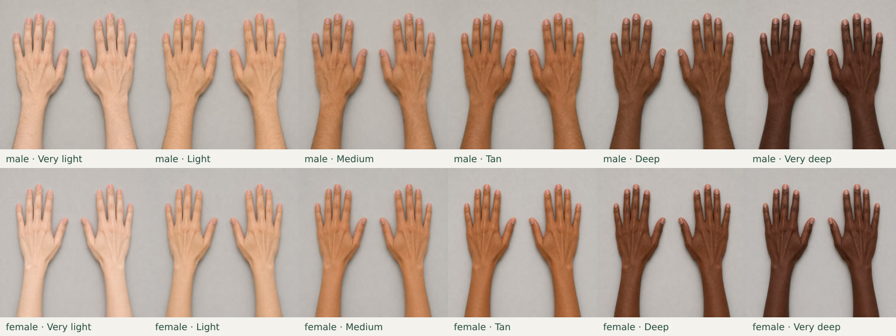
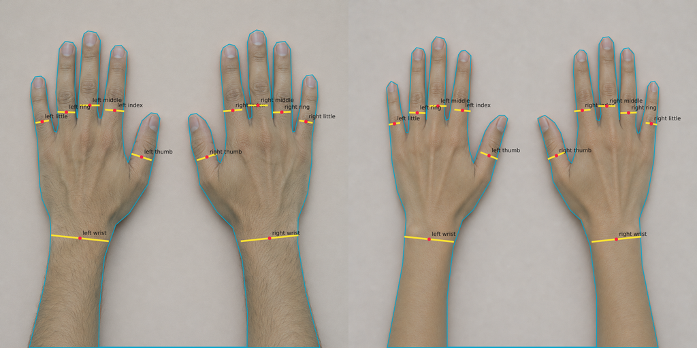

# Hands templates and anchors — J3

Web `0.20.0-alpha.3` adds twelve reusable hands photographs and placement
coordinates for later ring, bangle, bracelet and watch previews. These are static
sample assets: male and female libraries, each with the six existing illustrative
skin tones. Selecting a template makes no AI call and consumes no credits.

J3 supplies the assets and internal loader. Saving/selecting a hands avatar view
is J5; interactive jewellery try-on and overlays are J6–J9. There is no new hands
screen or customer-photo endpoint in J3. `jewelleryAvailable` remains false;
existing avatar and clothing generation is unchanged.



## Images and placement coordinates

`public/hands/{male|female}-{toneId}.png` contains a square **1024 × 1024** RGB
photograph. Tone ids are `very-light`, `light`, `medium`, `tan`, `deep` and
`very-deep`. Each photograph shows both adult hands resting palms down, all ten
fingers and nails, wrists and forearms on a neutral surface, without jewellery.
The images were created once using Image Gen, then normalized with the separate
preparation script. They are fictional sample hands, not customer hand photos.

Each PNG has a matching JSON file:

```js
{
  schemaVersion: 1, width: 1024, height: 1024,
  left:  {thumb, index, middle, ring, little, wrist},
  right: {thumb, index, middle, ring, little, wrist},
  handMask: [[x, y], /* ... */]
}
// Each finger/wrist value: {x, y, angle, widthPx}
```

Coordinates use the final image's top-left origin. `left` and `right` are the
wearer's anatomical hands; in these dorsal views, left is on the image's left
with its thumb toward the centre. `angle` is in degrees clockwise from a
horizontal jewellery band, across the finger/wrist. `widthPx` measures the
approximate band span. Finger widths are 30–90 px; wrists are 120–300 px. These
are placement guides, not a physical size or fit measurement.

Coordinates were authored against the normalized references. Each library keeps
the same pose across its six tones, allowing the reviewed positions to be reused.
The mask follows the skin silhouette and finger gaps. A one-pixel bridge along
the bottom edge represents both separated hands as the design's single polygon;
the central surface between the hands is excluded above that bridge. Future
area checks should compare against this same reference mask.



The contact sheet and anchor overlays were visually inspected during development;
they are development evidence, not a store operator's pilot sign-off. The tones
are illustrative, follow the existing template palette, and do not establish an
exact complexion match. Customer review of appearance and future jewellery
placement remains necessary before pilot use.

## Internal loader and validation

`server/hands-templates.js` exports `handsTemplate(body, tone)`, returning:

```js
{png, anchors, body, tone, sourceKind: 'template', warnings: []}
```

`png` is a PNG buffer. Omitted, null or empty tone selects Medium and returns
`warnings: [{code: 'hands_tone_defaulted', message: '…Using Medium hands.'}]`.
Later view APIs must preserve this warning. An unknown nonempty tone or invalid
body fails with status 400; path fragments are rejected before filesystem access.
Missing, corrupt or incorrectly sized assets fail with a safe status 503 and
do not silently choose another body or tone.

The loader validates the schema, complete fingers/wrists, numeric bounds, full
band endpoints inside the image and anchor centres inside the hand mask. Each
call owns its buffers and coordinate objects, so editing them cannot affect
another request. The module has no provider, database or network dependency and
does not log customer data. The optional root override exists for internal tests
and tools only; request bodies must never control filesystem paths.

The web build copies the public assets, and the runtime Dockerfile explicitly
copies `public/hands` for the server loader. Existing deployment overrides and
account volumes must be preserved when rebuilding. J3 does not deploy a service
or enable a jewellery generation flag.

## Replacing the sample assets

The one-off `scripts/make-hand-templates.mjs` prepares **already generated and
reviewed source images**. It never calls AI. It is excluded from application
startup, build and CI test commands. Keep generation, source review and coordinate
authoring outside the customer request path.

Provide a private JSON manifest with all twelve exact `body-tone` keys. Each
value contains `image` (square static source PNG) and `anchors` (reviewed JSON in
1024px coordinates). Paths resolve relative to the manifest. For example, one
entry is:

```json
{"male-medium":{"image":"sources/male-medium.png","anchors":"reviewed/male-medium.json"}}
```

The other eleven entries are required. Prepare to a **new** directory:

```sh
node scripts/make-hand-templates.mjs /private/hands-sources.json /private/hands-prepared
```

The script validates all sources and anchors, normalizes PNGs to 1024px and
refuses to overwrite an existing output. Inspect all ten fingers, tone consistency,
left/right conventions, wrists, complete forearms and every coordinate on the
prepared images. Copy the reviewed PNG/JSON pairs into `public/hands`, update
the development evidence, then run the tests and build. No script generates
assets during installation or CI.

## Verification and remaining work

`tests/hands-templates.test.js` checks all twelve unique PNG/JSON pairs, dimensions,
tone order, anchor bounds and skin placement, mask coverage, missing-tone warnings,
unsafe selectors, damaged assets and request isolation. Its colour checks apply
only to these fixed synthetic fixtures; they are not a detector for customer
hand photos. `tests/browser/hands-templates.spec.js` verifies that the shipped
PNGs and JSON decode in a browser with no generation request.

Release validation for `0.20.0-alpha.3`: **317 backend tests, 112 browser tests
and the production web build passed**. The offline preparation workflow also
reproduced all 24 shipped PNG/JSON files byte for byte from its source manifest.

[J4's internal portrait adapter](JEWELLERY_PORTRAITS.md) is implemented in
`0.20.0-alpha.4`; [J5 view storage and API](AVATAR_VIEWS.md) are implemented in
`0.20.0-alpha.5`. Human pilot review, exact customer complexion
matching, jewellery fidelity, physical sizing and Lightsail runtime performance
are not established by these asset tests. No APK is built.

## Customer-photo extension

[J14 customer hands](CUSTOMER_HAND_PHOTOS.md) now supplies a separate photo path
with authored markers, one consented Gemini cleanup, review/storage and stable
saved-look geometry. The original template assets and their authored anchors
stay unchanged and free. A customer's photo never receives template positions.
