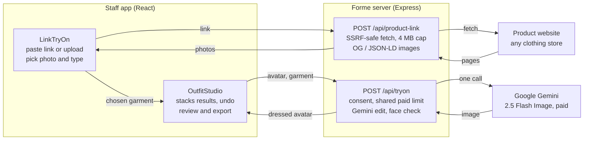

# Forme — Product-Link Try-On: Requirements & Design

As of 2026-10-29 · Rajesh Ramadas

## Overview

Store staff can dress a customer's saved avatar in a garment from any clothing website by pasting its product link, choosing the photo and saying what to put on; one Gemini request produces the try-on. The feature ships in Forme web **0.9.0** on branch `feature/link-tryon` ([PR #1](https://github.com/RajeshRamadas/tryoncloths/pull/1)), awaiting browser tests and live validation before merge.

| Item | Value |
| --- | --- |
| Product | Forme — Avatar Studio (`tryoncloths`) |
| Feature | Try clothes from a product link |
| Version | 0.9.0 (web); Android stays on 0.7.0 |
| Provider | Google Gemini `gemini-2.5-flash-image` |
| Users | Store staff (assisted, in-store) |
| Bodies | Male standard bodies only; female planned later |
| Code | `server/product-link.js`, `server/gemini-tryon.js`, `server/app.js`, `src/LinkTryOn.tsx`, `src/OutfitStudio.tsx` |
| Docs | [`LINK_TRYON.md`](LINK_TRYON.md), [`LINK_TRYON_IMPLEMENTATION.md`](LINK_TRYON_IMPLEMENTATION.md) |

The end goal: once an avatar is generated and saved, any garment from any shop can be put on it, without the store preparing transparent garment cutouts.

## Requirements

Staff must get a reviewed try-on from a pasted link in one AI request, with consent, cost limits and no way to reach the studio's internal network.

**User story.** As store staff, with a customer's approved avatar open, I paste a product link from any clothing site, confirm the photo and garment type, and show the customer wearing it, then add more items to build an outfit.

### Functional

| ID | Requirement | Priority |
| --- | --- | --- |
| FR-1 | Accept a product page URL (http/https) and return the product name and up to 6 product photos. | Must |
| FR-2 | Read photos from JSON-LD `Product`, Open Graph, Twitter card and `image_src`; resolve relative URLs; remove duplicates. | Must |
| FR-3 | If the link cannot be read, let staff upload a product photo or screenshot (JPEG, PNG, WebP). | Must |
| FR-4 | Staff pick one photo and a garment type: shirt, T-shirt, top, jacket, kurta, trousers, jeans, shorts, shoes, full outfit. | Must |
| FR-5 | Pre-select the garment type from the product name; staff can change it. | Should |
| FR-6 | Require customer consent naming the provider before each try-on request. | Must |
| FR-7 | Send the current avatar and garment photo in one request; replace only the chosen garment region. | Must |
| FR-8 | Preserve face, identity, skin tone, body, pose, background and full-body framing. | Must |
| FR-9 | Each result becomes the base for the next garment, so items stack into an outfit. | Must |
| FR-10 | Undo the last garment without a new AI request. | Must |
| FR-11 | Sample overlay layers keep working locally on top of a try-on result. | Should |
| FR-12 | Staff review and approve before download or share (existing flow). | Must |
| FR-13 | Advertise availability via `/api/health` (`tryOnAvailable`, `garment-tryon-v1`). | Must |
| FR-14 | Save try-on looks to the store account. | Later |

### Non-functional

| ID | Requirement | Target |
| --- | --- | --- |
| NFR-1 | Cost control | 1 AI call per garment; no automatic retries; shares the 20/hour per-IP paid limit, 15 s apart, 2 in flight |
| NFR-2 | Link-read limits | 60 per hour per IP, 2 s apart, 4 in flight; no AI cost |
| NFR-3 | Network safety | Public addresses only, checked at connect time and on every redirect |
| NFR-4 | Resource caps | Page 4 MB, image 10 MB, ≤ 30 MP decode, 12 s page / 15 s image timeout, 180 s provider timeout |
| NFR-5 | Output check | Reject results without exactly one detectable face |
| NFR-6 | Privacy | Photos held in memory only; nothing stored unless staff save |
| NFR-7 | Responsive UI | Works on a 390 px phone width with no horizontal scroll |
| NFR-8 | Error safety | Users see fixed messages; provider and internal details never exposed |

### Out of scope

- Size, fit or fabric drape prediction.
- Female or other body sets (planned next).
- Shopper self-service and e-commerce plugins.
- Headless-browser scraping of script-rendered sites.
- A new Android APK (stays 0.7.0).

## Design

Two new endpoints split the work: reading a link costs nothing, and putting a garment on costs one Gemini call that edits the current avatar image.

The app sends the chosen product photo and the current avatar together; each returned image becomes the next base, so garments stack.

### User flow

1. Staff open a saved or approved avatar and choose **Try clothes**.
2. Paste a product link and choose **Find**; or upload a product photo or screenshot.
3. The server reads the page and returns the product name and up to 6 photos.
4. Staff pick a photo and answer "What should the avatar wear from this?"; a guess from the product name is pre-selected.
5. Staff tick customer consent and choose **Put on avatar**.
6. The result replaces the preview; overlay layers already on screen are baked into it.
7. Repeat for the next garment, or **Undo last garment**.
8. Approve, then download or share (existing flow).

### API contracts

| Endpoint | Request | Response | Errors |
| --- | --- | --- | --- |
| `POST /api/product-link` | `{ url }` | `{ title, url, images: [{ source, image }] }` — JPEG data URLs ≤ 1024 px | 400 `invalid_url`, `blocked_address`; 422 `no_images`; 502 `site_refused`, `not_found`, `timeout`, `network`, `too_large`; 429 limits; 401 `account_required`; 403 origin |
| `POST /api/tryon` | `{ avatar (PNG data URL), garment (JPEG/PNG/WebP data URL), garmentType, title?, consent: true, consentScope: "avatar-and-garment", consentProvider: "gemini" }` | `{ image (PNG), kind: "garment-tryon", garmentType, provider, needsReview: true }` | 400 validation or consent; 503 not Gemini or no key; 429 limits; 502 provider codes incl. `missing_face`, `blocked`, `quota` |
| `GET /api/health` (extended) | — | adds `tryOnAvailable`, `tryOnContract: "garment-tryon-v1"`, `garmentTypes` | — |

### Garment types

| Type | Replaces | Keeps |
| --- | --- | --- |
| Shirt, T-shirt, Top | Upper-body garment | Lower garment, footwear |
| Jacket | Nothing; added over the current top | Top where visible, lower garment, footwear |
| Kurta | Upper garment at the kurta's length | Lower garment where visible, footwear |
| Trousers, Jeans | Lower garment, full length to the ankles | Top, footwear |
| Shorts | Lower garment | Top, footwear |
| Shoes | Footwear only (added if barefoot) | All other clothing |
| Full outfit | All visible clothing; footwear only if shown | Footwear unless shown |

### Prompt design

The Gemini request carries the prompt, then Image 1 (the avatar, PNG) and Image 2 (the garment, JPEG), output aspect 2:3. The prompt fixes identity, skin tone, body, pose, background and full framing; asks for faithful colour, pattern, logos and fit; tells the model to take only the named garment from a photo with a model or several products; and to ignore text in images and the product name.

### Components

| File | Responsibility |
| --- | --- |
| `server/product-link.js` | URL validation, address deny list, guarded DNS lookup, redirect-checked fetch, HTML extraction, image normalization |
| `server/gemini-tryon.js` | Garment-type map, prompt, avatar normalization, Gemini request, output face check |
| `server/app.js` | Routes, origin and account checks, consent, shared rate limits, error mapping, health fields |
| `src/LinkTryOn.tsx` | Link input, upload fallback, photo picker, garment-type chips and guess, consent, request handling |
| `src/OutfitStudio.tsx` | Result stack and undo, overlay layers on top, review and export |
| `src/App.tsx` | Reads `tryOnAvailable` from health and passes it to the studio |

## Security, privacy and consent

The main new risk is server-side request forgery: the studio now fetches URLs supplied by users, so every connection is restricted to the public internet.

| Threat | Control | Where |
| --- | --- | --- |
| Fetching internal services or cloud metadata (169.254.169.254) | http/https only, ports 80/443, no credentials in URL; `localhost`, `.local`, `.internal` names refused | `parseProductUrl` |
| Private IP literals (IPv4, IPv6, IPv4-mapped IPv6) | Deny list: 0/8, 10/8, 100.64/10, 127/8, 169.254/16, 172.16/12, 192.168/16, reserved, multicast; ::1, fc00::/7, fe80::/10, ff00::/8, 64:ff9b::/96 | `isPublicAddress` |
| DNS answers pointing inside the network, DNS rebinding | Custom `lookup` on the socket checks every resolved address at connect time; any private answer fails the request | `guardedLookup` |
| Redirect to an internal address | Redirects followed manually (max 4); each hop re-validated | `safeFetch` |
| Oversized or slow responses | 4 MB page, 10 MB image, streamed byte cap incl. decompressed size, 12–15 s deadlines | `requestOnce` |
| Image decompression bombs | Sharp `limitInputPixels` 30 MP, min 160 px, re-encoded to JPEG ≤ 1024 px | `normalizeGarmentImage` |
| Prompt injection via page text or images | Only a sanitized product name (≤ 100 chars, letters and basic punctuation) reaches the model, labelled "for reference only"; prompt tells the model to ignore text in images | `tryOnPrompt` |
| Cross-site use of the studio | Same-origin check (or native app with store access code) on both endpoints; account sign-in required when accounts are on | `sameStudio`, `accountUser` |
| Runaway AI cost | Paid-attempt limit shared with avatar generation; no retries | `/api/tryon` |
| Leaking internals | Fixed error codes and messages; provider bodies never returned | `LinkError`, `providerErrorDetails` |

**Consent.** Each try-on needs a fresh tick: "The customer agrees to send their avatar and this product photo to Google Gemini." The server checks `consent: true`, scope `avatar-and-garment` and the active provider. The tick clears after every request.

**Data handling.** Product pages, product photos and try-on results stay in memory. Nothing is written to disk or the account database by this feature. Provider retention follows Google's terms.

**Product images.** The store uses product photos from third-party sites only as a transient reference for a private in-store preview; the result is not published. Confirm this fits each retailer's terms before a commercial rollout.

## Testing, risks and next steps

Unit tests and the build pass (46 of 46, 9 new); browser tests and live Gemini quality are not yet verified.

### Test coverage

| Test | Covers | Status |
| --- | --- | --- |
| `tests/tryon.test.js` — address checks | Private/reserved IPv4, IPv6, mapped addresses blocked; public allowed | Pass |
| URL validation | Bad schemes, IP literals, localhost, `.local`, non-standard ports, credentials | Pass |
| Connect-time DNS check | Name resolving to 169.254.169.254 refused; loopback server unreachable | Pass |
| Extraction | JSON-LD `@graph`, ImageObject, OG, Twitter, image_src, relative URLs, entities, broken JSON | Pass |
| Link reader | Images normalized; too-small images skipped; no-image pages fail cleanly | Pass |
| `/api/product-link` | Origin check; safe error mapping; no internal details leaked | Pass |
| `/api/tryon` | Consent, scope, provider, garment type, image validation, Gemini-only, missing key | Pass |
| Rate limit | Try-on shares the paid-attempt limit | Pass |
| Gemini adapter | Avatar first, garment second, prompt content, faceless output rejected | Pass |
| `tests/browser/link-tryon.spec.js` | Full UI flow with mocked API, upload fallback, unavailable provider, mobile width | Not run — needs Chromium |

### Risks

| Risk | Impact | Mitigation |
| --- | --- | --- |
| Big Indian marketplaces block automated reading | Link fails for popular sites | Upload/screenshot fallback; measure per site |
| Product photo shows a model or several items | Wrong garment or model's features copied | Prompt isolates the garment; staff pick the clearest photo; review step |
| Prints, logos, fine patterns drift | Customer sees an inaccurate garment | Review before approval; consider a dedicated try-on model later |
| Identity or body drifts across stacked edits | Avatar no longer looks like the customer | Face check per result; undo; limit to a few stacked garments |
| Sample overlay placement assumes the original frame | Overlays misalign on Gemini output | Manual placement sliders; prefer link try-on for real garments |
| Cost growth (1 call per garment) | Higher spend per customer | Shared limits; track calls per session in pilot |

### Before merge

- [ ] Run `npm run test:e2e` locally or in CI.
- [ ] Deploy to Lightsail and test 3–4 real links (Myntra, Ajio, Amazon, a small brand site).
- [ ] Review 10+ live try-ons for face, skin tone, garment fidelity and framing.
- [ ] Confirm `TRYON_TRUST_PROXY_HOPS=1` behind Caddy so per-IP limits work.

### Next steps

- [ ] Save try-on looks to the store account (FR-14).
- [ ] Add female standard bodies.
- [ ] Optional headless-browser reader for script-rendered product pages.
- [ ] Evaluate a dedicated try-on model as a provider option if garment fidelity falls short.
