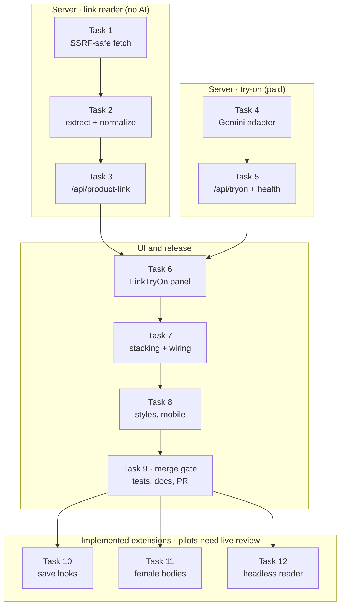

# Forme — Product-Link Try-On: Implementation Guide for an LLM

As of 2026-10-29 · Rajesh Ramadas

## How to use this guide

Give a coding LLM (Claude Code or similar) one task at a time, in order; each task lists the goal, files, steps and acceptance checks, and the prompt template below wraps them. Tasks 1–9 match what [PR #1](https://github.com/RajeshRamadas/tryoncloths/pull/1) built and can be used to rebuild or extend it; task 10 is now implemented; task 11 is implemented behind a pilot flag; task 12 is implemented as an optional isolated service, disabled by default. Tasks 13–14 add the release benchmark and private quality-review tools; live results and a candidate-provider choice remain outstanding. Requirements and design: [`LINK_TRYON_DESIGN.md`](LINK_TRYON_DESIGN.md).

### Repo context to give the LLM first

| Item | Value |
| --- | --- |
| Repo | `github.com/RajeshRamadas/tryoncloths` (Forme — Avatar Studio) |
| Stack | React 19 + Vite + TypeScript frontend, Capacitor Android, Express 5 server, Sharp, face-api (WASM), `node:sqlite` accounts |
| Run | `npm ci`, `npm run dev` (web 5173, API 3001) |
| Verify | `npm test` (node:test), `npm run build` (tsc + vite), `npm run test:e2e` (Playwright) |
| Provider | Gemini `gemini-2.5-flash-image` via `server/gemini.js`; key `TRYON_GEMINI_API_KEY` |
| Key files | `server/app.js` (routes, limits), `server/provider-errors.js`, `server/face-check.js`, `src/App.tsx`, `src/OutfitStudio.tsx`, `src/api.ts` |

### Rules for the LLM

1. Read the files a task names before writing code; follow existing patterns (validation style, error objects, `requestApi`, consent checks).
2. One task per branch commit; do not start the next task until the current acceptance checks pass.
3. Never change existing API contracts (`customer-avatar-v4`, `/api/personalize`) or existing test expectations.
4. No new runtime dependencies unless the task says so.
5. Never put API keys in frontend code or `VITE_` variables; never log customer images or provider bodies.
6. Paid AI calls: no automatic retries; always behind explicit consent and the shared rate limit.
7. Errors returned to the client use fixed messages and codes, never raw exception text.
8. Add or update tests in the same task; tests must not make real network or paid calls (inject stubs).
9. Finish each task by running `npm test` and `npm run build`, and report what was not verified.

### Prompt template

```markdown
You are working in the tryoncloths repo. Read <files> first.
Implement Task <n>: <title>.
Follow the steps and acceptance checks below exactly. Do not change unrelated code.
When done, run npm test and npm run build and report results.
<paste the task's steps and acceptance checks>
```

## Task order

Run tasks 1–3 and 4–5 as two independent server tracks; tasks 6–9 need both endpoints, and the future tasks start after the PR merges.



One task per LLM session keeps each change small enough to review; do not hand it the whole guide at once.

## Tasks 1–3: product link reader

These three tasks let the server turn a product URL into usable garment photos without AI and without reaching private networks.

### Task 1 — SSRF-safe fetch

**Goal.** Fetch a public URL safely: only the public internet, every redirect re-checked, size and time capped.

**Files.** New `server/product-link.js`. Read `server/app.js` for error style.

**Steps.**

1. Export class `LinkError(code)` with a fixed message map: `invalid_url`, `blocked_address`, `site_refused`, `not_found`, `too_large`, `timeout`, `network`, `no_images`, `unknown`. Unknown codes fall back to `unknown`.
2. Build a `net.BlockList` with IPv4 ranges 0/8, 10/8, 100.64/10, 127/8, 169.254/16, 172.16/12, 192.0.0/24, 192.0.2/24, 192.88.99/24, 192.168/16, 198.18/15, 198.51.100/24, 203.0.113/24, 224/4, 240/4 and IPv6 ::/128, ::1/128, 64:ff9b::/96, 100::/64, 2001::/23, 2001:db8::/32, 2002::/16, fc00::/7, fe80::/10, fec0::/10, ff00::/8.
3. Export `isPublicAddress(ip)`: false for non-IPs; unwrap `::ffff:a.b.c.d` and check as IPv4; reject other `::ffff:` forms.
4. Export `parseProductUrl(raw)`: string ≤ 2048 chars; `http`/`https` only; no username/password; port empty, 80 or 443; IP-literal hosts must be public; reject `localhost`, `*.localhost`, `*.local`, `*.internal`; strip the hash.
5. Write `guardedLookup(hostname, options, cb)` using `dns.lookup(…, {all: true})`; if any answer is non-public, fail with code `EBLOCKED`. Support `options.all`.
6. Write `requestOnce(url, {maxBytes, accept, deadline})` with `http`/`https.request`, passing `lookup: guardedLookup`; browser-like User-Agent, `Accept-Language: en-IN`; handle gzip, deflate, br; return `{redirect}` for 3xx with Location; 404/410 → `not_found`; other non-2xx → `site_refused`; enforce `maxBytes` on decompressed bytes and Content-Length; map `EBLOCKED` → `blocked_address`, other errors → `network`, timeouts → `timeout`.
7. Export `safeFetch(raw, {maxBytes = 3 MB, accept, timeoutMs = 12000, maxRedirects = 4})`: loop hops, resolve each Location against the current URL and run it through `parseProductUrl` again. Return `{body, type, url}`.

**Acceptance.**

- [ ] Private, loopback, link-local, CGNAT, multicast and mapped addresses are rejected; 8.8.8.8 and public IPv6 are accepted.
- [ ] `http://127.0.0.1:<port>`, `http://localhost`, `http://169.254.169.254`, `ftp:`, `file:`, `:8443` and credential URLs are rejected.
- [ ] A hostname whose DNS answer includes 169.254.169.254 fails with `blocked_address` (test by stubbing `dns.lookup`).
- [ ] No new dependencies.

### Task 2 — product extraction and image normalization

**Goal.** From page HTML, get the product name and up to 8 candidate image URLs; turn the best 6 into safe JPEGs.

**Files.** `server/product-link.js`.

**Steps.**

1. `extractProduct(html, pageUrl)`: limit input to 3 MB; parse every `<script type="application/ld+json">`, ignore broken JSON; walk nodes (depth ≤ 8) through `@graph`, `mainEntity`, `itemOffered`, `hasVariant`, `isVariantOf`; for `@type` containing "Product" collect `name` and `image` (string, array, or ImageObject `url`/`contentUrl`).
2. Also collect `<meta>` `og:image`, `og:image:secure_url`, `og:image:url`, `twitter:image`, `twitter:image:src`, `itemprop=image`, and `<link rel="image_src">`. Decode HTML entities in attributes.
3. Title priority: JSON-LD product name, then `og:title`/`twitter:title`, then `<title>`; collapse whitespace; max 120 chars.
4. Image order: JSON-LD images first, then meta images; resolve relative and protocol-relative URLs against the page; keep http/https only; de-duplicate; max 8.
5. `normalizeGarmentImage(bytes)`: Sharp with `limitInputPixels: 30_000_000`, `animated: false`; accept jpeg, png, webp, avif, gif; min 160 × 160; rotate, flatten on white, fit inside 1024, JPEG quality 88.
6. `readProductLink(raw, {fetchImpl = safeFetch})`: fetch page (4 MB); if the response is itself an image, use it directly; else extract; fetch up to 6 images in parallel (10 MB, 15 s each) with `Promise.allSettled`; drop failures; return `{title, url, images: [{source, image: dataURL}]}`; throw `no_images` when none survive.

**Acceptance.**

- [ ] Test HTML with JSON-LD `@graph`, ImageObject, OG, Twitter, image_src and a broken JSON block gives the expected ordered, de-duplicated list and product name.
- [ ] Images under 160 px are skipped; a page with no images throws `no_images`.
- [ ] `fetchImpl` is injectable so tests make no network calls.

### Task 3 — `POST /api/product-link`

**Goal.** Expose the reader to the app with the same access rules as generation.

**Files.** `server/app.js`.

**Steps.**

1. Add `productLink = readProductLink` to `createApp` options for test injection.
2. Add a `sameStudio(req)` helper: Origin present and either a native origin with a mobile token configured, or same host.
3. Route order: account required when `accountStore` is set (401 `account_required`) → origin (403) → per-IP limit 60/hour, 2 s apart (429) → global 4 in flight (429).
4. Call `productLink(req.body.url)`; return its JSON.
5. On error, use the `LinkError` code (else `unknown`): 400 for `invalid_url`/`blocked_address`, 422 for `no_images`, 502 otherwise. Log only `{event: "product_link_failure", code}`.
6. Place the route before the `/api` 404 handler; the existing mobile-token middleware already covers it.

**Acceptance.**

- [ ] Cross-origin request → 403 and the reader is not called.
- [ ] Success returns images; `site_refused` → 502 with its code; an unexpected error → `unknown` with no internal text.
- [ ] Existing 37 tests still pass.

## Tasks 4–5: try-on server

These two tasks add the paid step: one Gemini edit that puts the chosen garment on the current avatar.

### Task 4 — Gemini try-on adapter

**Goal.** A provider function that takes avatar + garment + type and returns a checked PNG data URL.

**Files.** New `server/gemini-tryon.js`. Read `server/gemini.js`, `server/provider-errors.js`, `server/face-check.js` first and mirror their patterns.

**Steps.**

1. Export `TRYON_CONTRACT = "garment-tryon-v1"`.
2. Export `garmentTypes`: keys `shirt`, `tshirt`, `top`, `jacket`, `kurta`, `trousers`, `jeans`, `shorts`, `shoes`, `outfit`; each `{label, region, keep}` (what to replace and what stays — see the design doc's garment table).
3. `cleanTitle(title)`: keep only letters, digits, spaces and `.,'&()-/%`; collapse spaces; max 100 chars.
4. Export `tryOnPrompt(type, title)`: Image 1 = PERSON (base to edit), Image 2 = GARMENT; replace `region`, keep `keep`; preserve face, identity, hair, glasses, skin tone, body, pose, hands, lighting, background, full framing to both feet; reproduce colour, pattern, print, logos, texture, neckline, sleeves, length, fit; take only the named garment if the photo has a model or several items; ignore text in images and in the product name (marked "for reference only"); one 2:3 full-body photo, no collage.
5. Export `normalizeAvatar(dataUrl)`: PNG data URL only, < 20 MB string; Sharp 25 MP limit; portrait (width < height), ≥ 128 × 256; fit inside 1024 × 1536; PNG. Throw plain `Error` with a user-safe message.
6. Export `geminiTryOn({avatar, garment, garmentType, title, apiKey, model, fetchImpl})`: validate key and model name (`/^[a-zA-Z0-9.-]+$/`); POST `…/models/{model}:generateContent` with `x-goog-api-key`, 180 s timeout, parts = prompt, label, avatar PNG, label, garment JPEG; `responseModalities: ["TEXT","IMAGE"]`, `aspectRatio: "2:3"`.
7. Handle response like `gemini.js`: block reasons → `blocked`; no image → `no_image`; > 28 MB or undecodable → `invalid_image`; re-encode PNG; `await requireVisibleFace(bytes)`.

**Acceptance.**

- [ ] Stubbed fetch sees avatar first (PNG) and garment second (JPEG), the right region text and the sanitized title.
- [ ] A `<script>` in the title never reaches the prompt.
- [ ] A faceless returned image throws `missing_face`.

### Task 5 — `POST /api/tryon` and health

**Goal.** Expose try-on with consent, Gemini-only gating and the shared paid limit.

**Files.** `server/app.js`.

**Steps.**

1. Add `tryOn = geminiTryOn` to `createApp` options.
2. Extend `/api/health` with `tryOnAvailable: provider === "gemini" && Boolean(apiKey)`, `tryOnContract`, `garmentTypes: Object.keys(garmentTypes)`.
3. Route checks, in order: account (401) → `sameStudio` (403) → `consent === true`, `consentScope === "avatar-and-garment"`, `consentProvider === provider` (400) → `garmentType` in `garmentTypes` (400) → provider is Gemini with a key (503) → `inFlight < 2` (429) → the same `attempts` map as `/api/personalize`: 15 s apart, 20/hour (429).
4. Normalize the avatar with `normalizeAvatar` (400 on error); validate the garment as a JPEG/PNG/WebP data URL under the 5 MB photo limit and run `normalizeGarmentImage` (400 on error).
5. Re-check limits after the async validation, record the attempt, increment `inFlight`.
6. Call `tryOn(...)`; respond `{image, provider, kind: "garment-tryon", garmentType, needsReview: true}`.
7. On failure use `providerErrorDetails`; reword avatar-generation wording for try-on; `missing_face` gets a try-on specific message; status 502; log only event, provider, code, status. Always decrement `inFlight` in `finally`.

**Acceptance.**

- [ ] Each bad field (consent, scope, provider, type, avatar, garment) → 400 with no provider call.
- [ ] OpenAI provider or missing key → 503; health shows `tryOnAvailable: false`.
- [ ] A second try-on within 15 s → 429 (shared limit).
- [ ] Existing `/api/personalize` tests unchanged and passing.

## Tasks 6–8: staff UI

These tasks put the flow in front of staff inside the existing **Try clothes** screen, with no change to avatar generation.

### Task 6 — `LinkTryOn` component

**Goal.** A panel to paste a link or upload a photo, pick a photo and garment type, consent and request the try-on.

**Files.** New `src/LinkTryOn.tsx`. Read `src/OutfitStudio.tsx`, `src/api.ts`, `src/images.ts` (`readPhoto`) and the consent markup in `src/App.tsx`.

**Steps.**

1. Export `garmentChoices` (id, label) matching the server keys, and type `GarmentType`.
2. Export `guessGarmentType(title)`: regex on the lowercase name — jeans → `jeans`; t-shirt/tee/polo → `tshirt`; kurta; jacket/blazer/hoodie/sweatshirt/coat/overshirt → `jacket`; shorts; trousers/pants/chinos/joggers/cargos → `trousers`; shoes/sneakers/loafers/boots/sandals → `shoes`; shirt → `shirt`; set/co-ord/suit/outfit → `outfit`; else `null`. Check jeans and t-shirt before shirt and trousers.
3. Props: `base` (current preview PNG data URL), `disabled`, `available`, `providerLabel`, `onBusy(bool)`, `onResult(image, label)`.
4. State: `url`, `title`, `images`, `chosen`, `garmentType`, `consent`, `state` (`idle` | `reading` | `generating`), `error`.
5. **Find**: `requestApi("/api/product-link", POST, 45 s)`; keep only images starting `data:image/jpeg;base64,`; set title, images, first image chosen, guessed type; consent cleared. Enter key also submits.
6. **Upload fallback**: hidden file input (jpeg, png, webp) → `readPhoto(file)` → one image; title from the file name.
7. **Put on avatar**: enabled only with chosen image, type, consent, `base` and `available`; `requestApi("/api/tryon", POST, 200 s)` with `consentScope: "avatar-and-garment"`, `consentProvider: "gemini"`; validate `kind === "garment-tryon"` and a PNG data URL; call `onResult(image, "<Label> · <title>")`; clear consent.
8. On `code === "account_required"` dispatch `forme-account-expired`. Timeout/abort errors get a fixed message noting a possible charge.
9. Show a note when `available` is false; show cost note "One AI request per garment" under the button. Use existing classes (`outfit-panel`, `garment-tile`, `consent`, `button`).

**Acceptance.**

- [ ] `npm run build` passes type checks.
- [ ] Put on avatar stays disabled until photo, type and consent are set, and when try-on is unavailable.

### Task 7 — stacking in `OutfitStudio` and App wiring

**Goal.** Each try-on result becomes the new base; undo goes back without AI; App tells the studio if try-on is available.

**Files.** `src/OutfitStudio.tsx`, `src/App.tsx`.

**Steps.**

1. Add prop `tryOn: {available, providerLabel}`.
2. Add state `dressed: {image, label}[]`; `current = dressed.at(-1)?.image || base`; render overlays on `current` instead of `base`.
3. Render `<LinkTryOn base={result} …/>` first in `outfit-controls` — `result` (the composed preview) is sent, so visible overlay layers are baked in.
4. `dress(image, label)`: push to `dressed`, clear overlay layers (`update([])`), then set the review notice.
5. When `dressed` is not empty, show a "Wearing from product links" panel listing labels and an **Undo last garment** button (pop + clear layers).
6. Review checkbox, Download and Reset are enabled when there are layers **or** dressed items; Reset also clears `dressed`.
7. Update header text to "Sample layers: no AI · Product links: one AI request per garment" and the intro line.
8. In `App.tsx`: state `tryOnAvailable`; reset to false at the start of `checkService`; set from health `tryOnAvailable === true && tryOnContract === "garment-tryon-v1"`; pass `tryOn={{available: tryOnAvailable, providerLabel}}` to `OutfitStudio`.

**Acceptance.**

- [ ] Existing outfit e2e test still passes (sample layers, export, reset, no AI calls).
- [ ] After undo of all garments, the preview equals the original avatar.

### Task 8 — styles and mobile layout

**Goal.** The panel fits the current design and a 390 px phone.

**Files.** `src/styles.css` (append only).

**Steps.**

1. `.link-tryon .link-row`: flex row, input fills, button beside; stacked under 480 px.
2. `.product-images`: auto-fill grid, min 88 px tiles, 120 px image height.
3. `.garment-chips`: wrapping pill buttons; `aria-pressed="true"` uses the existing green `#245a49`.
4. `.dressed-list`, `.product-title`, `.link-question`: wrap long names (`overflow-wrap: anywhere`).
5. Disabled inputs and chips at 0.6 opacity.

**Acceptance.**

- [ ] No horizontal scroll at 390 px with a long product name.
- [ ] Keyboard: every control reachable; pressed state announced via `aria-pressed`.

## Task 9: tests, docs and release

The feature is done when unit tests, the build and the browser tests pass, docs are updated and a PR is open.

**Files.** New `tests/tryon.test.js`, new `tests/browser/link-tryon.spec.js`, new `docs/LINK_TRYON.md`; edit `README.md`, `package.json`, `package-lock.json`.

**Steps.**

1. Unit tests (`node:test`, follow `tests/api.test.js` and its `withServer` helper):
    1. Address deny list and URL validation cases from Task 1.
    2. Connect-time block: stub `dns.lookup` to return a public and a metadata address; expect `blocked_address`; restore it in `finally`.
    3. Extraction from a fixture HTML string (Task 2).
    4. `readProductLink` with an injected `fetchImpl` returning Sharp-made images (one too small).
    5. Endpoints with injected `productLink` and `tryOn` stubs: origin, error mapping, consent and validation 400s, 503s, shared 429.
    6. `geminiTryOn` with a stubbed `fetchImpl`: payload order and prompt; faceless output rejected. Use `standardAvatar("regular")` as a face-bearing image.
2. Browser test with Playwright `page.route` mocks for `/api/health` (force `tryOnAvailable`), `/api/product-link` and `/api/tryon`: link flow end to end, upload fallback guesses `jeans` from `black-jeans.jpg`, unavailable provider blocks generation, no horizontal scroll at 390 px. Scope duplicate button names ("Shirt", "Trousers", "Shoes") with `getByRole("group", {name: "Garment type"})`.
3. `docs/LINK_TRYON.md`: workflow, API, security, limits. Add a short README section linking it.
4. Bump version to `0.9.0` in `package.json` and the two root entries of `package-lock.json` only.
5. Commit on `feature/link-tryon`, push, open a PR listing what was and was not verified.

**Verify.**

```bash
npm test
npm run build
npx playwright install chromium
npm run test:e2e
```

**Acceptance.**

- [ ] `npm test` all green (46 at the time of PR #1).
- [ ] `npm run build` green.
- [ ] `npm run test:e2e` green, including existing outfit and studio specs.
- [ ] No test makes a real network or paid call.
- [ ] Manual check on a deployed studio: 3–4 real product links and 10+ live try-ons reviewed.

## Implemented extensions: tasks 10–12

These tasks are implemented. The acceptance lists below retain the original specification; live rollout checks remain outstanding as noted under each task.

### Task 10 — save try-on looks to the store account

Implemented in web 0.10 on `feature/account-saved-looks`.

**Goal.** Staff save an approved look against the customer's avatar and reopen it on any device without another AI call.

**Files.** `server/accounts.js`, `src/OutfitStudio.tsx`, `src/SavedAvatars.tsx`, `src/account-avatars.ts`, `src/App.tsx`, tests.

**Steps.**

1. In `AccountStore` constructor add table `looks(id TEXT, account TEXT REFERENCES accounts(id) ON DELETE CASCADE, avatarId TEXT, name TEXT, garments TEXT, image BLOB, thumbnail BLOB, savedAt INTEGER, PRIMARY KEY(account,id))`. `garments` = JSON array of labels (max 10, each ≤ 120 chars).
2. Add `saveLook`, `listLooks(account, avatarId?)`, `lookImage`, `removeLook`: same PNG validation and 10 MB / 16 MP limits as `save()`; id = SHA-256 of the image; cap 200 looks per account (409).
3. Routes, following the avatar routes: `GET /api/looks?avatar=<id>`, `GET /api/looks/:id/image`, `POST /api/looks` (`sameOrigin`, `requireUser`, `storageConsent === true`), `DELETE /api/looks/:id`.
4. App: track the open avatar's account id (from `useSavedAvatar` details or the generation response's saved id — add `avatarId` to the `/api/personalize` response when saved).
5. OutfitStudio: when signed in and reviewed, show **Save look to account** with a consent checkbox; post the composed PNG and dressed labels.
6. SavedAvatars: show a looks count per avatar and a looks list with open and delete.
7. Tests: store unit tests (limits, cascade delete, ownership), route tests (401, 403, consent), e2e save and reopen.

**Acceptance.**

- [ ] Another account cannot list, read or delete a look (404).
- [ ] Deleting an account removes its looks.
- [ ] Reopening a look makes no AI request.

### Task 11 — female standard bodies

Implemented in web 0.11 on `feature/female-body-profiles`; disabled by default pending live visual validation. See [female profiles](FEMALE_PROFILES.md).

**Goal.** Add four female standard bodies and female garment types, with the same pipeline.

**Files.** `public/avatar-library-female.png` (new asset), `src/profiles.js`, `server/app.js` (`standardAvatar`), `server/gemini-reference.js`, `server/avatar-prompt.js`, `src/outfits.ts`, `server/gemini-tryon.js`, `src/LinkTryOn.tsx`, `src/App.tsx`, tests, `public/garments/`.

**Steps.**

1. Asset: a 4-panel contact sheet matching the male one (panel crop 384 × 942 after the 0.92 height crop), neutral pose, plain fitted top and shorts, front facing, full feet visible. Record the clothing words used in it.
2. `profiles.js`: add `body: "male" | "female"` and four female ids (for example `f-slim`, `f-regular`, `f-athletic`, `f-curvy`) with `index`; keep male ids unchanged. Make `recommendProfile(height, weight, body)` return ids for that body; validate the height range per body.
3. `standardAvatar(id)`: pick the library file by the profile's body.
4. `gemini-reference.js`: add `headCentres` for each new id — measure them by running `detectFaces(avatar, {landmarks: true, upper: true})` on each panel and record the eye midpoint x; keep the 384 × 942 size check.
5. `avatar-prompt.js`: replace the hard-coded "grey T-shirt, charcoal shorts" with a per-body clothing description from the profile.
6. `outfits.ts` `defaultPlacement`: per-profile width factors and boxes for the female panels; add female sample garments or hide samples for female profiles until assets exist.
7. Try-on: add types `dress`, `skirt`, `saree`, `lehenga`, `blouse` to `garmentTypes` (region and keep text) and to `garmentChoices`; extend `guessGarmentType`. Show only the types valid for the avatar's body.
8. UI: a body selector on step 1 (Male / Female), stored with saved avatars (add a `body` column with default `male`).
9. Tests: profile matching per body, `standardAvatar` crops, face detection on every new panel, prompt wording, garment-type validation.

**Acceptance.**

- [ ] All existing male tests unchanged.
- [ ] Each female panel has exactly one detectable face and passes `geminiBodyReference`.
- [ ] Live review of 10+ female avatars and try-ons before release.

### Task 12 — headless reader for script-rendered pages (optional)

Implemented in web 0.12 on `feature/isolated-browser-link-reader`. See [setup and validation limits](BROWSER_LINK_READER.md). Real-shop benchmarking remains a rollout prerequisite.

**Goal.** Read product pages whose images load only through JavaScript, without weakening network safety.

**Files.** New `server/browser-reader.js`, `server/product-link.js`, `deploy/lightsail/compose.yaml`, tests.

**Steps.**

1. Behind env flag `TRYON_LINK_BROWSER=1` only; default off. Add `playwright-core` as an optional dependency and use a system Chromium.
2. Use it only after `readProductLink` returns `no_images` or `site_refused` on the static fetch.
3. Run Chromium in a separate container with an egress firewall that drops RFC 1918, link-local, loopback and metadata ranges — browser DNS cannot be hooked like `guardedLookup`, so the network layer must enforce it.
4. In the page, intercept every request: allow only http/https on 80/443, block hosts that `parseProductUrl` rejects, block fonts, media and third-party scripts above a size budget.
5. Limits: one page at a time, 20 s total, 8 MB transferred, no downloads, no persistent profile.
6. After load, run the same `extractProduct` on `page.content()` and fetch images through `safeFetch` (not the browser).
7. Tests: unit tests for the request filter; the browser path is skipped in CI unless Chromium exists.

**Acceptance.**

- [ ] With the flag off, behaviour is identical to tasks 1–3.
- [ ] A page that redirects or loads a resource to a private address gets no response from it.
- [ ] Measured success rate on a fixed list of 20 product links is recorded before enabling in production.


## Task 13 — repeatable product-link release benchmark

Implemented on `feature/release-link-benchmark`. See [commands and rollout checks](RELEASE_VALIDATION.md).

**Goal.** Measure the same 20 real product URLs with the normal reader and optional
isolated fallback, preserving network guards and making no AI calls.

**Files.** `server/evaluation/link-benchmark.js`, `server/evaluation/files.js`,
`tests/link-benchmark.test.js`, `docs/evaluation/links.example.json`.

**Steps.** Validate the whole manifest before networking; reject duplicates and
unsafe URLs; read sequentially with two-second spacing; reuse each static result
for comparison; record sanitized errors, image counts, success rate and timing;
write a private, non-overwriting report bound to a manifest hash.

**Acceptance.**

- [x] Invalid or private URLs prevent all requests.
- [x] Every result, including failures, contributes to the denominator.
- [x] Comparison reuses static responses; reports never retain images or raw errors.
- [x] Fewer than 20 products cannot mark the benchmark complete.
- [ ] Run against 20 real retailer products and review photo correctness and memory.


## Task 14 — private avatar/try-on review and candidate-provider comparison

Implemented in web 0.13 on `feature/tryon-quality-evaluation`. See
[dataset format and commands](RELEASE_VALIDATION.md#task-14--avatar-and-provider-quality-review).

**Goal.** Complete the evidence-gathering workflow required by female rollout and
conditional dedicated-provider evaluation without changing the active provider.

**Files.** `server/evaluation/quality.js`, `quality-cli.js`, `review.html`,
`review.js`, `review.css`; `docs/evaluation/quality.example.json`;
`tests/quality-evaluation.test.js`, `tests/browser/quality-review.spec.js`.

**Steps.**

1. Validate case ids, profiles, storage consent, providers and result metadata.
2. Load only bounded local JPEG/PNG/WebP images underneath the manifest directory;
   strip metadata and copy them into a new private report directory.
3. Bind reports to input/output hashes, reject duplicate input sets, run the existing
   face detector and check portrait orientation; retain rejected results for review.
4. Display references and each provider output side by side with the same visual
   rubric; export and reload complete ratings without network requests or storage.
5. Verify report/image hashes when summarizing. Retain failures and unrun cases in
   denominators and report cost/latency coverage explicitly.
6. Require live rather than fixture evidence for female targets and paired candidate
   comparisons. Never automatically approve rollout, retry or switch providers.

**Acceptance.**

- [x] Missing consent, duplicate ids, unsafe file references and repeated input sets fail.
- [x] Missing faces, malformed images and unrun attempts cannot be approved.
- [x] Ratings for another report, edited image or incomplete score set are rejected.
- [x] Fixture evidence cannot satisfy live quality targets.
- [x] A phone-width browser can review, download and reload scores with no external calls.
- [ ] Collect and review ten independent live female cases at each stage.
- [ ] If Gemini fidelity is inadequate, select and compare a dedicated provider on ten paired try-ons.
- [ ] Decide on rollout or a provider adapter from the measured evidence; no candidate is selected yet.


## Task 15 — store garment catalogue and approved adaptation reuse

Implemented in web 0.14 on `feature/store-garment-catalogue`, following the user's
approval to save garments once and reuse matching adapted results. See
[requirements, matching rules, API and deployment](GARMENT_CATALOGUE.md).

**Goal.** Store-owned product photos can be browsed for any customer; a reviewed
result can be reused without an AI call only for its exact input context.

**Files.** `server/garment-store.js`, `server/garment-routes.js`, account/application
wiring; `src/GarmentCatalogue.tsx`, `src/store-garments.ts`, `src/garment-types.ts`,
`src/LinkTryOn.tsx`, `src/OutfitStudio.tsx`, `src/App.tsx`, styles and tests.

**Steps.**

1. Add account-owned garment/link/result tables with cascade deletion and limits.
2. Normalize and hash product photos; canonicalize URLs without discarding variants;
   offer conservative similar-photo suggestions without automatic merging.
3. Add authenticated same-origin catalogue and reuse endpoints. Use stored product
   data for generation and bind cache keys to avatar/outfit pixels and model context.
4. Issue signed output receipts, persist only after review/storage consent, and
   preserve paid output if receipt creation fails. Prevent identical concurrent calls.
5. Add catalogue search/filter/save/delete, link/photo matching and explicit free
   reuse. Save the latest eligible adaptation alongside an approved complete look.
6. Test ownership, duplicates, variants, changed inputs, consent, receipts, limits,
   restart persistence, deletion and the real browser save/reopen workflow.

**Release checks.** Run backend tests, browser tests and the web build. Deploy using
the existing accounts volume, then verify the catalogue on Lightsail. Live provider
quality remains a separate check; this task does not enable pilots or build an APK.
