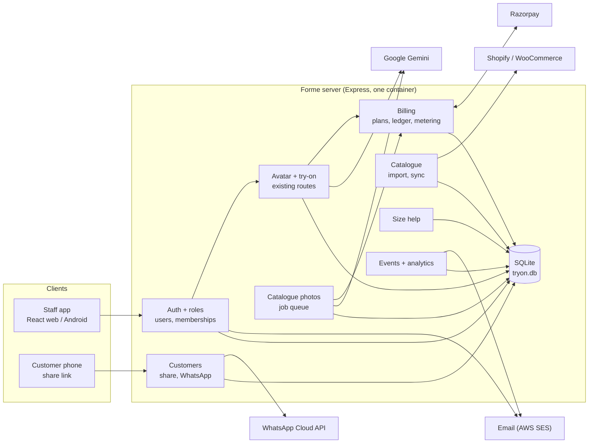
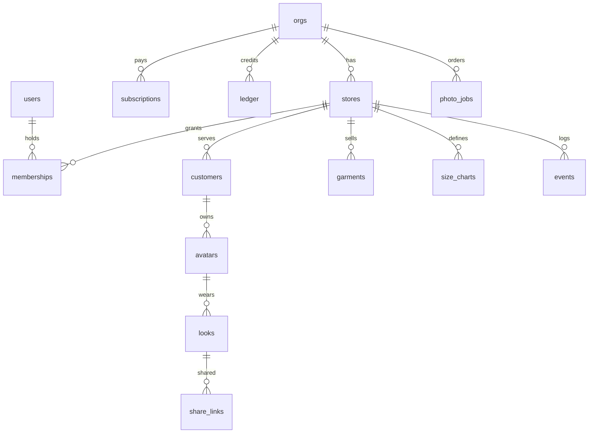
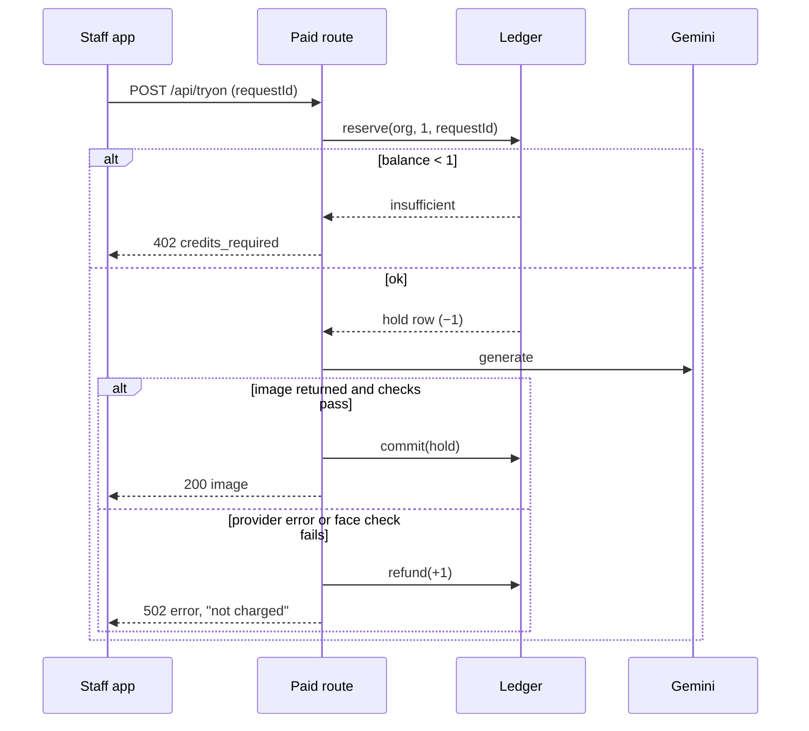

# Forme — Commercial Features: Design

As of 2026-10-30 · Baseline: `main` web **0.15.0** · Requirements: [`SALES_REQUIREMENTS.md`](SALES_REQUIREMENTS.md) · Build steps: [`IMPLEMENTATION_LLM.md`](IMPLEMENTATION_LLM.md)

## 1. Design principles

1. **Do not break the pilot.** Existing tables keep their `account` key; it now means *store*. Existing logins keep working after migration.
2. **Money is a ledger.** Credits are never a mutable counter. Balance is the sum of immutable ledger rows.
3. **Charge only for delivered images.** Reserve before a paid call, commit on success, refund on failure, in one SQLite transaction each.
4. **Tenant from the session, never from the request body.** Every query is scoped by the store id resolved from the logged-in user's membership.
5. **Same stack.** Express 5, `node:sqlite`, Sharp, React. New dependencies only where listed in §11.
6. **India first.** INR, GST, Razorpay, WhatsApp, DPDP Act consent, AWS Mumbai.

## 2. Current baseline (0.15)

| Area | Today |
| --- | --- |
| Tenancy | `accounts` = one store login (email + password); `sessions(token, account)` |
| Data | `avatars`, `looks`, `garments`, `garment_links`, `garment_results`, all keyed by `account` |
| Paid calls | `POST /api/personalize`, `POST /api/tryon` in `server/app.js`; per-IP limits only |
| Reuse | Approved adaptation reuse already returns stored results with no provider call |
| Hosting | One Docker container on AWS Lightsail behind Caddy; SQLite in a named volume |

## 3. Target architecture

New server modules (one file each, mounted from `createApp`):

| Module | Responsibility |
| --- | --- |
| `server/tenancy.js` | Orgs, stores, users, memberships, invites, role middleware, migration from `accounts` |
| `server/billing.js` | Plans, subscriptions, credit ledger, `meter()` helper, Razorpay orders/subscriptions/webhooks, invoices |
| `server/customers.js` | Customer profiles, opt-ins, share links, public share page |
| `server/whatsapp.js` | Cloud API client, templates, webhook (status, opt-out) |
| `server/catalogue-import.js` | CSV import, Shopify/WooCommerce connectors, sync scheduler |
| `server/size.js` | Size charts, recommendation, outcomes |
| `server/photo-jobs.js` | Catalogue-photo batch jobs, worker, format exports |
| `server/events.js` | Event recording, aggregation queries, monthly report |
| `server/secrets.js` | AES-256-GCM encrypt/decrypt for stored third-party tokens |
| `server/mailer.js` | Transactional email via SES SMTP |

## 4. Data model

All new tables live in the existing SQLite database. Times are epoch milliseconds. `store` columns hold the existing `accounts.id`.

| Table | Columns (key ones) | Notes |
| --- | --- | --- |
| `orgs` | id, name, gstin, billingEmail, plan, status (`trial`/`active`/`past_due`/`suspended`), trialEndsAt, createdAt | One per paying business |
| `stores` | id (= old `accounts.id`), org, name, city, phone, brandingJson | Existing account becomes a store |
| `users` | id, email (unique), phone, name, salt, password, disabled, createdAt | Staff logins; migrated owner keeps old email/password |
| `memberships` | user, store, role (`owner`/`manager`/`staff`), PK(user, store) | Owner has a membership on every store in the org |
| `sessions` (changed) | token hash, user, store, expires | Active store chosen at login / switch |
| `invites` | tokenHash, org, store, role, email, expiresAt, acceptedAt | 7-day single-use links |
| `subscriptions` | id, org, provider (`razorpay`), providerSubId, plan, period (`monthly`/`annual`), status, currentPeriodEnd | Mirrors Razorpay state from webhooks |
| `ledger` | id, org, store, user, pool (`ai`/`photo`), amount (+/−), kind, ref, requestId (unique), createdAt | Immutable; see §5 |
| `payments` | id, org, providerPaymentId (unique), providerOrderId, amountPaise, gstPaise, kind, status, createdAt | Credit packs and subscription charges |
| `invoices` | id, org, number (unique, `FY26-27/0001`), paymentId, pdf BLOB, createdAt | Sequential per financial year |
| `webhook_events` | provider, eventId, PK(provider, eventId), receivedAt | Idempotency |
| `customers` | id, store, name, phoneE164, notes, marketingOptIn, optInAt, optInSource, measurementsJson, createdAt | `UNIQUE(store, phoneE164)` |
| `avatars` (changed) | + customer | Nullable for old rows |
| `looks` (changed) | + purchasedAt, purchasedSize, staffUser | Conversion tracking |
| `share_links` | tokenHash PK, store, look, expiresAt, revokedAt, views, createdBy | Token itself never stored |
| `garments` (changed) | + sku, brand, priceInr, mrpInr, sizesJson, stock (`in`/`low`/`out`), externalId, source (`manual`/`csv`/`shopify`/`woo`), updatedAt | `UNIQUE(store, source, externalId)` when externalId set |
| `integrations` | store, kind (`shopify`/`woo`/`whatsapp`), configJson, secretCipher, lastSyncAt, lastError | Secrets via `secrets.js` |
| `size_charts` | id, store, brand, garmentType, size, measurementsJson, sortOrder | Measurements in cm |
| `photo_jobs` / `photo_items` | job: id, org, store, status, createdBy; item: id, job, garment, model, pose, status, image BLOB, approved | Separate `photo` credit pool |
| `events` | id, org, store, user, type, refJson, createdAt | Index `(store, type, createdAt)` |

**Migration (one transaction, run on start-up, idempotent):** for every `accounts` row without a `stores` row → create `orgs` (plan `trial`, 30 AI credits granted in `ledger`, status `active` for existing pilot stores with an admin-set plan), `stores` (same id), `users` (same email, salt, password), `memberships` (owner). Re-key `sessions` to the new user. Keep the `accounts` table read-only for one release, then drop.

## 5. Credits and metering

- `meter(req, {pool: "ai", action, requestId}, fn)` wraps the existing provider calls in `/api/personalize` and `/api/tryon` and the photo worker. `requestId` is a client UUID so a retried HTTP request never double-charges.
- `reserve` runs in `BEGIN IMMEDIATE`: computes balance (sum of `ledger` for org and pool, including holds), inserts the hold if ≥ 1. SQLite serialises writers, so two tabs cannot overspend.
- Ledger `kind`: `grant_plan`, `grant_pack`, `grant_admin`, `trial`, `hold`, `commit` (0-amount marker linking to the hold), `refund`, `expire`.
- Plan credits are granted at each period start (`subscription.charged` webhook) and expire at period end with an `expire` row for the unused plan portion. Pack credits do not expire for 12 months.
- Holds older than 10 minutes with no commit/refund are refunded by a sweeper (crash safety).
- Free actions (link read, reuse, saved looks, overlays) never call `meter`.
- Trial watermark: when `orgs.status = trial`, `meter` passes `watermark: true` and the server composites a corner mark with Sharp before returning the image.

## 6. Payments (Razorpay)

| Flow | Design |
| --- | --- |
| Subscribe | Owner chooses a plan → server creates a Razorpay subscription for the plan id (`RAZORPAY_PLAN_*` env) → client opens Razorpay Checkout with `subscription_id` → webhook confirms |
| Credit pack | Server creates an order (amount in paise incl. 18 % GST) → Checkout → client posts payment id + signature → server verifies `HMAC_SHA256(order_id + "|" + payment_id, key_secret)` → grant only after webhook `payment.captured` or verified signature, whichever first, idempotent by payment id |
| Webhooks | `POST /api/billing/webhook` mounted with `express.raw()` **before** `express.json()`; verify `X-Razorpay-Signature` = HMAC-SHA256(raw body, webhook secret) with `timingSafeEqual`; dedupe by event id in `webhook_events` |
| Events handled | `subscription.activated`, `subscription.charged` (grant period credits, invoice), `subscription.halted` (status `past_due`, paid actions blocked after 3-day grace), `subscription.cancelled`, `payment.captured`, `payment.failed` |
| Invoices | Generated server-side as PDF (supplier GSTIN, customer GSTIN if given, HSN/SAC 998314, CGST+SGST for Karnataka, IGST otherwise); sequential number per financial year inside the same transaction as the payment row |
| Secrets | `RAZORPAY_KEY_ID`, `RAZORPAY_KEY_SECRET`, `RAZORPAY_WEBHOOK_SECRET` server env only; never `VITE_` |

## 7. Customers, sharing and WhatsApp

**Share link.** `POST /api/looks/:id/share` → 32 random bytes, base64url → store SHA-256 in `share_links` → return `https://<host>/s/<token>`. `GET /s/:token` is server-rendered HTML (no React bundle, no auth): look image, product names and prices from the look's garments, store branding, "Call store" and "Get directions" buttons, `noindex`, `Cache-Control: private`. Image at `/s/:token/image`. Expired or revoked → 410 page. Views counted in `share_links` and `events`.

**Click-to-chat (no setup).** Client builds `https://wa.me/<customerPhone>?text=<encoded message + link>`; works on any staff phone.

**Cloud API (Growth).** Per-store `integrations(kind=whatsapp)`: phone number id, WABA id, access token (encrypted). Templates submitted once per store: `look_share` (image header, customer name, store name, URL button with token suffix) and `new_arrivals`. Sending checks `customers.marketingOptIn` for marketing templates; utility template `look_share` needs the customer's in-store consent tick, recorded as `optInSource = "in_store"`. Webhook `POST /api/whatsapp/webhook` verifies `X-Hub-Signature-256` with the app secret, records delivery status, and sets `marketingOptIn = 0` when the customer replies STOP or taps the opt-out button.

**Customer lookup.** Mobile numbers normalised to E.164 (`+91` default) before insert and search.

## 8. Catalogue import and sync

| Source | Design |
| --- | --- |
| CSV / Excel | Upload ≤ 5 MB; columns `name, type, sku, brand, price, mrp, sizes, colour, stock, product_url, image_url`; parse with `csv-parse` (xlsx via existing SheetJS on the client, converted to CSV); validate per row; images fetched with existing `safeFetch` + `normalizeGarmentImage`; result report with row errors |
| Shopify | Custom app access token with `read_products`, `read_inventory`; Admin GraphQL `products(first: 50, after:)` paging; map variants to `sizesJson`, first image as garment photo; `externalId = product gid` |
| WooCommerce | REST `/wp-json/wc/v3/products` with consumer key/secret over HTTPS only |
| Scheduling | In-process scheduler, one sync at a time per server, nightly at 02:00 IST plus **Sync now**; per-store lock row; image fetch concurrency 3 |
| Safety | Store URLs pass `parseProductUrl`; tokens encrypted; sync never deletes garments with saved results, it marks them `stock = out` |
| Garment type | Mapped from product type/tags via `guessGarmentType`; unmapped items need staff confirmation before use |

## 9. Size recommendation

1. Customer measurements (cm) from profile; if none, estimate chest and waist from height, weight and body profile with a simple fitted table → confidence capped at **Low**.
2. For each size in the matching chart (brand + garmentType), score = Σ over measured fields of `max(0, |customer − chart| − ease)` / chart, where ease is 2 cm (chest), 2 cm (waist), 3 cm (hip).
3. Pick the lowest score. Confidence: **High** if ≥ 2 measured fields and the next size scores ≥ 2× worse; **Medium** if 1 field or close second; **Low** otherwise.
4. Response: `{size, confidence, reason, alternatives}`; UI shows "Suggested M · High — chest 98 cm fits M (96–100)".
5. Purchased size from `looks.purchasedSize` is logged in `events`; later tuning per brand, no ML in R2.

## 10. Catalogue photos

- Input: garment(s) from catalogue + standard model = existing body library template and complexion tone (no customer image, so no customer consent needed).
- Generation: reuse `geminiTryOn` with the template as Image 1 and a `catalogue` prompt variant (plain studio background, natural pose, garment fully visible).
- Post-process with Sharp: crops and pads to 1:1, 4:5, 3:4; white-background variant; JPEG 90; filename `<sku>-ai-model-<format>.jpg`; EXIF/XMP `DigitalSourceType = trainedAlgorithmicMedia`.
- Jobs: `photo_jobs` queue processed in-process, concurrency 1 per org, 2 global; each item metered from the `photo` pool; one free regeneration per item tracked on the item row.

## 11. Analytics and branding

- `events.record(req, type, ref)` called from routes; types: `avatar_generated`, `tryon_generated`, `tryon_reused`, `look_saved`, `look_shared`, `share_viewed`, `purchase_marked`, `whatsapp_sent`, `catalogue_photo`.
- Dashboard queries aggregate by day with indexes; chain view groups by store; conversion = `purchase_marked` / sessions with ≥ 1 try-on.
- Monthly report: 1st of month 09:00 IST, HTML email via SES to owners; CSV export endpoint.
- Branding: logo (PNG/SVG ≤ 500 KB, sanitised: SVG converted to PNG with Sharp), primary colour, contact; applied to share page and server-side watermark/footer on exports.

## 12. API summary

| Method and path | Role | Purpose |
| --- | --- | --- |
| `POST /api/auth/login`, `/logout`, `/switch-store` | any | Session per user and active store |
| `GET/POST/DELETE /api/staff`, `POST /api/invites`, `POST /api/invites/accept` | owner, manager (own store) | Staff management |
| `GET /api/billing`, `POST /api/billing/subscribe`, `/order`, `/verify` | owner | Plan, balance, payments |
| `POST /api/billing/webhook` | Razorpay | Signed webhook |
| `GET /api/usage` | owner, manager | Credit usage |
| `GET/POST/PATCH /api/customers`, `GET /api/customers/search?phone=` | staff+ | Customer profiles |
| `POST /api/looks/:id/share`, `DELETE /api/share/:id`, `GET /s/:token` | staff+ / public | Share links |
| `POST /api/whatsapp/send`, `POST /api/whatsapp/webhook` | staff+ / Meta | WhatsApp |
| `POST /api/catalogue/import`, `POST /api/integrations/:kind`, `POST /api/catalogue/sync` | manager+ | Catalogue |
| `GET/PUT /api/size-charts`, `GET /api/size?customer=&garment=` | manager+ / staff+ | Size help |
| `POST /api/photo-jobs`, `GET /api/photo-jobs/:id`, `POST /api/photo-items/:id/approve` | manager+ | Catalogue photos |
| `GET /api/analytics`, `GET /api/analytics.csv` | owner, manager | Reports |
| `PUT /api/branding` | owner | Branding |
| Existing paid routes | staff+ | Now wrapped by `meter()`; 402 `credits_required` when empty |

**New dependencies:** `csv-parse` (import), `pdfkit` (invoices), `nodemailer` (SES SMTP). Razorpay, Shopify, WooCommerce and WhatsApp are called with `fetch`; no SDKs.

**New environment variables:** `TRYON_SECRET_KEY` (32-byte base64, encrypts integration tokens), `RAZORPAY_KEY_ID`, `RAZORPAY_KEY_SECRET`, `RAZORPAY_WEBHOOK_SECRET`, `RAZORPAY_PLAN_STARTER|GROWTH|CHAIN` (+ `_ANNUAL`), `TRYON_PUBLIC_URL`, `SMTP_URL`, `MAIL_FROM`, `WHATSAPP_APP_SECRET`, `FORME_GSTIN`, `FORME_STATE_CODE`.

## 13. Security and compliance

| Risk | Control |
| --- | --- |
| Cross-tenant access | Store id only from session membership; repository functions require `store` argument; tests attempt cross-store reads on every new route |
| Privilege escalation | `requireRole()` middleware; owners cannot be removed by managers; last owner cannot be disabled |
| Payment fraud | Credits granted only after signature or webhook verification; idempotent by payment/event id; amounts computed server-side |
| Double charge | Client `requestId` unique in `ledger`; holds swept |
| Share link leakage | 256-bit tokens, hashed at rest, expiry, revoke, no customer phone on the page, `noindex` |
| WhatsApp spam / DPDP | Opt-in recorded with source and time; STOP honoured; marketing blocked without opt-in; deletion endpoint removes customer, avatars, looks, share links |
| Third-party tokens | AES-256-GCM with random 12-byte IV and key id; key only in env |
| SSRF via imports | All remote fetches through existing `safeFetch` |
| Abuse of trials | One trial per GSTIN/phone/email; trial credit cap; per-IP limits unchanged |
| Data location | Paid plans hosted in AWS Mumbai (ap-south-1); daily encrypted SQLite backup to S3 with 30-day retention |

## 14. Scale path

SQLite with one container is sufficient for roughly 100 stores and a few writes per second. Move to PostgreSQL (RDS Mumbai) and a separate job worker when any of these hold: more than one server container is needed, photo jobs exceed 1,000/day, or database size passes 20 GB. Keep repository functions behind the module boundaries above so the swap does not touch routes.

## 15. Testing approach

- Unit: ledger arithmetic, reserve/commit/refund under concurrency, webhook signature and idempotency, invoice numbering, size scoring, CSV validation, encryption round trip.
- Route: role matrix (owner/manager/staff/other store/anonymous) for every new endpoint.
- Browser: subscribe with Razorpay test mode (mocked in CI), share page render, WhatsApp click-to-chat link, credits-empty state.
- No test calls Razorpay, Meta, Shopify, Gemini or SES; all clients take an injectable `fetchImpl`.
