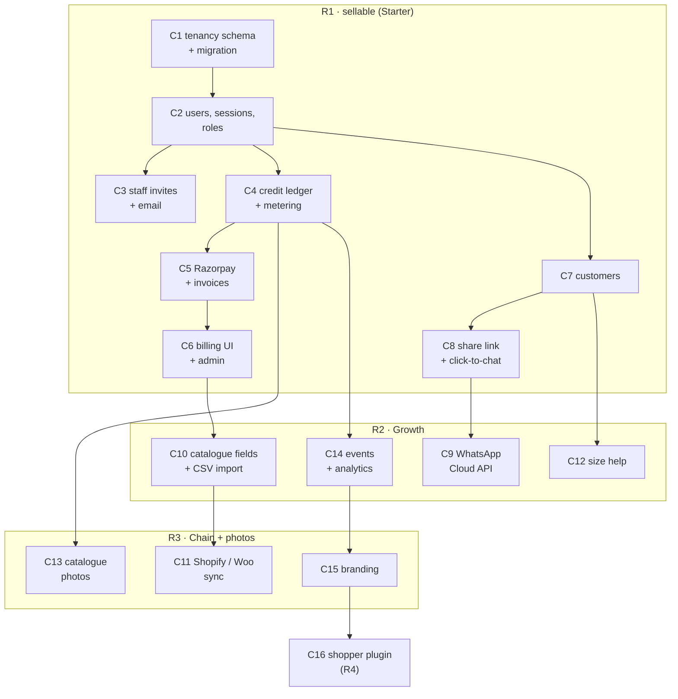

# Forme — Commercial Features: Implementation Guide for an LLM

As of 2026-10-30 · Baseline: `main` web **0.15.0** · Requirements: [`SALES_REQUIREMENTS.md`](SALES_REQUIREMENTS.md) · Design: [`DESIGN.md`](DESIGN.md)

## How to use this guide

Give a coding LLM (Claude Code or similar) **one task per session**, in order. Each task lists goal, files to read, steps and acceptance checks. Do not paste the whole guide; paste the repo context, the rules, and one task.

### Repo context to give the LLM first

| Item | Value |
| --- | --- |
| Repo | `github.com/RajeshRamadas/tryoncloths` (Forme — Avatar Studio) |
| Stack | React 19 + Vite + TypeScript, Capacitor Android, Express 5, Sharp, face-api (WASM), `node:sqlite` |
| Data | `server/accounts.js` (`AccountStore`: accounts, sessions, avatars, looks), `server/garment-store.js` (garments, links, results) |
| Paid routes | `POST /api/personalize`, `POST /api/tryon` in `server/app.js` |
| Run / verify | `npm ci` · `npm run dev` · `npm test` · `npm run build` · `npm run test:e2e` |
| Deploy | `deploy/lightsail/` Docker Compose behind Caddy; accounts need `compose.accounts.yaml` |

### Rules for the LLM

1. Read every file the task names before writing code; follow existing style (validation, error objects, `wrap`, `sameOrigin`, `requestApi`).
2. Never change existing API responses or test expectations unless the task says so; existing pilot logins must keep working.
3. Store/tenant id comes **only** from the session; never trust a store id in the body, query or header without checking membership.
4. Money: credits only through the ledger functions from Task 4; never update a balance column.
5. No real calls to Razorpay, Meta, Shopify, WooCommerce, SES or Gemini in tests; every client takes an injectable `fetchImpl` or transport.
6. Secrets only in server env; never in `VITE_` variables, logs, or API responses.
7. Every new route gets a role-matrix test: owner, manager, staff, user of another store, anonymous.
8. Database changes are additive and idempotent (`CREATE TABLE IF NOT EXISTS`, guarded `ALTER TABLE`), run in a transaction at start-up.
9. End every task with `npm test` and `npm run build`; report what was not verified.
10. One task = one branch commit; bump the minor version and add a short doc in `docs/` per release.

### Prompt template

```markdown
You are working in the tryoncloths repo (Forme). Read <files> first.
Implement Task C<n>: <title> from docs/commercial/IMPLEMENTATION_LLM.md.
Follow the steps and acceptance checks exactly; follow docs/commercial/DESIGN.md for data model and API.
Do not change unrelated code. When done, run npm test and npm run build and report results.
```

## Task order



---

## R1 — make it sellable

### Task C1 — tenancy schema and migration

**Goal.** Add organisations, stores, users and memberships; turn each existing account into org + store + owner without breaking anything.

**Read.** `server/accounts.js`, `server/garment-store.js`, `server/index.js`, `tests/accounts*.test.js`.

**Steps.**

1. Create `server/tenancy.js` exporting `migrateTenancy(db)` and repository functions; call `migrateTenancy(this.db)` at the end of the `AccountStore` constructor.
2. `CREATE TABLE IF NOT EXISTS` for `orgs`, `stores`, `users`, `memberships`, `invites` exactly as in DESIGN §4.
3. In one `BEGIN IMMEDIATE` transaction: for each `accounts` row with no `stores` row, insert org (`plan = 'pilot'`, `status = 'active'`), store (id = account id, name = account name), user (new id, same email/salt/password), owner membership.
4. Add nullable columns with guarded `ALTER TABLE`: `avatars.customer`, `looks.purchasedAt`, `looks.purchasedSize`, `looks.staffUser`.
5. Leave `accounts` and current login code untouched in this task.

**Acceptance.**

- [x] Running start-up twice creates no duplicates.
- [x] A database with 3 existing accounts gets 3 orgs, 3 stores, 3 users, 3 owner memberships.
- [x] Existing behavior assertions pass unchanged; the look-capacity fixture uses an explicit INSERT column list for the additive schema.

**Implemented:** `0.16.0-alpha.1`, branch `feature/commercial-tenancy-migration`.
See [migration behavior and C2 handoff](../TENANCY_MIGRATION.md). C2 must reconcile
legacy credential updates and provision new users atomically before switching auth.

### Task C2 — users, sessions and roles

**Goal.** Log in as a user, with an active store and role; keep old cookies working once.

**Read.** `server/accounts.js` (sessions, `accountUser`, `installAccountRoutes`), `src/StoreAccount.tsx`, `src/App.tsx`.

**Steps.**

1. Add `users`-based `login(email, password)` using the existing scrypt check; sessions store `SHA-256(token)`, `user`, `store`, `expires`.
2. Replace `accountUser(store, req)` internals so it returns `{id: storeId, name, user: {id, name, role}, org}`; existing callers keep using `.id` as the store id.
3. Old session rows (keyed by account) are upgraded on first use to the owner user of that store, then rewritten.
4. Add `requireRole(...roles)` middleware and `POST /api/auth/switch-store` (only stores with a membership).
5. `GET /api/account` additionally returns `user`, `role`, `stores[]`.
6. UI: show the signed-in staff name and a store switcher when `stores.length > 1`.

**Acceptance.**

- [x] Pilot owner can log in with the old email/password and sees the same avatars, looks and catalogue.
- [x] A user without a membership on store B gets 403 on switch to B.
- [x] Role-matrix tests for `switch-store` pass.

**Implemented:** `0.16.0-alpha.2`, branch `feature/commercial-user-sessions`.
See [user sessions and migration](../USER_SESSIONS.md).

### Task C3 — staff invites and email

**Goal.** Owners and managers add staff; staff set their own password.

**Read.** Task C2 code, `src/StoreAccount.tsx`.

**Steps.**

1. `server/mailer.js`: `sendMail({to, subject, html, text})` using `nodemailer` with `SMTP_URL`; in tests use an injected transport.
2. `POST /api/invites` (owner: any store/role; manager: own store, role `staff` only) → 32-byte token, store hash, 7-day expiry, email the link `TRYON_PUBLIC_URL/invite#<token>`.
3. `POST /api/invites/accept` `{token, name, password}` → create or attach user, membership, mark accepted; single use.
4. `GET /api/staff`, `PATCH /api/staff/:user` (role, disabled), with rules: managers cannot change owners; last active owner cannot be disabled or demoted.
5. Disabled users' sessions are deleted immediately.
6. UI: **Staff** screen for owners/managers; invite acceptance page.

**Acceptance.**

- [x] Expired, reused or tampered invite tokens fail.
- [x] Manager cannot invite an owner or manage another store.
- [x] Disabling a user ends their session on the next request.

**Implemented:** `0.16.0-alpha.3`, branch `feature/commercial-staff-invites`.
See [staff invitations, SMTP setup and safeguards](../STAFF_INVITES.md).

### Task C4 — credit ledger and metering

**Goal.** Charge 1 credit per delivered AI image, refund failures, block at zero.

**Read.** `server/app.js` (`/api/personalize`, `/api/tryon`, adaptation reuse path), DESIGN §5.

**Steps.**

1. `server/billing.js`: `ledger` table; `balance(org, pool)`; `grant(org, pool, amount, kind, ref)`; `reserve({org, store, user, pool, requestId})` in `BEGIN IMMEDIATE` (throws `CreditsRequired` when balance < 1); `commit(holdId)`; `refund(holdId, reason)`.
2. `meter(req, opts, fn)`: reserve → `await fn()` → commit on success, refund on any throw, rethrow.
3. Require a client `requestId` (UUID v4) on both paid routes; a repeated `requestId` with a committed hold returns 409 `duplicate_request` without a new provider call.
4. Wrap only the provider call sites; the adaptation-reuse branch must not call `meter`.
5. Map `CreditsRequired` → 402 `{code: "credits_required"}`; client shows "Buy credits or upgrade" with a link to billing.
6. Trial watermark: if org status is `trial`, composite a small "Forme trial" mark bottom-right with Sharp before returning.
7. Sweeper every 5 minutes: refund holds older than 10 minutes with no commit/refund.
8. On C1 migration, grant pilot orgs a configurable starting balance (`TRYON_PILOT_CREDITS`, default 1000) so the pilot is not interrupted.

**Acceptance.**

- [x] 20 parallel reserves with balance 5 → exactly 5 succeed.
- [x] Provider error or failed face check → balance unchanged.
- [x] Reuse of an approved adaptation → no ledger rows.
- [x] Balance 0 → 402 and no provider call.

**Implemented:** `0.16.0-alpha.4`, branch `feature/commercial-credit-metering`.
See [credit ledger, migration and replay handling](../CREDITS.md).

### Task C5 — Razorpay subscriptions, packs and invoices

**Goal.** Owners pay in INR; credits and plan status update only from verified events.

**Read.** `server/billing.js`, `server/app.js` (middleware order), DESIGN §6.

**Steps.**

1. Razorpay client in `billing.js` with `fetch` + Basic auth (`RAZORPAY_KEY_ID:RAZORPAY_KEY_SECRET`); injectable `fetchImpl`.
2. `POST /api/billing/subscribe {plan, period}` (owner) → create subscription → return `{subscriptionId, keyId}`.
3. `POST /api/billing/order {pack}` (owner) → create order; amount from a server-side price table incl. 18 % GST.
4. `POST /api/billing/verify {orderId, paymentId, signature}` → verify HMAC with `timingSafeEqual` → grant pack credits idempotently by payment id.
5. Mount `POST /api/billing/webhook` with `express.raw({type: "application/json"})` **before** the global JSON parser; verify `X-Razorpay-Signature`; dedupe in `webhook_events`; handle the events in DESIGN §6.
6. Invoice: `pdfkit` PDF with GST split (CGST/SGST when customer state = `FORME_STATE_CODE`, else IGST), SAC 998314, sequential number per financial year allocated in the payment transaction; email to billing email.
7. `past_due` after `subscription.halted`; paid routes return 402 `subscription_past_due` after a 3-day grace.

**Acceptance.**

- [x] Bad signature → 400 and no state change; replayed event → no second grant.
- [x] Invoice numbers are gap-free and unique under concurrent payments.
- [x] Amounts never come from the client.

**Implemented:** `0.16.0-alpha.5`, branch `feature/commercial-razorpay`.
Payment service is in `server/payments.js`, mounted through the billing routes.
See [configuration, tests and remaining R1 work](../PAYMENTS.md). Online checkout
UI is still C6; no live Razorpay or SMTP transaction has been run here.

### Task C6 — billing UI, usage and admin tools

**Goal.** Owners see plan, balance and usage; we can manage accounts.

**Read.** `src/StoreAccount.tsx`, `server/account-admin.js`.

**Steps.**

1. **Billing** screen (owner): current plan, status, balance per pool, renew date, plan cards, credit packs, invoices list with PDF download, GSTIN form. Load Razorpay Checkout script from `https://checkout.razorpay.com/v1/checkout.js` only on this screen.
2. **Usage** screen (owner, manager): credits per day (last 30 days), per staff member, per action; CSV export.
3. Header badge: remaining AI credits; warning at ≤ 10 %.
4. Extend `server/account-admin.js` CLI: `grant-credits`, `set-plan`, `extend-trial`, `suspend`, `list-orgs`.
5. New signups (if allowed) start as `trial` with 30 credits and 14-day expiry; one trial per email/phone/GSTIN.

**Acceptance.**

- [x] Staff role cannot open billing (UI hidden and API 403).
- [x] Browser test with mocked Checkout completes a pack purchase flow.

**Implemented:** `0.16.0-alpha.6`, branch `feature/commercial-billing-ui`.
See [billing, usage, trials and operator commands](../BILLING.md). Duplicate trial
checks use supplied identifiers; phone/GSTIN ownership verification is not included.

### Task C7 — customer profiles

**Goal.** Store customers by mobile number and attach avatars and looks.

**Read.** `src/SavedAvatars.tsx`, `src/account-avatars.ts`, `server/accounts.js` avatar routes.

**Steps.**

1. `server/customers.js`: `customers` table; E.164 normalisation (default +91); CRUD and `search?phone=` (prefix match on last 10 digits) scoped to store.
2. Saving an avatar accepts an optional `customerId` (must belong to the same store).
3. Consent fields: `marketingOptIn`, `optInAt`, `optInSource` (`in_store`, `whatsapp`).
4. UI: step 1 gets **Find customer by mobile** / **New customer**; Saved avatars groups by customer.
5. `DELETE /api/customers/:id` deletes the customer, their avatars, looks, results and share links (DPDP erasure).

**Acceptance.**

- [ ] Same number in two stores = two separate customers; neither store can see the other's.
- [ ] Erasure leaves no rows referencing the customer.

### Task C8 — share link and WhatsApp click-to-chat

**Goal.** Send a look to the customer's phone with no WhatsApp setup.

**Read.** `server/accounts.js` looks routes, `src/OutfitStudio.tsx` save/share code.

**Steps.**

1. `POST /api/looks/:id/share {days?}` (staff+) → token, hash stored, URL returned; default 30 days, max 90.
2. `GET /s/:token` server-rendered HTML: look image, garment names and prices (if catalogue has them), store name, phone, map link, `noindex`, no customer data; 410 when expired or revoked.
3. `GET /s/:token/image` streams the look PNG with `Cache-Control: private, max-age=300`.
4. `DELETE /api/share/:id` revokes.
5. UI: **Share on WhatsApp** opens `https://wa.me/<customer E.164 without +>?text=` with a short message and the link; fallback to `navigator.share`.
6. Record `look_shared` and `share_viewed` events (table from C14 may not exist yet: create `events` minimal table here if missing).

**Acceptance.**

- [ ] Token not guessable (256-bit) and not stored in plain text.
- [ ] Revoked link → 410 within one request.
- [ ] Page passes a 390 px mobile check.

**R1 release:** bump to 0.16.0, `docs/BILLING.md` + `docs/STAFF_AND_CUSTOMERS.md`, Lightsail env additions, Razorpay test-mode run, then live keys.

---

## R2 — Growth plan

### Task C9 — WhatsApp Cloud API lookbook

**Goal.** Send lookbooks and new arrivals from the store's own WhatsApp number.

**Read.** `server/customers.js`, DESIGN §7.

**Steps.**

1. `server/secrets.js`: `encrypt(plain) → "v1:<iv>:<tag>:<cipher>"` and `decrypt` with AES-256-GCM, key `TRYON_SECRET_KEY`.
2. `PUT /api/integrations/whatsapp` (owner): phone number id, WABA id, token (encrypted), verify by calling the Graph API phone-number endpoint.
3. `POST /api/whatsapp/send {customerId, template, lookIds}`: utility template `look_share` requires in-store consent recorded; marketing template `new_arrivals` requires `marketingOptIn`.
4. `GET/POST /api/whatsapp/webhook`: verify token handshake; `X-Hub-Signature-256` HMAC with `WHATSAPP_APP_SECRET`; store statuses; STOP / opt-out button sets `marketingOptIn = 0`.
5. **New arrivals on you** (manager): choose catalogue items + opted-in customers → creates try-ons through `meter` (credits shown before confirm) → sends lookbook.
6. Rate: max 1 marketing message per customer per 7 days.

**Acceptance.**

- [ ] No marketing send without opt-in; STOP works end to end in tests.
- [ ] Access token never appears in responses or logs.

### Task C10 — catalogue fields and CSV import

**Goal.** Bulk-load the store's products with price, sizes and stock.

**Read.** `server/garment-store.js`, `server/garment-routes.js`, `src/GarmentCatalogue.tsx`, `server/product-link.js`.

**Steps.**

1. Guarded `ALTER TABLE garments` adds `sku, brand, priceInr, mrpInr, sizesJson, stock, externalId, source, updatedAt`.
2. `POST /api/catalogue/import` (manager+): multipart CSV ≤ 5 MB; parse with `csv-parse`; columns in DESIGN §8; per-row validation; download `image_url` via `safeFetch` + `normalizeGarmentImage` with concurrency 3; upsert by `(store, source='csv', sku)`.
3. Response: `{created, updated, skipped, errors: [{row, message}]}`; downloadable error CSV.
4. Client: Excel files converted to CSV in the browser with SheetJS before upload; downloadable template CSV.
5. Catalogue UI: price, sizes, stock filter; out-of-stock hidden by default.
6. Plan limits: Starter 500 items, Growth 5,000, Chain 50,000 (409 when exceeded).

**Acceptance.**

- [ ] 1,000-row CSV with 20 bad rows imports 980 and reports 20 errors.
- [ ] Private-address image URLs are rejected by the existing guard.

### Task C12 — size recommendation

**Goal.** Suggest a size with confidence and reason.

**Read.** `src/profiles.js`, `server/customers.js`, DESIGN §9.

**Steps.**

1. `server/size.js`: `size_charts` CRUD (manager+), CSV import of charts, scoring algorithm exactly as DESIGN §9.
2. Customer measurements editable on the customer profile (cm, validated ranges).
3. `GET /api/size?customer=&garment=` → `{size, confidence, reason, alternatives}`; 404 `no_chart` when the brand/type has no chart.
4. UI: chip under the try-on result: "Suggested M · High"; tap for reason.
5. **Mark purchased** on a look records size and staff; event `purchase_marked`.

**Acceptance.**

- [ ] Unit tests for each confidence branch and the height/weight fallback (always Low).
- [ ] Recommendation never blocks generation or saving.

### Task C14 — events and analytics

**Goal.** Owners see what sells and how the tool is used.

**Read.** Routes from C4, C7, C8, C12; `server/events.js` stub from C8.

**Steps.**

1. Complete `server/events.js`: `record(req, type, ref)`; index `(store, type, createdAt)`; add calls in all routes listed in DESIGN §11.
2. `GET /api/analytics?from=&to=&store=` (owner: any store in org; manager: own store): totals, daily series, top products tried, tried-not-bought, conversion per product and staff, credits used.
3. CSV export endpoint.
4. Dashboard screen with simple charts (Recharts is not in deps; draw bars with plain SVG or add `recharts` explicitly).
5. Monthly email report on the 1st at 09:00 IST via `mailer.js`, with an unsubscribe flag per owner.

**Acceptance.**

- [ ] Manager of store A cannot query store B.
- [ ] Aggregates match fixture event counts exactly.

**R2 release:** bump to 0.17.0, docs for WhatsApp setup, catalogue import template, size charts.

---

## R3 — Chain plan and catalogue photos

### Task C11 — Shopify and WooCommerce sync

**Goal.** Keep the catalogue in sync with the store's online shop.

**Read.** `server/catalogue-import.js` (C10), `server/secrets.js`, DESIGN §8.

**Steps.**

1. `PUT /api/integrations/shopify {shopDomain, token}` and `/woo {siteUrl, key, secret}` (owner); validate URLs with `parseProductUrl`; encrypt secrets; test connection.
2. Shopify: Admin GraphQL product paging (`first: 50`), variants → `sizesJson`, inventory → `stock`, first image → photo; `externalId` = product GID.
3. WooCommerce: `/wp-json/wc/v3/products?per_page=50&page=n` over HTTPS only.
4. Upsert by `(store, source, externalId)`; removed products → `stock = 'out'` (never deleted when results exist).
5. Scheduler: nightly 02:00 IST and **Sync now**; per-store lock; record `lastSyncAt`, `lastError`.
6. Chain: org-level master catalogue flag; stores read master items read-only.

**Acceptance.**

- [ ] Mocked 3-page Shopify response syncs all products; second run changes nothing.
- [ ] Bad token → `lastError` set, no partial deletes.

### Task C13 — AI catalogue photos

**Goal.** Generate on-model product images for the store's marketing.

**Read.** `server/gemini-tryon.js`, `src/profiles.js` (body library and tones), `server/billing.js`, DESIGN §10.

**Steps.**

1. `server/photo-jobs.js`: `photo_jobs`, `photo_items`; `POST /api/photo-jobs {garmentIds, model: {profileId, tone}, poses, formats}` (manager+); max 50 items.
2. Worker loop: concurrency 1 per org, 2 global; each item metered from pool `photo`; Image 1 = standard template; prompt variant `catalogue` (add to `gemini-tryon.js` without changing the existing prompt).
3. Post-process with Sharp into the requested formats; set XMP `DigitalSourceType` to `trainedAlgorithmicMedia`; filename `<sku>-ai-model-<format>.jpg`.
4. Review UI: approve, reject (one free regeneration), download all as zip (client-side `JSZip` or server stream).
5. Stand-alone buyers: an org may have only photo credits (no try-on plan).

**Acceptance.**

- [ ] Failed items are refunded; regeneration beyond one costs a credit.
- [ ] Job survives a server restart (pending items resumed).

### Task C15 — branding

**Goal.** Store identity on everything the customer sees.

**Read.** Share page (C8), `src/OutfitStudio.tsx` export.

**Steps.**

1. `PUT /api/branding` (owner): logo upload (PNG/JPEG/SVG ≤ 500 KB, SVG rasterised by Sharp), primary colour (hex), display name, phone, address, map URL.
2. Share page and WhatsApp lookbook use branding.
3. Export: optional store footer strip composited server-side or on canvas.
4. Watermark rules: trial = Forme mark (cannot be removed); paid = optional store mark.

**Acceptance.**

- [ ] Malicious SVG (script, external refs) is neutralised.
- [ ] Trial users cannot remove the Forme mark via API.

**R3 release:** bump to 0.18.0, docs for integrations, catalogue photos and branding.

---

## R4 — shopper self-service (outline)

### Task C16 — "Try it on me" plugin

**Goal.** Shoppers try store products on the store's website; the store pays per use.

**Outline.**

1. Embeddable script + hosted page under the store's branding; Shopify theme app extension first.
2. Shopper flow: consent → face + body photo → avatar → try-on of the current product; nothing stored unless the shopper opts in.
3. Billing: per-use from the store's AI pool with a separate monthly cap set by the owner.
4. Abuse: per-device and per-IP limits, CAPTCHA, image moderation, no adult-content prompts, stricter face checks.
5. Separate design review before starting; legal review of shopper consent text.

**Acceptance (for design sign-off).**

- [ ] Threat model and cost cap approved.
- [ ] Shopper data retention ≤ 24 hours unless opted in.
