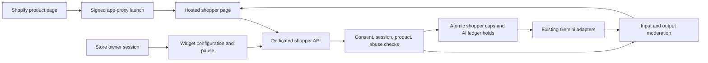

# C16 — Shopper self-service: approved staged design

Status: **product/design approved in this task conversation, 2026-11-06**.
Prepared against web `0.18.0-alpha.3`; [C16.1 spending controls](../SHOPPER_SPENDING.md)
are implemented in `0.19.0-alpha.1`. Shopify integration, shopper sessions and
hosted generation remain pending. Service/legal review and launch verification
are still required; design approval does not enable production shopper access.

This prepares the design review for [C16](IMPLEMENTATION_LLM.md#task-c16--try-it-on-me-plugin),
not its feature acceptance. The guide requires: “Separate design review before
starting; legal review of shopper consent text.” Its threat-model/cost approval
checkboxes below record product/design approval. Existing staff workflows remain
the implementation baseline.

## 1. Proposed first release

- An opt-in Shopify theme app extension adds **Try it on me** to a published
  product page. It opens a hosted Forme page with that store's saved branding.
- Adults using their own photos consent to processing, select/correct an
  approximate standard body and complexion, upload face and full-body photos,
  then explicitly generate one avatar. Automatic complexion matching follows
  the customer photos; the template selection is only a starting reference.
- The shopper checks face, skin tone and proportions before trying the current
  product. Each try-on needs a separate explicit action and consent. A session
  permits at most two successful try-ons, including another eligible product
  selected through the same shop. No free-text prompts or arbitrary URL imports.
- Results are labelled **AI preview — fit and details may differ**. The shopper
  can download a reviewed result or return to the merchant's product page.
- No store/customer account creation, durable avatar library, public sharing,
  marketing, automatic purchase tracking, jewellery or WooCommerce widget in this
  increment. A later, separately consented save/reuse flow can extend retention;
  the initial release offers no save opt-in and creates no customer records.
- Proposed eligibility: active Growth/Chain subscriptions only, explicitly
  enabled by an owner after configuring both store and organisation limits.
  Trial, photo-only, suspended and overdue organisations cannot start paid work.

## 2. Shopper and owner flow

1. Owner connects a Shopify app installation, maps it to the active Forme store,
   verifies shop domains, enables eligible catalogue products and reviews the
   consent/privacy text. Existing read-only catalogue credentials alone do not
   constitute a Shopify app installation or theme extension.
2. Owner sets the caps in §4, enables the widget and adds its theme block. The
   owner page shows committed shopper credits, held credits, dispatched attempts,
   remaining allowance, month/reset date and an immediate **Pause widget** action.
3. Button launches the hosted page through a signed Shopify app-proxy request.
   Server validates the installation and current catalogue eligibility before
   issuing a single-use 60-second launch ticket. The ticket is exchanged on Forme
   for a scoped session, then removed from the URL/history. No photos in URLs.
4. Hosted page first explains the merchant, active AI provider, purpose, limits,
   expiry and deletion. Consent defaults off. Both camera and file selection work.
5. CAPTCHA is verified server-side before accepting photos. The shopper reviews
   normalized previews and body choice, then explicitly submits generation.
   Local validation and input moderation happen before dispatch to Gemini.
6. Successful avatar appears for review; approval binds the exact output hash to
   the session. Product try-on is permitted only against that approved avatar.
7. An explicit try-on sends the approved avatar and server-resolved garment image.
   The server validates/moderates the result; the shopper reviews before download.
8. **End session** invalidates access and clears image state. Expiry and server
   restart require starting over; no automatic AI retries or recovery generations.

Show distinct states for invalid photos, failed CAPTCHA, store paused, cap
reached, insufficient credits, provider quota, timeout/unknown outcome, expired
session and successful output. State explicitly when a new attempt can cost the
store. Do not suggest repeating a timed-out request automatically.

## 3. Architecture and trust boundaries

Reuse image normalization, standard templates, provider adapters, trial/export
policy where applicable and immutable ledger primitives. Leave existing staff
route contracts and prompts intact. Do not call `/api/personalize` anonymously:
it requires staff storage consent and automatically saves an account avatar.
Do not fabricate a staff membership or expose a mobile/store token in the widget.

Shopper handlers resolve store/org from a validated installation/session in the
database, never from shopper-supplied store ids, shop domains or catalogue ids.
Dedicated public routes sit outside the optional `/api` mobile-token gate,
using their own strict auth, small parsers and rate limits; staff APIs stay gated.

### Proposed route contract

| Route | Authority and purpose |
| --- | --- |
| `GET/PUT /api/shopper-settings` | Staff session; owner-only update, owner/manager read; same-origin mutations, revision checks |
| `GET /shopper/launch` | Valid Shopify app-proxy signature/timestamp, active verified installation, eligible product; issue ticket |
| `GET /shopper` | Hosted shell; no staff state; `noindex`, no-referrer, no-store |
| `POST /shopper-api/session` | Single-use launch ticket; issue isolated session, CSRF secret, public branding/product metadata |
| `POST /shopper-api/challenge` | Session + CSRF + CAPTCHA; bind short-lived verification to session/action |
| `POST /shopper-api/avatar` | Session + CSRF + fresh consent + CAPTCHA, normalized images and UUID; one avatar attempt |
| `POST /shopper-api/avatar/approve` | Session + CSRF; bind server-authenticated generated image hash |
| `POST /shopper-api/tryon` | Session + CSRF + fresh consent + CAPTCHA, approved avatar and eligible mapped product revision |
| `DELETE /shopper-api/session` | Session + CSRF; immediate revocation/clearing; idempotent |

Use an independent `__Host-` Secure/HttpOnly/SameSite=Strict shopper cookie;
staff cookies confer no shopper authority. A top-level hosted page avoids
third-party-cookie dependence. Session is 30 minutes absolute, not sliding.
Issue an explicit CSRF token; enforce exact Forme Origin on mutations and no
credentialed cross-origin API access. Origin checks supplement session auth.

Shopify signature verification uses the documented app-proxy canonicalization
and timing-safe comparison, replay protection and a short timestamp tolerance.
Webhook signatures for uninstall/domain changes are checked over raw bytes.
Map the verified shop to one installation/store. Allow only verified merchant
HTTPS return URLs; prevent open redirects. Uninstall, pause and configuration
revision changes invalidate outstanding launches and block subsequent work.

The server signs a session-bound capability over generated avatar hash,
provider/revision, body and expiry; the browser holds image bytes in memory.
Try-on rechecks that capability and supplied-image hash, avoiding a persistent
server image cache or arbitrary image substitution. No result is shared across
shopper sessions, even when a product is the same.

## 4. Approved pilot spending and abuse limits

These pilot ceilings and policies are approved. C16.1 enforces the monthly
accounting limits; session, IP/device, provider and moderation integrations are
implemented in later increments. Limits apply to shopper work only; staff
continue using their existing limits and the same organisation pool.

| Scope | Proposed default / ceiling |
| --- | --- |
| Feature | Disabled; cap 0 until explicitly configured |
| Each enabled store per calendar month | 50 delivered AI credits; 50 dispatched image-provider attempts |
| Entire organisation per calendar month | 200 delivered AI credits; 200 dispatched image-provider attempts |
| Owner-configurable pilot range | Store 0–50; organisation 0–200; increases above these ceilings require a later reviewed change |
| Moderation invocations | At most 100/store/month and 400/org/month, including failures; reserve before every external moderation request |
| One session | At most 3 dispatched image-provider attempts, one successful avatar and two successful try-ons |
| One device cookie / one IP | 3 / 12 dispatched image-provider attempts per rolling hour, across installations |
| Session creation | 2/device/hour; 10/IP/hour; bounded global table/request limits |
| Concurrent shopper generation | 1 per store; 1 globally; also inside a shared total staff/photo/shopper image-call ceiling of 2 |
| Upload | JPEG/PNG/WebP; 5 MB each, 12 MP decoded each; normalized with metadata stripped; no SVG/URL upload |
| Provider execution | One image output, bounded input dimensions/tokens, 120-second absolute deadline; no SDK/network retry |

Month boundaries use **Asia/Kolkata**, calculated server-side. Holds belong to
the month in which they were reserved, even if completion crosses midnight.
Changing caps or restarting never resets counters; lowering below usage blocks
new work. An owner pause or subscription suspension is checked again immediately
before dispatch and delivery. An already dispatched call may still cost money.

One successful avatar plus its first try-on costs **2 AI credits**. Thus a
50-attempt store cap allows at most 25 complete first-product journeys when
all calls succeed; retries/additional products reduce this. Existing cached
staff adaptations remain free but cannot be accessed by a shopper session.

### Atomic reserve and settle

1. Validate session, consent revision, CAPTCHA, product and decoded images before
   any image-provider call. Bound CPU validation separately. Input moderation
   has its own atomic monthly invocation reservation, never charged as AI credits.
2. In one `BEGIN IMMEDIATE` transaction, recheck eligibility, all limits and AI
   balance; insert operation, cap reservation, concurrency lease and ledger hold.
   Add a dedicated, tightly scoped shopper billing entry point; existing
   `BillingStore.reserve()` requires a real staff membership and stays that way.
3. Persist `dispatching` **before** calling the provider. It conservatively uses
   a provider-attempt allowance even if a crash prevents the network send.
   Failed/unknown dispatched calls never restore that allowance this month.
4. Validate and moderate output. Atomically commit the ledger hold and delivered
   credit counter, mark success, release lease; return image. Failed validation,
   timeout or error refunds the credit hold and releases the delivered-credit
   reservation, but preserves dispatched-attempt consumption. A committed
   response lost in transit is still charged; never claim proven browser delivery.
5. UUID deduplication is bound to session, action and request-body hash. Repeated
   requests never send another provider call; return in-progress/completed/error
   metadata, with completed bytes only if still present in the original browser.
   Unknown outcomes require explicit new request ids within the remaining limits.
6. A restart/lease sweeper refunds unsettled holds and marks unknown work; it
   never resends. Extend the existing billing sweeper so it cannot refund a live
   shopper operation before its deadline; all settlement paths are idempotent.

Credits cap customer charges; dispatched-attempt caps also bound exposure from
provider-billed failures. Neither is a guaranteed rupee budget: current provider
image/token and moderation tariffs must be confirmed before launch. No automatic
top-ups, fallback provider, plan purchase or cap increase. Display both counters
to the owner, and stop when **either** cap or shared AI balance is exhausted.

CAPTCHA is checked before every paid action, with a single-use, short-lived
server-side proof tied to the session and action. CAPTCHA/moderation unavailable
means generation unavailable. Device cookies are a soft control, not fingerprint
identity: clearing cookies, VPNs and distributed attacks remain possible. Monthly
org/store caps are the final financial boundary. IP limits can affect shared shop
or mobile networks; show a retry time and never silently weaken them.

## 5. Data model and retention

Add migrations transactionally/idempotently. Proposed tables:

| Table | Purpose / durable fields |
| --- | --- |
| `shopper_installations` | Org/store, verified Shopify shop/domain mapping, encrypted app credentials, enabled/revision, createdBy |
| `shopper_settings` | Store/org cap policy, approved consent/privacy revision, pause state; revision-checked owner updates |
| `shopper_launches`, `shopper_sessions` | Hashed capabilities, installation, product revision, expiry, consent version, revocation; short-lived only |
| `shopper_operations` | Random operation UUID, org/store, action, reserved month, ledger hold, dispatch/settlement state and lease; request/session bindings held separately in transient storage |
| `shopper_budgets` | Org/store/month aggregate held, committed, dispatched and moderation counts; no shopper identifiers |
| `shopper_abuse` | Expiring keyed IP/device hashes and bounded rolling counters; no raw IP or fingerprint |

Operation records required to dedupe and settle money outlive sessions but
contain no photos, measurements, names, emails, face descriptors or device/IP
hashes. Keep request-body hashes and session links in transient storage, outside
the backed-up accounting DB, and purge within 24 hours. Keep only
nonidentifying accounting refs/aggregates under the existing financial policy.

| Data | Proposed lifetime and deletion |
| --- | --- |
| Original photos / measurements | Browser memory; server process memory only during validation/request, bounded by deadline; never DB, filesystem, logs, analytics or account storage |
| Generated avatar / outfit | Browser Blob memory for the 30-minute session; synchronous server response only; no durable result cache |
| Launch capability | Single use, 60-second expiry; retain only hashed replay marker for ≤24 h |
| Session, consent evidence and abuse hashes | Maximum 24 h server retention; use denied-at-expiry checks immediately, then purge every minute/startup |
| Catalogue image / branding | Existing merchant data; shopper process does not copy customer photos into those records |
| Local download | Explicit shopper action; recipient controls the file after download |
| Provider copies | Governed separately by contracted provider terms; exact processing location/retention must be disclosed and approved before launch |

Use no localStorage/IndexedDB/service-worker image caching, and no thumbnail
uploads to analytics. Check absolute expiry on visibility/resume and before each
action; clear Blobs and revoke object URLs on end/expiry/tab navigation. Timers
alone cannot enforce expiry while a mobile browser is suspended. Exclude public
routes from analytics/session replay; scrub cookies, tickets, photos and bodies
from proxy/app error and access logging. Browser downloads/screenshots cannot be
remotely deleted. Discarding JS buffers does not guarantee immediate physical RAM
erasure; ensure the host's swap/core-dump policy does not persist image buffers.

Do not put transient session/abuse data in the backed-up main SQLite database.
Use a bounded separate transient store on tmpfs, excluded from volumes/backups;
restart invalidates all sessions. Keep durable budget/ledger/operation records
in the existing DB without personal payloads. Budget counters must survive
restart. Validate tmpfs memory capacity on the small Lightsail instance.
Logical expiry must deny reads immediately even when the cleanup worker is down.

## 6. Threat model and required controls

| Threat / trust boundary | Required control and evidence |
| --- | --- |
| Forged shop/product/store spends another tenant's credits | Verified installation and server-side catalogue mapping; scoped session on every query; tampering/isolation tests |
| Public widget exposes staff sessions, store access code or API keys | Dedicated cookie/auth/billing path, public branding allowlist; secret scan of shell/bundle/responses |
| Bots drain credits or keep retrying refunded errors | CAPTCHA, durable attempt/moderation budgets, shared concurrency, no automatic retries; failure/restart tests |
| Parallel tabs or month-boundary races overspend | Atomic holds/counters and stable operation UUIDs; parallel SQLite connections and month rollover tests |
| IP spoofing defeats limits | Trust only configured Caddy proxy hops; reject untrusted forwarded client IPs; keyed expiring hashes |
| Malicious photos exhaust memory/CPU or embed payloads | Byte/pixel/decode limits before face checks, metadata strip, bounded queues/body parsers, reject malformed/polyglot input |
| Someone else's face, minors or sexualized imagery | Own-photo adult attestation, one usable adult face per reference, quality/landmark checks, input/output moderation, covered-body templates and no arbitrary prompt; no claim of identity/age verification |
| Face disappears or appearance is distorted | Existing face-presence check plus input/output suitability thresholds, human review; not a biometric identity guarantee |
| Prompt injection in product title/content | Only server-resolved approved product fields; bounded plain text; fixed adapter prompt; no web reader or arbitrary instructions |
| Replay, stolen ticket, session fixation or CSRF | Short-lived hashed one-use launches, new independent cookie, CSRF proof, strict origins, no-referrer, URL cleanup, revocation |
| Third-party origin reads output or frames capture page | No wildcard CORS, no-store, CSP with `frame-ancestors 'none'`, restricted assets/connect targets; no arbitrary postMessage image payloads |
| Staff or another shopper reads private images | No account save/public share, session-bound image capability, no persistent image cache; isolated browser-context tests |
| End/expiry/uninstall happens while AI is running | Abort where possible; recheck revocation before return, discard result and settle once; a provider charge can still occur |
| Retention promise contradicted by backups/logs/provider | Transient tmpfs isolation, log scrubbing, expiry/purge verification, provider/legal review and accurate consent copy |

CAPTCHA provider choice, image moderation provider/thresholds and actual provider
data terms require review before implementation can be enabled. Existing local
face detection does not establish age, ownership or identity; provider generic
safety defaults alone do not implement the stated moderation/abuse requirements.

## 7. Draft consent for legal review

Display store display name, privacy contact, provider and expiry from trusted
configuration, with readable links to the current policy. Suggested unchecked
statements, **not legally approved text**:

> I am 18 or older and these are my own photos. I ask [Store] to send my face and
> full-body photos and approximate measurements to [Provider] to create an AI
> avatar. The store pays for this generation. The preview may change my appearance
> and does not predict exact fit. Forme keeps these photos only while processing
> this request; the browser preview ends after 30 minutes or when I end the
> session. [Provider] handles copies under [linked terms and disclosed retention].

Before try-on, separately:

> Send my reviewed avatar and this product image to [Provider] to create an AI
> clothing preview. I understand this is another generation paid for by the store.

Consent does not imply marketing or future account storage. Record purpose,
provider, wording revision and timestamp in the short-lived session. Explain
that ending a session cannot recall an already submitted provider request or
delete a downloaded file. Require a further explicit opt-in if save/reuse is
introduced later; do not bundle that into generation consent.

## 8. Implementation order after approval

Each increment gets a branch, mocked tests, build and merge before the next.

1. **C16.1 — Owner budgets and shopper metering.** Add durable caps/operations,
   additive ledger action support and a scoped service meter; owner settings,
   pause and usage UI. Widget stays disabled. Prove simultaneous reservations,
   refund/unknown-attempt accounting, cross-month settlement and crash recovery.
2. **C16.2 — Shopify installation and launch.** App registration/OAuth with state,
   signed uninstall webhooks, installation/store mapping, verified domains,
   eligible products, app-proxy signature/replay checks, theme extension button.
   Existing custom-app read-only sync remains supported independently.
3. **C16.3 — Transient session and guards.** Separate public route auth/parsers,
   tmpfs session store, CAPTCHA/moderation interfaces, rate limits, cleanup,
   provider cancellation and global concurrency shared with existing workloads.
4. **C16.4 — Hosted shopper workflow.** Responsive branded consent/photo/body,
   avatar review, product try-on, download/end session and explicit error states;
   integrate existing adapters with immutable prompt/contract boundaries.
5. **C16.5 — Verification and opt-in rollout.** Automated suites and mobile
   walkthrough, separate provider/legal/cost verification, Shopify development
   store installation, memory/load/expiry checks and owner-supervised pilot.

No runtime version bump for this design-only change. Code increments follow the
repository release/version rules. Do not build an APK for this web feature.

### Required tests and release evidence

- Owner/manager/staff/other-store/anonymous role matrix; tenant/installation and
  product substitution; forged shopper cookie and staff-cookie confusion.
- Invalid/replayed/stale signatures and tickets; uninstalled shop, open redirect,
  fake CAPTCHA, revoked consent and configuration races before/after awaits.
- Malformed/large photos, multiple/no face, rejected moderation, provider quota,
  timeout, lost responses, disconnect, restart and stale sweeper recovery.
- Atomic store/org/AI-balance caps across workers; 50th/51st store attempt,
  200th/201st org attempt, held+committed counters, failed attempts not reset,
  moderation allowance, UUID/body mismatch, no duplicate dispatch/settlement.
- Exact IST month boundaries, midnight in-flight settlement, cap lowering,
  owner pause, trial/photo/past-due/suspended eligibility and global concurrency.
- Expiry at 30 minutes even after background/resume; 24-hour metadata purge;
  no photos in DB/files/logs/backups; no accidental account/avatar writes;
  two independent browsers cannot obtain one another's image/capabilities.
- Android Chrome file picker and camera, narrow screens, keyboard/screen reader,
  slow network, consent reset on explicit retry, end-session clearing and
  correct branded return URL. Do not mislabel a sample as a generated customer.
- All automated external services mocked/injected. Run `npm test`,
  `npm run build`, and targeted/full browser suites when code is implemented.
  Mocked output proves control flow, not live identity/appearance quality.

## 9. Decisions for sign-off

- [x] Approve this threat model and separate shopper authority/storage design.
- [x] Approve disabled-by-default pilot eligibility and the §4 **50 store / 200
  organisation** monthly credit **and provider-attempt** ceilings, moderation
  caps and rate/concurrency limits. Adjust these figures before code if needed.
- [x] Approve 30-minute browser session, no account save in the first release,
  processing-only server image retention and ≤24-hour transient metadata policy.
- [ ] Select CAPTCHA/moderation services and confirm tariffs, capacity, age/safety
  limits and provider processing/retention terms before enabling generation.
- [ ] Legal review: merchant/provider roles, adult own-photo consent, privacy
  contact, deletion/complaints process and cross-border processing disclosures.

Product/design approval permits C16.1 onward and was explicitly given in the
task conversation. Production enablement additionally requires the service/legal
and deployment evidence above. Only the first three product/design decisions
are approved; no legal or service-provider approval is implied.

## 10. Validation of the original design-only change

`npm test`: 210 passed, zero failures. `npm run build`: passed. Local document
links resolve and `git diff --check` passes. These verify the existing baseline
and documentation changes; they do not validate an implemented shopper widget.
No browser suite was rerun for this documentation-only change. No live provider,
Shopify, CAPTCHA, moderation, payment or messaging call, deployment or APK build
was performed.
