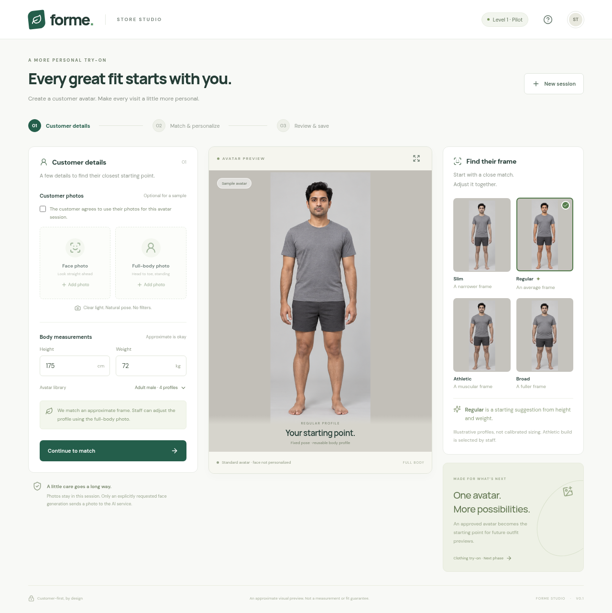
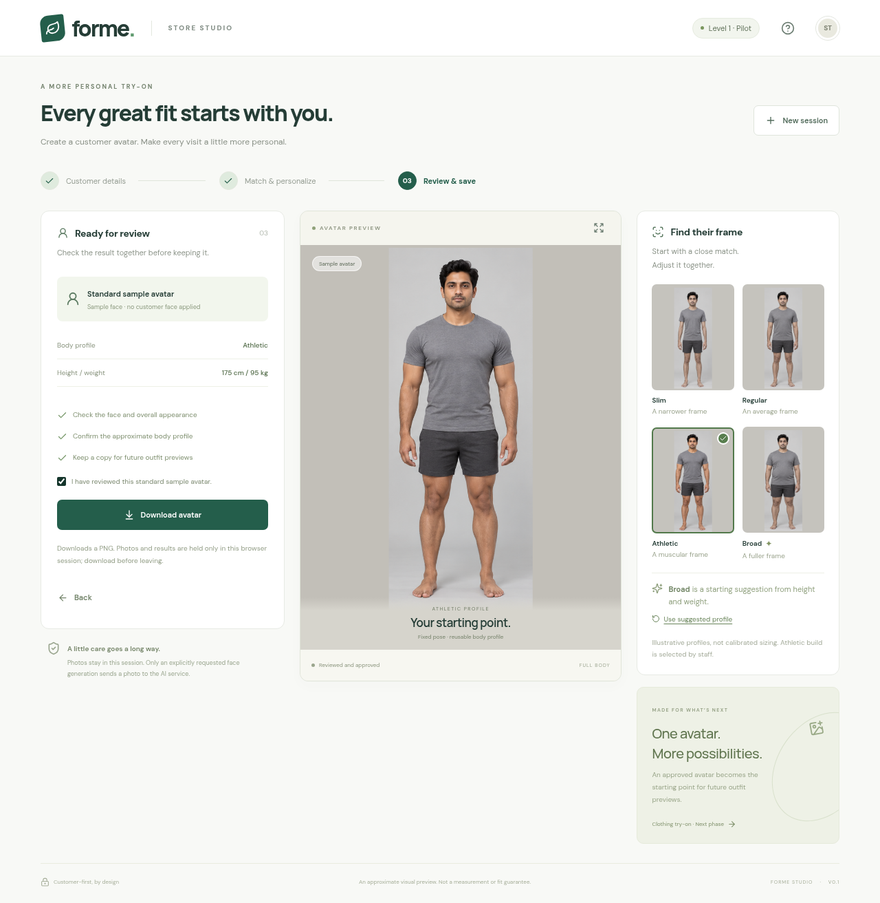
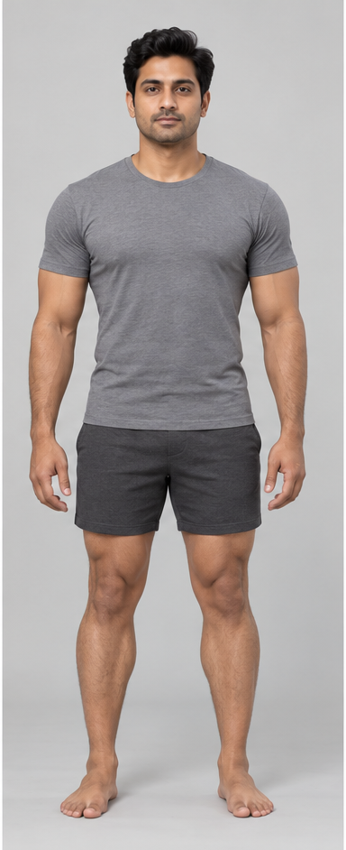

# Watch the app and see its output

This is a recording of the working Level 1 app, using the sample-avatar workflow. It is a demonstration, not an interactive hosted deployment. No customer photos or paid AI calls were used.

## Recorded walkthrough

The recording shows:

1. The initial customer-details screen with the Regular sample selected.
2. A weight change that suggests the Broad profile.
3. Staff manually selecting Athletic.
4. The personalization screen reporting that the AI service is unavailable.
5. Approval and download of the Athletic standard sample.

## Customer-details screen

## Review and download screen

## Actual downloaded PNG

The file below was downloaded through the app's **Download avatar** button. It is the selected standard Athletic avatar, with the sample face. A real customer's face is applied only after the separate AI service has been configured and explicitly requested.

[Open the PNG file](athletic-sample-output.png)

To test the controls yourself, follow the [local setup instructions](../../README.md#run-locally).
