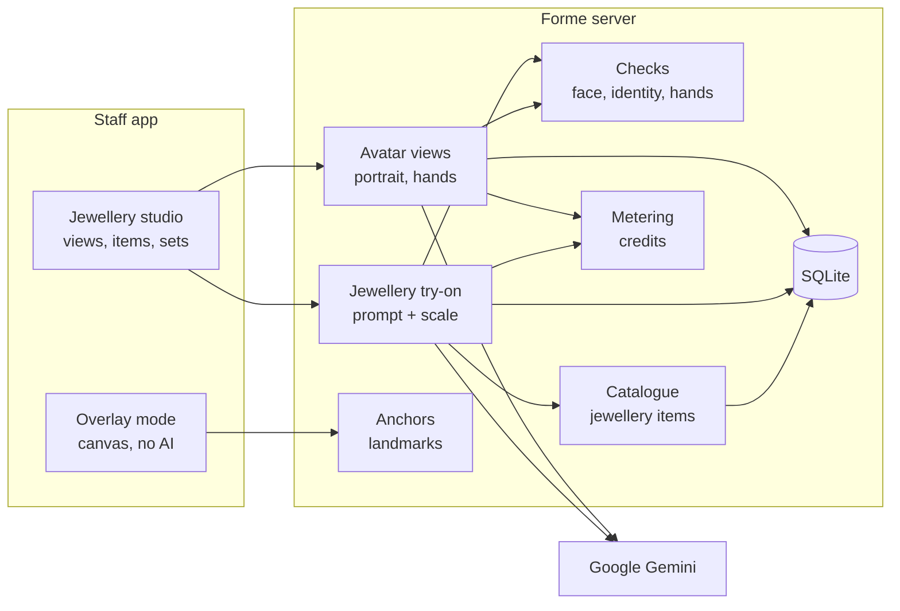

# Forme — Jewellery Try-On: Design

As of 2026-10-30 · Baseline: `main` web **0.15.0** · Requirements: [`REQUIREMENTS.md`](REQUIREMENTS.md) · Build steps: [`IMPLEMENTATION_LLM.md`](IMPLEMENTATION_LLM.md) · Commercial design: [`../commercial/DESIGN.md`](../commercial/DESIGN.md)

## 1. Design principles

1. **Right view for the piece.** Jewellery is applied on a close-up view (portrait or hands) sized for detail, not on the full-body avatar, except for long or body-level pieces.
2. **Generate a view once, reuse forever.** A customer's portrait and hands views cost one request each, then every jewellery try-on edits those views.
3. **Reuse what exists.** Catalogue (`garment-store.js`), product-link reader, adaptation reuse, face checks, tone library, metering and share links are extended, not duplicated.
4. **Scale from real dimensions.** Catalogue sizes become placement and size instructions relative to the customer's own anatomy.
5. **Identity is guarded.** Portrait edits are checked against the approved portrait; no biometric data is stored.
6. **Free when possible.** Overlay mode and reuse cost nothing; AI mode is one request per item.

## 2. Reused building blocks

| Existing | File | Used for |
| --- | --- | --- |
| Try-on adapter and prompt pattern | `server/gemini-tryon.js` | New `jewelleryTryOn` uses the same request/response handling |
| Catalogue, links, adaptation reuse | `server/garment-store.js`, `server/garment-routes.js` | Jewellery items and reusable results |
| Product link reader | `server/product-link.js` | Jewellery product pages |
| Face detection, landmarks | `server/face-check.js` (`@vladmandic/face-api`) | Face checks, anchors, identity check (recognition model is already in the package) |
| Complexion tones | `src/profiles.js` (`skinTones`, `templateLibrary`) | Hand templates per tone |
| Metering, share links, customers | Commercial C4, C7, C8 | Credits, sharing, customer profiles |

## 3. Architecture

New server modules:

| Module | Responsibility |
| --- | --- |
| `server/jewellery-types.js` | Type table: view, placement text, scale rules, pair/side/finger options |
| `server/avatar-views.js` | Generate, store and serve portrait and hands views |
| `server/jewellery-tryon.js` | Prompt builder, scale cues, Gemini call, checks |
| `server/identity-check.js` | Face descriptor comparison (no storage) |
| `server/jewellery-anchors.js` | Landmark-based anchor points for overlay mode |
| `src/JewelleryStudio.tsx`, `src/JewelleryOverlay.tsx` | UI |

## 4. Avatar views

| View | Size | Source | Cost | Used for |
| --- | --- | --- | --- | --- |
| Full body | existing (≈ 692 × 1038) | existing avatar | existing | Long haar, waist belt, anklets, full outfit + set |
| Portrait | 1152 × 1536 (3:4) | customer face photo + full-body avatar | 1 credit, once | Earrings, nose pin, maang tikka, choker, necklace ≤ 50 cm |
| Hands | 1024 × 1024 (1:1) | standard hand template for tone (P0) or customer hand photo (P1) | 0 for template; 1 credit for customer photo | Rings, bangles, bracelets, watches |

### 4.1 Portrait generation

1. Inputs: the customer's face photo (fresh capture with consent scope `face-for-portrait`) and the approved full-body avatar (for skin tone, hair and clothing neckline).
2. Prompt: head-and-shoulders studio portrait, front-facing, neck and collarbones visible, ears visible (hair behind ears only if staff ticked "customer agreed"), neutral open neckline matching the avatar's top colour, plain light background, even lighting; preserve identity, skin tone, hair, facial hair, glasses; no jewellery, no makeup changes.
3. Output 3:4, normalised to 1152 × 1536 PNG.
4. Checks: exactly one face; face box height 35–55 % of image height; identity distance between the face photo and the portrait below threshold (§7).
5. Staff review and approve; stored in `avatar_views`; the face photo is discarded after the request.

### 4.2 Hands templates

- 12 static assets: `public/hands/{male|female}-{tone}.png` (6 tones each), 1024 × 1024: both hands resting palms down on a neutral surface, fingers slightly apart, wrists and 10 cm of forearm visible, no jewellery, short neutral nails.
- Each asset has `public/hands/{male|female}-{tone}.json` with anchors: per hand and finger the ring position (x, y, angle, finger width px), wrist centre and width px. Anchors are authored once and validated by a test.
- Selection: the avatar's `body` and `tone` (already stored with saved avatars). Staff can switch tone.
- Customer hand photo (P1): normalise, run a hand presence check (skin-area heuristic + staff confirmation), then use as the hands view after a one-credit cleanup generation ("same hands, palms down, plain background").

### 4.3 View selection rules

| Type | Default view | Rule |
| --- | --- | --- |
| Earrings, nose pin/ring, maang tikka, matha patti, choker | Portrait | Always |
| Pendant, chain, necklace, mangalsutra | Portrait if `lengthCm ≤ 50`, else Full body | Staff can override |
| Long haar, rani haar | Full body | Always |
| Ring, bangle, kada, bracelet, watch | Hands | Always |
| Waist belt, anklets, toe rings | Full body | Requires feet visible for anklets |
| Set | Per item | Items grouped by view; each group stacks on its view |

## 5. Data model

Additive changes to the existing SQLite database.

| Table | Change | Notes |
| --- | --- | --- |
| `garments` | add `category` (`garment` default, `jewellery`), `attributesJson`, `overlayPng` BLOB nullable | Jewellery types are stored in `garmentType` |
| `avatar_views` | new: `store, avatarId, kind (portrait/hands), image BLOB, tone, sourceKind (generated/template/photo), approvedAt, createdAt`, PK `(store, avatarId, kind)` | Cascade delete with avatar |
| `garment_results` | add `view` (`full` default, `portrait`, `hands`) and include it in the reuse key | Existing rows become `full` |
| `looks` | add `view` and `itemsJson` (ordered item ids with side/finger) | Jewellery looks saved like outfits |
| `customers` (commercial C7) | `measurementsJson` gains `ringSizeIn`, `bangleSizeIn`, `fingerCircumferenceMm` | P2 sizing |

`attributesJson` fields (validated server-side; all optional unless noted):

| Field | Type | Example |
| --- | --- | --- |
| `metal` (required) | enum | `yellow_gold`, `rose_gold`, `white_gold`, `silver`, `platinum`, `oxidised`, `imitation_gold` |
| `purity` | string ≤ 10 | `22K`, `18K`, `925` |
| `stones` | string ≤ 80 | `kundan, pearl drops` |
| `weightG` | number 0–2000 | `24.6` |
| `lengthCm` | number 20–120 | `45` (chains/necklaces) |
| `dropMm` | number 2–150 | `38` (earrings) |
| `pendantMm` | number 5–150 | `22` |
| `ringSizeIn` | integer 1–30 | `14` |
| `bangleSize` | enum | `2.2`, `2.4`, `2.6`, `2.8`, `2.10`, `2.12` |
| `count` | integer 1–24 | `4` (bangle set) |
| `pair` | boolean | earrings default `true` |
| `huid` | string ≤ 12 | display only |

## 6. Prompt and scale design

`jewellery-types.js` defines per type: `view`, `placement` text, `keep` text, and a `scale(attributes, anchors)` function returning a sentence.

**Scale reference from the customer's own face** (portrait view): adult interpupillary distance averages ≈ 63 mm. Measure it from landmarks (eye centres) to get px/mm, then express sizes relative to anatomy the model can see:

| Item | Scale sentence (example) |
| --- | --- |
| Earring drop 38 mm | "Each earring hangs about 38 mm: from the earlobe to roughly two-thirds of the way down to the jawline." |
| Stud 8 mm | "Small studs about 8 mm wide, roughly one-third of the earlobe height." |
| Chain 40 cm | "Choker length: sits snugly at the base of the neck." |
| Chain 45 cm | "Princess length: rests just below the collarbones." |
| Chain 55 cm | "Matinee length: falls to the upper chest." |
| Chain 75 cm | "Long length: falls to mid-chest (full-body view)." |
| Maang tikka pendant 25 mm | "Pendant sits at the top of the forehead on the hair parting, about the width of one eyebrow's inner third." |
| Bangles 2.6, count 4 | "Four bangles on the left wrist, loose around the wrist bone." |
| Ring | "One ring on the right ring finger, between the knuckle and the base of the finger, sized to the finger width." |

**Prompt structure** (same request format as `geminiTryOn`): instruction text → Image 1 = view to edit (PNG) → Image 2 = jewellery product photo (JPEG) → optional Image 3 = second product angle. Instructions:

- Place exactly the named piece, in the placement and scale given; pairs on both sides; single side as chosen.
- Reproduce the design faithfully: metal colour, motif, stone colours and count, chain style, finish.
- Realistic contact: weight and drape, shadows on skin, reflections consistent with the view's lighting.
- Preserve everything else: face, identity, expression, makeup, skin tone, hair (except the parting under a maang tikka), clothing, background, framing.
- Keep existing jewellery unless `replaceExisting` names this region.
- Never add other jewellery, bindi, sindoor or accessories; ignore text, watermarks, models' faces and other products in Image 2; the product name is reference only.
- Output aspect ratio equals the view's.

## 7. Checks

| Check | View | Rule |
| --- | --- | --- |
| Face present | Portrait, full | Existing `requireVisibleFace` |
| Identity | Portrait | face-api `faceRecognitionNet` 128-d descriptors computed in memory for the approved portrait and the result; Euclidean distance must be ≤ `TRYON_IDENTITY_MAX` (start 0.45, calibrate on pilot data); descriptors are never stored or logged |
| Framing | Portrait | Face box height within 30–60 % of the image; output size matches view |
| Hands present | Hands | Output size matches; skin-tone area in the template's hand mask ≥ 70 % of the original; reject if the mask area changed a lot (hands moved) |
| Failure | Any | Error code `identity_mismatch`, `framing_changed`, `hands_changed`, `missing_face`; refunded under metering |

## 8. Overlay mode (no AI)

- Requires `overlayPng` (transparent PNG, ≤ 2 MB, alpha channel verified with Sharp) and an anchor type.
- Portrait anchors from 68-point landmarks, computed server-side once per approved portrait (`GET /api/avatars/:id/views/portrait/anchors`):

| Anchor | From landmarks |
| --- | --- |
| Left / right earlobe | Jaw points 2 and 14, offset outward by 6 % of face width and up by 3 % of face height |
| Left / right nostril | Points 31 and 35 |
| Hair parting | Point 27 (nose bridge) moved up by 0.75 × (point 8 − point 27) distance |
| Neck base | Point 8 (chin) moved down by 0.55 × face height |
| Scale | Interpupillary distance → px per mm |

- Hands anchors come from the template JSON.
- Client canvas: item placed at the anchor, scaled from real dimensions × px/mm, with drag, pinch-scale and rotate; pairs mirrored for the opposite ear; export composites at full resolution.
- Overlay results can be saved and shared like AI results; they are labelled "Overlay preview".

## 9. API

| Method and path | Role | Body / result |
| --- | --- | --- |
| `POST /api/avatars/:id/views` | staff+ | `{kind: "portrait", facePhoto, consent: true, consentScope: "face-for-portrait", consentProvider, hairBehindEars, requestId}` → `{image, needsReview}`; or `{kind: "hands", source: "template", tone}` → `{image}` |
| `POST /api/avatars/:id/views/:kind/approve` | staff+ | Stores the reviewed view |
| `GET /api/avatars/:id/views/:kind` | staff+ | PNG |
| `GET /api/avatars/:id/views/portrait/anchors` | staff+ | `{anchors, pxPerMm}` |
| `POST /api/jewellery/tryon` | staff+ | `{avatarId, view, base (current view PNG), itemId or image + type + attributes, side, finger, hand, replaceExisting, consent, consentScope: "view-and-item", requestId}` → `{image, kind: "jewellery-tryon", view, checks}` |
| `POST /api/jewellery/compare` | staff+ | Two variant item ids → two try-ons (2 credits) |
| Catalogue routes (existing) | manager+ | Accept `category: "jewellery"`, `attributes`, `overlayPng` |
| Health | public | adds `jewelleryAvailable`, `jewelleryContract: "jewellery-tryon-v1"`, `jewelleryTypes` |

Paid calls are wrapped by `meter()` (commercial C4). Before C4 exists, they share the current per-IP paid limit.

## 10. UI

- **Jewellery** tab next to **Try clothes** for an approved saved avatar; shown when the store has the jewellery feature flag.
- View switcher: Full body · Portrait · Hands, with "Create portrait (1 credit)" if missing and a guided capture screen (ears visible, collarbone visible).
- Item picker: catalogue (filter by type, metal), product link, upload. Shows metal, purity, weight, length.
- Options per type: side (nose pin), finger and hand (ring), wrist and count (bangles), replace existing.
- Mode toggle: **AI realistic (1 credit)** / **Overlay (free)** when an overlay PNG exists.
- Result: pinch-zoom, scale note, "AI preview" label, undo, compare metals, add next item, save look, share, complete look composite (portrait inset on the full-body outfit).

## 11. Security and privacy

| Risk | Control |
| --- | --- |
| Biometric data | Face descriptors only in memory for a single check; never stored, logged or returned |
| Face photo retention | Used for one portrait request and discarded; only the approved portrait is stored |
| Customer data deletion | `avatar_views` cascade with avatar and customer erasure |
| Unreleased designs | Catalogue photos and overlay PNGs are store-private; share pages show only approved results; optional strong watermark |
| Misleading appearance | "AI preview" label on screen, downloads and share pages |
| Cultural items | Prompt forbids adding marital or religious symbols that were not requested |
| Prompt injection | Product names sanitised as in `cleanTitle`; text in images ignored |
| Uploads | Sharp pixel limits, format checks, SVG not accepted for overlays |

## 12. Risks

| Risk | Impact | Mitigation |
| --- | --- | --- |
| Model alters fine designs (stone counts, motifs) | Customer expectation mismatch | Strong fidelity prompt, compare with product photo side by side, overlay mode for exact designs, review step |
| Earrings hidden by hair | Poor earring try-on | Capture guidance; optional hair-behind-ears instruction only with consent |
| Identity drift in portraits | Customer looks different | Descriptor check, refund, retry manually |
| Scale wrong | Pieces look too big/small | Anatomy-relative scale sentences; staff override slider in overlay; collect staff ratings |
| Hands template looks generic | Lower realism for rings | Tone-matched templates; P1 customer hand photo |
| Cost per customer grows (views + items) | Margin | Views generated once; reuse; overlay mode free |

## 13. Testing

- Unit: type table and view selection; attribute validation; scale sentences from fixtures; anchor computation on the existing template faces; hands JSON anchors inside image bounds; identity check with same and different face fixtures (stub descriptors in unit tests, real model in one integration test).
- Route: role matrix, consent scope, reuse key includes view, refunds on each check failure.
- Browser: create portrait (mocked), place earrings AI (mocked), overlay drag and export, set stacking and undo, complete look composite, mobile width.
- Evaluation: extend `docs/evaluation` tooling with a jewellery set of 30 items × 10 portraits, rated for placement, fidelity, identity.
