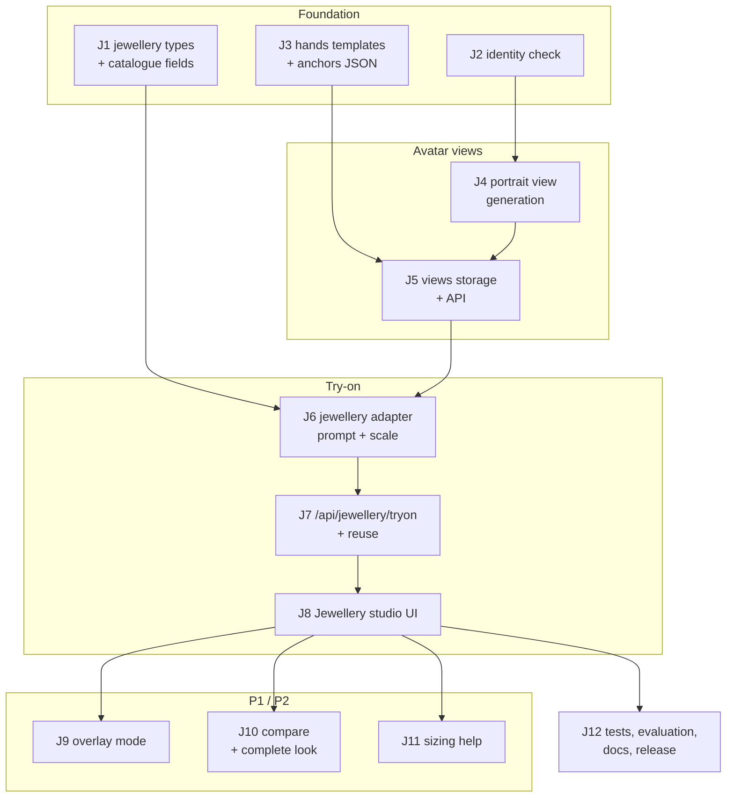

# Forme — Jewellery Try-On: Implementation Guide for an LLM

As of 2026-10-30 · Baseline: `main` web **0.15.0** · Stage: later, after commercial R1 · Requirements: [`REQUIREMENTS.md`](REQUIREMENTS.md) · Design: [`DESIGN.md`](DESIGN.md)

## How to use this guide

Give a coding LLM **one task per session**, in order. Paste the repo context, the rules and one task. Each task has files to read, steps and acceptance checks.

### Repo context to give the LLM first

| Item | Value |
| --- | --- |
| Repo | `github.com/RajeshRamadas/tryoncloths` (Forme — Avatar Studio) |
| Stack | React 19 + Vite + TypeScript, Express 5, Sharp, `@vladmandic/face-api` (WASM), `node:sqlite` |
| Clothing try-on | `server/gemini-tryon.js`, `src/LinkTryOn.tsx`, `src/OutfitStudio.tsx` |
| Catalogue and reuse | `server/garment-store.js`, `server/garment-routes.js`, `src/GarmentCatalogue.tsx` |
| Faces | `server/face-check.js` (tiny detector + 68 landmarks); recognition model exists in the face-api package `model/` folder |
| Tones | `src/profiles.js` (`skinTones`, `templateLibrary`) |
| Commercial pieces | `meter()`, customers, share links from `docs/commercial/IMPLEMENTATION_LLM.md` C4, C7, C8 (use them if merged; otherwise use the existing per-IP paid limit) |
| Verify | `npm test` · `npm run build` · `npm run test:e2e` |

### Rules for the LLM

1. Read the named files first; extend existing modules and patterns instead of duplicating them.
2. Never change the clothing try-on prompt, contract (`garment-tryon-v1`) or existing test expectations.
3. All new behaviour behind feature flag `TRYON_JEWELLERY=1` (server) and `jewelleryAvailable` in health (client).
4. Paid calls: explicit consent, one request, no automatic retries, refunded on failed checks when metering exists.
5. Never store, log or return face descriptors or customer face photos.
6. Tests never call Gemini or the network; inject `fetchImpl` and use Sharp-made or repo fixture images.
7. Database changes additive and idempotent; tenant/store id only from the session.
8. Finish every task with `npm test` and `npm run build`; report what was not verified.

### Prompt template

```markdown
You are working in the tryoncloths repo (Forme). Read <files> first.
Implement Task J<n>: <title> from docs/jewellery/IMPLEMENTATION_LLM.md, following docs/jewellery/DESIGN.md.
Do not change unrelated code or the clothing try-on behaviour. Run npm test and npm run build and report results.
```

## Task order



---

## Foundation

### Task J1 — jewellery types and catalogue fields

**Goal.** Describe every jewellery type once and store jewellery items in the existing catalogue.

**Read.** `server/gemini-tryon.js` (`garmentTypes`), `src/garment-types.ts`, `server/garment-store.js`, `server/garment-routes.js`, `src/GarmentCatalogue.tsx`.

**Steps.**

1. Create `server/jewellery-types.js` exporting `jewelleryTypes` keyed by id: `stud_earrings`, `drop_earrings`, `jhumka`, `nose_pin`, `nose_ring`, `maang_tikka`, `matha_patti`, `choker`, `necklace`, `pendant`, `long_haar`, `mangalsutra`, `ring`, `bangles`, `bracelet`, `watch`, `waist_belt`, `anklets`. Each: `{label, view, pair, sides, needsFinger, needsWrist, placement, keep}` per DESIGN §4.3 and §6.
2. Export `chooseView(type, attributes)` implementing DESIGN §4.3 (necklace/pendant/mangalsutra by `lengthCm`).
3. Export `validateAttributes(type, input)` for DESIGN §5 fields; return a clean object or throw a user-safe `Error`.
4. Guarded `ALTER TABLE garments` add `category TEXT NOT NULL DEFAULT 'garment'`, `attributesJson TEXT NOT NULL DEFAULT '{}'`, `overlayPng BLOB`.
5. Catalogue save/list routes accept and return `category` and `attributes` (validated); garment-only flows filter `category = 'garment'` so clothing UIs are unchanged.
6. Client: `src/jewellery-types.ts` with labels and `guessJewelleryType(title)` (jhumka, chandbali, stud, nath, tikka, choker, haar, mangalsutra, ring, bangle, kada, bracelet, watch, payal, kamarbandh).

**Acceptance.**

- [ ] Existing catalogue tests pass; clothing lists contain no jewellery.
- [ ] `chooseView("necklace", {lengthCm: 45})` → `portrait`; 60 → `full`.
- [ ] Invalid metal, out-of-range lengths and unknown fields are rejected or dropped.

### Task J2 — identity check

**Goal.** Detect when an edit changed who the person is, without storing biometrics.

**Read.** `server/face-check.js`.

**Steps.**

1. Create `server/identity-check.js`; load `faceRecognitionNet` and `faceLandmark68Net` (full model) from the face-api `model` folder alongside the existing nets, lazily and once.
2. `descriptor(pngBuffer)`: detect exactly one face (SSD MobileNet or tiny detector with landmarks), return a `Float32Array(128)`; throw `missing_face` otherwise.
3. `requireSameIdentity(reference, candidate, max = Number(process.env.TRYON_IDENTITY_MAX || 0.45))`: compute both in memory; throw `ProviderError("identity_mismatch")` when the distance is above `max`; return the distance for a non-identifying log field (rounded to 2 decimals).
4. Add `identity_mismatch` to `provider-errors.js` messages: "The result changed the customer's face and was rejected."
5. Never write descriptors to disk, DB or logs.

**Acceptance.**

- [ ] Same template image vs itself (slightly resized) passes; two different template faces fail.
- [ ] A grep test confirms no descriptor arrays are logged.

### Task J3 — hands templates and anchors

**Goal.** Tone-matched hand images with known ring and wrist positions.

**Read.** `src/profiles.js`, `docs/AVATAR_LIBRARY.md`, `public/avatar-tones/`.

**Steps.**

1. Add `public/hands/` with 12 PNGs `{male,female}-{toneId}.png` (1024 × 1024, DESIGN §4.2). The assets are produced and reviewed by a person (or with a separate one-off generation script `scripts/make-hand-templates.mjs` that is never run in CI).
2. Add matching JSON anchor files: `{ "left": {"thumb"|"index"|"middle"|"ring"|"little": {x, y, angle, widthPx}, "wrist": {x, y, angle, widthPx}}, "right": {…}, "handMask": [[x,y],…] }`.
3. `handsTemplate(body, tone)` helper on the server returns `{png, anchors}`; validate tone with `validTemplateTone`.
4. Test: every JSON exists, all anchors inside the image, widths plausible (ring finger 30–90 px, wrist 120–300 px).

**Acceptance.**

- [ ] 12 PNG + 12 JSON present; tests pass.
- [ ] Missing tone falls back to the default tone with a warning in the response.

## Avatar views

### Task J4 — portrait view generation

**Goal.** One paid request turns the customer's face photo + approved avatar into a high-resolution portrait.

**Read.** `server/gemini.js` (avatar generation request shape), `server/gemini-tryon.js`, `server/identity-check.js`, `server/app.js` (`/api/personalize` validation and limits).

**Steps.**

1. Create `server/avatar-views.js` with `generatePortrait({facePhoto, avatar, hairBehindEars, apiKey, model, fetchImpl})`: prompt per DESIGN §4.1; images: face photo (JPEG) then avatar (PNG); aspect `3:4`.
2. Normalise output to 1152 × 1536 PNG (`fit: cover`, position top).
3. Checks: exactly one face; face box height 35–55 % of image height (else `framing_changed`); `requireSameIdentity(facePhoto, output)`.
4. Return a PNG data URL; never keep the face photo.

**Acceptance.**

- [ ] Stubbed provider: request has face photo first, avatar second, 3:4 aspect, hair instruction only when `hairBehindEars` is true.
- [ ] Faceless, wrongly framed or different-person outputs are rejected with the right codes.

### Task J5 — views storage and API

**Goal.** Create, approve, fetch and delete views for a saved avatar.

**Read.** `server/accounts.js` avatar routes, `server/avatar-views.js`, `server/garment-routes.js` for route style.

**Steps.**

1. Table `avatar_views` per DESIGN §5, cascade with avatars.
2. `POST /api/avatars/:id/views`: `kind=portrait` → consent scope `face-for-portrait` + provider match, `requestId`, paid limit/`meter()`; returns `{image, needsReview: true}` (not stored yet). `kind=hands, source=template` → returns the template for the avatar's body and tone (free).
3. `POST /api/avatars/:id/views/:kind/approve {image}`: validates PNG size per view, stores with `approvedAt`.
4. `GET /api/avatars/:id/views/:kind` streams PNG; `DELETE` removes.
5. `GET /api/avatars/:id/views/portrait/anchors`: compute anchors per DESIGN §8 from the stored portrait; cache in memory by view hash.
6. Health adds `jewelleryAvailable` when `TRYON_JEWELLERY=1` and the provider is Gemini with a key.

**Acceptance.**

- [ ] Another store's avatar id → 404 on every view route.
- [ ] Deleting the avatar removes its views.

## Try-on

### Task J6 — jewellery try-on adapter

**Goal.** Build the prompt with placement and scale, call Gemini, run view-specific checks.

**Read.** `server/gemini-tryon.js`, `server/jewellery-types.js`, `server/identity-check.js`, DESIGN §6–7.

**Steps.**

1. Create `server/jewellery-tryon.js` exporting `JEWELLERY_CONTRACT = "jewellery-tryon-v1"`, `scaleSentence(type, attributes, anchors)`, `jewelleryPrompt({type, attributes, view, side, finger, hand, wrist, replaceExisting, title})`, `jewelleryTryOn({...})`.
2. `scaleSentence`: px/mm from interpupillary distance (portrait) or template widths (hands); output anatomy-relative sentences per DESIGN §6 table; omit when dimensions are missing.
3. Prompt sections exactly as DESIGN §6 "Prompt structure", reusing `cleanTitle` from `gemini-tryon.js` (export it if needed without changing behaviour).
4. Request: view PNG, product JPEG, optional second angle; aspect equals the view (`3:4`, `1:1`, `2:3`).
5. Checks after response: portrait → `requireSameIdentity(base, output)` + framing; full → `requireVisibleFace`; hands → size match and hand-mask skin coverage ≥ 70 % of the template's.

**Acceptance.**

- [ ] Snapshot tests for prompts of earrings (pair), nose pin (left), ring (right ring finger), bangles (count 4), necklace 45 cm.
- [ ] The prompt never contains "sindoor" or "bindi" except in the "never add" sentence.
- [ ] Each failing check maps to its error code.

### Task J7 — `POST /api/jewellery/tryon` and reuse

**Goal.** Expose jewellery try-on with consent, metering and adaptation reuse.

**Read.** `server/app.js` `/api/tryon` route and reuse path, `server/garment-store.js` results, DESIGN §9.

**Steps.**

1. Route checks: feature flag → account and store → origin → consent scope `view-and-item` + provider → type/attributes valid → view allowed for type (`chooseView` or explicit override within allowed views) → base PNG size matches view → item image from catalogue (`itemId`, same store) or upload.
2. Guarded `ALTER TABLE garment_results ADD view TEXT NOT NULL DEFAULT 'full'`; include `view`, side/finger options and the base image hash in the reuse key.
3. If an approved result matches → return it with `reused: true` and no provider call.
4. Else call `jewelleryTryOn` inside `meter()` (or the current paid limit) with `requestId`; respond `{image, kind: "jewellery-tryon", view, reused: false}`.
5. `POST /api/jewellery/results/:id/approve` saves for reuse (same as clothing adaptation save).

**Acceptance.**

- [ ] Reuse hit → no provider call and no credit.
- [ ] Wrong view for type (ring on portrait) → 400.
- [ ] Identity mismatch → 502 `identity_mismatch` and refund.

### Task J8 — Jewellery studio UI

**Goal.** Staff can create views, pick items, place them, stack a set, review and save.

**Read.** `src/OutfitStudio.tsx`, `src/LinkTryOn.tsx`, `src/GarmentCatalogue.tsx`, `src/App.tsx`, `src/styles.css`.

**Steps.**

1. `src/JewelleryStudio.tsx`: tab **Jewellery** beside **Try clothes** when `jewelleryAvailable` and the avatar is saved.
2. View switcher with "Create portrait (1 AI request)" flow: capture guidance, face photo input, consent ticks (provider and optional hair-behind-ears), review, approve.
3. Item picker: catalogue filtered to `category = jewellery` with type and metal filters; product link and upload reuse `LinkTryOn` reading logic; type guessed from title and confirmed.
4. Options by type: side, hand + finger, wrist + count, replace existing.
5. Result area with pinch-zoom, scale note, "AI preview — actual piece may differ in detail" label, undo per item, add next item, save look (`view`, `itemsJson`), share (if share links exist).
6. Use existing styles; check 390 px width.

**Acceptance.**

- [ ] Browser test (mocked APIs): create portrait → earrings → nose pin → undo → save look.
- [ ] Clothing studio unchanged (existing e2e passes).

## P1 / P2

### Task J9 — overlay mode (no AI)

**Goal.** Exact-design placement for items with a transparent PNG, at no cost.

**Read.** `src/outfits.ts` (canvas layering), anchors API (J5), hands JSON (J3), DESIGN §8.

**Steps.**

1. Catalogue: upload `overlayPng` (PNG with alpha, ≤ 2 MB, ≥ 200 px, verified by Sharp), plus anchor type.
2. `src/JewelleryOverlay.tsx`: place at anchor, scale by real size × px/mm, drag, pinch-scale, rotate; mirror for the second earring; reset.
3. Export at full view resolution; label "Overlay preview"; save and share like AI results.

**Acceptance.**

- [ ] Earrings land within 10 px of the anchor on the fixture portrait before manual adjustment.
- [ ] No network request to `/api/jewellery/tryon` in overlay mode.

### Task J10 — compare metals and complete look

**Goal.** Side-by-side variants and one image combining jewellery and outfit.

**Steps.**

1. Catalogue variant links (`variantOf` in `attributesJson`); compare button shows two try-ons side by side (2 requests, cost shown first); reuse applies per variant.
2. Complete look: client canvas composites the full-body outfit result with the portrait result as an inset (top-right, 40 % width, rounded border) plus item names; saved as a look with `view = "complete"`.

**Acceptance.**

- [ ] Compare shows the cost before running and reuses approved variants for free.
- [ ] Complete look export is legible on a phone.

### Task J11 — sizing help

**Goal.** Necklace length guide and ring/bangle size suggestions.

**Steps.**

1. Necklace guide overlay on portrait/full view at choker, princess, matinee, opera lengths using the neck-base anchor and px/mm.
2. Customer profile fields: finger circumference (mm), hand circumference (mm), known ring size, known bangle size.
3. Conversions: Indian ring size from circumference table; bangle size from hand circumference table; show suggestion with confidence; never block.

**Acceptance.**

- [ ] Table-driven unit tests for ring and bangle conversions.
- [ ] Guide lines move with the portrait's anchors.

### Task J12 — tests, evaluation, docs, release

**Goal.** Ship safely behind the flag and measure quality before enabling for stores.

**Steps.**

1. Complete the role-matrix and check-failure tests listed in DESIGN §13.
2. Extend the evaluation tooling with a jewellery set (30 items × 10 portraits): staff ratings for placement, fidelity, identity; record identity-distance distribution to calibrate `TRYON_IDENTITY_MAX`.
3. Docs: `docs/JEWELLERY_TRYON.md` (staff workflow, capture guidance, setup, limits); README section.
4. Bump the minor version; deploy with `TRYON_JEWELLERY=1` only for pilot stores.

**Acceptance.**

- [ ] `npm test`, `npm run build`, `npm run test:e2e` green.
- [ ] Pilot targets from REQUIREMENTS §8 measured before general release.
