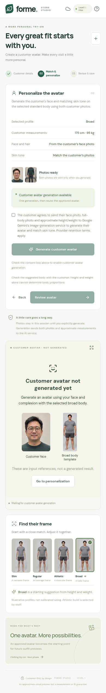

# Version 0.4.0 validation

The default backend is Gemini. Each request sends the selected standard body, an independently supplied customer face photo and a customer full-body photo. Instructions prioritize the customer's facial features and natural complexion, applying skin tone across exposed face, neck, arms, hands, legs and feet while preserving the standard body. Staff choose the approximate body profile and review the result.

With customer photos loaded, a pending preview replaces the large sample. Input thumbnails are labelled as references. Failures remain visibly incomplete, and approval/export requires an actual provider response. Successful output is displayed for review alongside original customer photos. A changed photo, measurement or profile invalidates the result and approval.



This screenshot shows inputs and pending state, **not a generated likeness**.

## Checks completed

- 27 unit/API tests: selected provider and consent contract, Gemini three-image payload, OpenAI adapter, normalized images, body selection, complexion instructions, safe errors and metadata checks, request limits and export-related API contracts.
- 31 distinct browser scenarios passed: the original 30-scenario suite plus a new public Gemini website scenario; the protected/public connection tests were run together. Independent synthetic customers differ from the standard avatar library. Paid provider calls were replaced by deterministic fixtures.
- Mobile screenshot inspected at a 390-pixel viewport: automatic photo-based skin-tone choice, provider-specific consent and pending references are visible without horizontal clipping.
- Production web build and Android `assembleDebug` / `lintDebug` passed. APK version 0.4.0, code 4; APK signature verified. SHA-256 is recorded in `downloads/SHA256SUMS`.
- Docker production image built with certificate verification enabled. Runtime checks cover public Gemini, protected Gemini and protected OpenAI, including authentication/CORS configuration and frontend serving. Compose configuration validates without an OpenAI key.

## Limits

No real Gemini generation or production deployment was performed. Provider responses in tests prove request/response wiring and UI state, not facial resemblance or skin-tone accuracy. No server key is available in this workspace, and the live studio URL is inaccessible through this environment's network proxy. Real appearance, lighting consistency, latency, quota/billing and physical-device behavior need review on the deployed backend. The customer must approve face, body and skin tone before export.

## Reproduce

```sh
npm test
npm run build
npm run test:e2e
npm run android:check
sha256sum -c downloads/SHA256SUMS
```

Android checks require the SDK/JDK described in [the Android guide](../../ANDROID.md). Browser tests use installed Chromium where available. No paid API calls are made by these tests.
