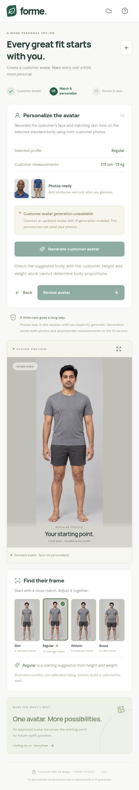

# Customer avatar generation: v0.2 verification

**15 unit/API tests and 29 Playwright tests passed.** TypeScript/Vite production build, Android `assembleDebug lintDebug`, and APK signature verification passed. Version 0.2.0 uses Android version code 2.

## Corrected behavior

- Generation uses the selected standard body, independent customer face photo, and independent customer full-body photo in **one** provider request, with approximate height/weight.
- The request instructs the provider to preserve the selected standard body geometry and clothing, use the customer's face/hair, and match natural skin tone coherently across face, ears, neck, arms, hands, legs and feet.
- Consent explicitly covers both photos and measurements. Invalid/missing body photos, unsupported measurements, or face-only consent cannot reach the provider.
- A session containing customer photos cannot approve/export a sample in place of a generated result. Missing configuration and provider failures keep customer export blocked.
- Review shows both original photo references and requires approval of the face, body and skin tone. Changing the photos, measurements, or standard body invalidates generation and approval.
- A legacy face-only backend cannot enable the updated generation flow. The app checks the `customer-avatar-v2` contract.

## What the tests actually prove

API tests inspect all three image payloads and the skin-tone/standard-body instructions, verify normalization and consent, and check that only one provider call is made per explicit attempt. Browser tests use mocked Android camera/filesystem/share APIs and **stubbed generation responses**. They verify blocked export after failure, explicit retries, approval gating, and that the decoded pixels shared by Android match the provider-returned PNG.

The 16 randomized photo sessions use three independent synthetic customers. Without a backend connection, those customer sessions now stop at generation; a new empty session is started to test sample-library export separately. No sample export is presented as a personalized customer result.

### Actual interface with an independent customer, generation not connected



This screenshot shows the actual updated UI with the blue-polo test customer. It is a browser run with simulated Android APIs, not a physical phone capture.

## What still needs a real API key

No live Gemini avatar was generated during these tests. Face resemblance, natural skin-tone accuracy across the entire body, preservation of standard-body proportions, generation latency, account/model access, and cost require live evaluation after [backend configuration](../../GENERATION_SETUP.md). The image-generation fixture tool used to create synthetic test customers is separate from the app's Gemini integration.

Physical-device camera/gallery/share validation also remains pending. The APK is a debug test build, not a published Google Play release. Android lint has 28 existing resource/icon warnings and no errors.

## Reproduce

```sh
npm ci
npm test
npm run test:e2e
npm run android:check
```
