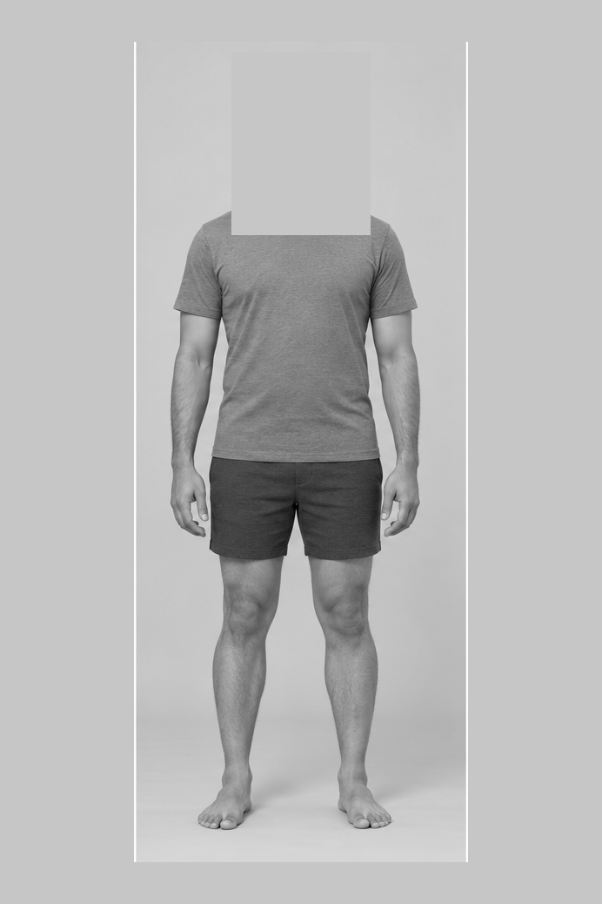

# Gemini customer reference correction

## Reproduced live failure

On 26 October 2026, the public studio loaded successfully and `/api/health` reported Gemini configured with `customer-avatar-v4`. One live generation used the independent synthetic green-sweater customer, Regular template and 175 cm / 72 kg measurements. The API returned HTTP 200 and an image, but visual review failed: the result omitted the customer's glasses, retained the template's styled hair and appearance, and cropped the feet.

| Customer reference | Failed live output |
| --- | --- |
|  |  |

The request/response path worked. The image did not satisfy personalization. The old request included a full-colour template person first, creating a competing identity and skin-tone reference. This is a plausible contributor; a single output does not prove a sole cause.

## Backend change

Gemini now receives three explicitly labelled references in this order:

1. Unchanged customer face: primary identity, hair, glasses and complexion reference.
2. Unchanged customer full-body photo: supporting appearance/complexion reference.
3. Selected standard body converted to grayscale, with its original head/hair/neck covered by an opaque mask. Padding gives the complete figure room on a 2:3 canvas, without cropping or stretching.



Instructions explicitly preserve customer glasses and hairstyle, recolour all exposed skin from customer references, reconstruct the blank head, and include both complete feet with floor below. The image configuration requests a 2:3 portrait. Original sample previews/exports remain intact. This transformation is specific to the four bundled templates and rejects different dimensions until mask placement is reviewed.

There is still one provider call per explicit attempt, with no automatic retry, second AI pass, provider switch or extra AI analysis. OpenAI's optional adapter is unchanged. Existing v0.4 Android/browser clients remain compatible.

## Verification and limits

- 28 unit/API tests passed, including request image order, separate labels, unchanged customer bytes, complete opaque identity masks, grayscale references and unscaled body/feet preservation for all four templates.
- Production frontend build passed.
- Four focused browser scenarios passed: public/protected connection and generation flows, error/export gates and legacy-server rejection. Provider image generation is simulated in these tests.
- Production Docker build and runtime checks passed, including public Gemini configuration and reference rendering inside the container.

**The corrected request has not yet been tested through the live Gemini account.** The available API key is on Lightsail, and this workspace cannot deploy that server. The live failure above is evidence for the defect, not proof that the new reference strategy solves facial fidelity. Gemini output can still vary; likeness, skin tone and full-body framing require a real generated result and customer review. HTTP 200 alone is not a quality check.

## Deploy and verify

Keep the existing Gemini key and public-access settings. From Lightsail:

```sh
cd ~/tryoncloths && git pull --ff-only origin main && cd deploy/lightsail && sudo docker compose -f compose.shared.yaml up -d --build tryon
```

Then open `/api/health`. It must include `"generationRevision":"customer-first-v1"`. Refresh the app and generate a new result; existing images are not changed by deployment. Repeat the green-sweater test and visually compare face, glasses, hair, complexion and both feet before approving. Do not automatically retry a failure.
