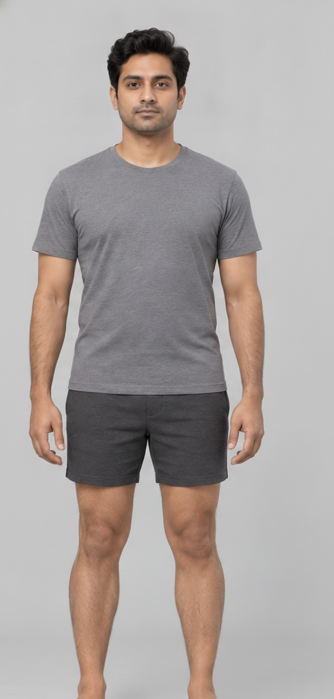
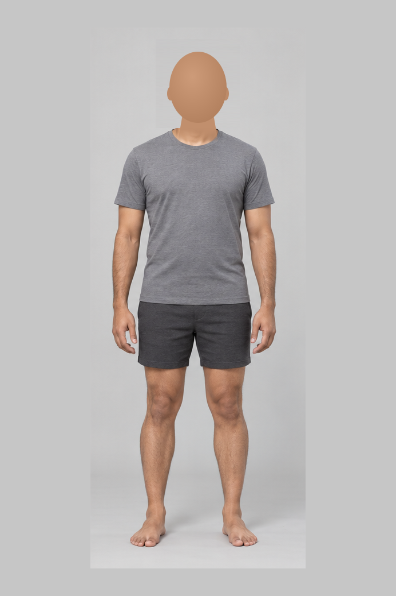

# Gemini customer reference correction

## Neck transition correction (`customer-neck-v6`)

After v5 restored the visible customer face, the user reported a rough head/body join. The reference still introduced the underlying template neck at a fixed horizontal row. V6 fades that underlying neck in over 30 rows and blends the customer layer out over a wider 50-row curved boundary. The neck mask also grows gradually instead of switching on at one row. Face placement and scaling are unchanged; no blur is applied to the face or provider output.

Gemini is instructed to reconstruct and relight the jaw, entire neck, collarbones and fabric contact together, retaining identity and eye alignment while removing inherited seam pixels, halos and duplicate collar edges. This is still one paid generation call, with no automatic retry. The existing face-presence rejection remains active.

Validation: 32 unit/API tests and the production frontend build passed. Reference preparation succeeded for three independent synthetic customers across all four profiles. Tests verify face presence, eye alignment, unchanged body pixels below the blend, and a gradual curved transition. These checks do not establish final image quality: the intermediate reference still needs Gemini to reconcile lighting, background and complexion. A newly generated live result must be visually reviewed after deployment; no live v6 generation was performed here.

## Visible customer face correction (`customer-face-v5`)

The user supplied a later result with no head, despite approval being available. The backend previously accepted any decodable image. The featureless-head reference strategy is replaced with the customer's actual face, locally aligned to the selected template using eye landmarks, uniform scaling and rotation. The reference is an intermediate composite for Gemini to blend; it is never returned as a generated fallback.

Before sending a paid Gemini request, a local check requires one usable customer face and a visible face in the prepared reference. Both provider adapters now require one detectable face in the returned image. A headless result produces HTTP 502 with `missing_face`, without an image or customer-avatar success marker. The existing browser failure state blocks review/export. There is one provider request per explicit attempt, no automatic retries and no extra paid analysis call. Invalid customer face inputs return `face_input` before a provider call. A rejected provider output can still incur a charge.

Only Tiny Face Detector and Tiny 68-point landmarks are loaded from the pinned `@vladmandic/face-api@1.7.15` package (MIT), using `@tensorflow/tfjs@4.22.0` and `@tensorflow/tfjs-backend-wasm@4.22.0` (Apache-2.0). Models and WASM are installed with npm and read locally, with one WASM thread and serialized inference. There are no runtime model downloads. No recognition, age, gender or emotion model is loaded. Only standard-template landmarks are cached; customer photos/landmarks remain transient.

These checks establish face presence, not identity, skin-tone accuracy or anatomical correctness. Difficult photos may be rejected and false detections remain possible. Customer review is still required. The new output has **not** been validated through the live Gemini account after deployment.

Local validation includes 31 unit/API tests, including all four reference profiles, preserved body pixels and eye alignment, rejection of headless provider responses through HTTP, and no paid call for a blank customer photo. Three independent synthetic customers passed reference preparation. Four focused browser tests passed, exercising rejection, disabled review/export and explicit retry. The production frontend and Docker builds passed. The production image also passed the three-customer reference check and headless-image rejection with networking disabled, one CPU and a 512 MiB memory limit. Observed process RSS was 242 MiB; first preparation/check took 1.28 seconds and subsequent samples 0.54–0.58 seconds in this environment. This is not a Lightsail latency or concurrent-load benchmark. Public-mode runtime health/configuration checks passed using a test key, without a provider call.

## Reproduced live failure

On 26 October 2026, the public studio loaded successfully and `/api/health` reported Gemini configured with `customer-avatar-v4`. One live generation used the independent synthetic green-sweater customer, Regular template and 175 cm / 72 kg measurements. The API returned HTTP 200 and an image, but visual review failed: the result omitted the customer's glasses, retained the template's styled hair and appearance, and cropped the feet.

| Customer reference | Failed live output |
| --- | --- |
|  |  |

The request/response path worked. The image did not satisfy personalization. The old request included a full-colour template person first, creating a competing identity and skin-tone reference. This is a plausible contributor; a single output does not prove a sole cause.

## Natural-colour correction (`customer-first-v2`)

After deploying `customer-first-v1`, the user reported that the face came from the customer but the lower body was gray. That version supplied a grayscale body reference. Version 2 removes desaturation while retaining the identity mask and customer-first ordering. A subsequent live test of v2 returned a recognizable synthetic customer with coloured skin and full-body framing. It also copied the template separator lines. The user reported unnatural head/body proportions in their result.

## Proportion correction (`customer-first-v3`)

The old 160 × 210 blank region erased neck/collar landmarks along with identity. Version 3 replaces a smaller head region with a featureless head-size guide, centred on each standard profile’s neck. The source body from row 175 downward stays at its original scale, including the collar, shoulders, neck, limbs and feet. Customer facial proportions must be preserved by uniform scaling; the prompt explicitly separates canvas aspect ratio from anatomical proportions and asks for roughly seven head lengths as a visual guide, not a calibrated rule. The four-pixel contact-sheet separator strips are removed without moving or resizing body pixels.

The latest live test used v2, not this new v3 code. [View that live output](live-v2-output.png). It does not establish that v3 resolves all proportion issues.

## Neck-seam correction (`customer-first-v4`)

The user supplied a result showing a straight horizontal cut across the neck. Inspection found that the v3 reference ended its head patch abruptly at template row 175. Across the four references, the mean RGB difference between rows 174 and 175 in the neck centre was about 21–35 intensity levels (out of 255). That artificial edge could be copied into a generated result.

Version 4 fully removes source identity above that boundary, then fades the guide into the original neck over 28 rows using a smooth opacity curve. The original neck/collar image remains under the overlap so background colour does not wash out the shoulders. The old cut-row jump is now below one intensity level in the reference. Body pixels below the overlap remain unchanged, and shoulder/collar pixels outside the reconstructed neck differ by at most one level from alpha-compositing rounding. The prompt explicitly asks Gemini to re-render jaw, entire neck and collar contact together, removing straight crop edges and colour discontinuities.

These are measurements of the prepared reference, **not proof of a seam-free Gemini result**. Live visual verification is still needed after deploying v4. The user's supplied image is not stored in this repository.

## Previous v4 request (superseded by v5 above)

Version 4 sent three explicitly labelled references in this order:

1. Unchanged customer face: primary identity, hair, glasses and complexion reference.
2. Unchanged customer full-body photo: supporting appearance/complexion reference.
3. Selected standard body with natural colour, texture and shading preserved, its original face/hair removed, and a featureless head-size guide aligned to its neck. Padding gives the complete figure room on a 2:3 canvas, without cropping or stretching.



Instructions explicitly preserve customer glasses and hairstyle, match all exposed skin to customer references, replace the head-size guide, and include both complete feet with floor below. They request one natural full-colour photograph with coherent lighting and neck blending; gray garments must not cause gray exposed skin. The template supplies shape and realistic shading, not the target complexion. The image configuration requests a 2:3 portrait. Original sample previews/exports remain intact. This transformation is specific to the four bundled templates and rejects different dimensions until mask placement is reviewed.

There is still one provider call per explicit attempt, with no automatic retry, second AI pass, provider switch or extra AI analysis. OpenAI's optional adapter is unchanged. Existing v0.4 Android/browser clients remain compatible.

## Previous v4 verification and limits

- 28 unit/API tests passed, including request image order, separate labels, unchanged customer bytes, complete source-identity removal, absence of the hard neck colour step, collar/shoulder preservation, natural colour/texture retention and unscaled body/feet preservation for all four templates.
- The preceding version passed four focused browser scenarios. This change leaves the UI and request/response contract unchanged; no Android rebuild is required.
- Production Docker build and runtime checks passed, including public Gemini configuration and reference rendering inside the container.

**The neck-seam correction has not yet been tested through the live Gemini account.** The available API key is on Lightsail, and this workspace cannot deploy that server. The live failure above is evidence for the defect, not proof that the new reference strategy solves facial fidelity. Gemini output can still vary; likeness, skin tone and full-body framing require a real generated result and customer review. HTTP 200 alone is not a quality check.

## Deploy and verify

Keep the existing Gemini key and public-access settings. From Lightsail:

```sh
cd ~/tryoncloths && git pull --ff-only origin main && cd deploy/lightsail && sudo docker compose -f compose.shared.yaml up -d --build tryon
```

Then open `/api/health`. It must include `"generationRevision":"customer-neck-v6"`. Refresh the app and generate a new result; existing images are not changed by deployment. Repeat the green-sweater test and visually compare face, glasses, hair, complexion and both feet before approving. Do not automatically retry a failure.
