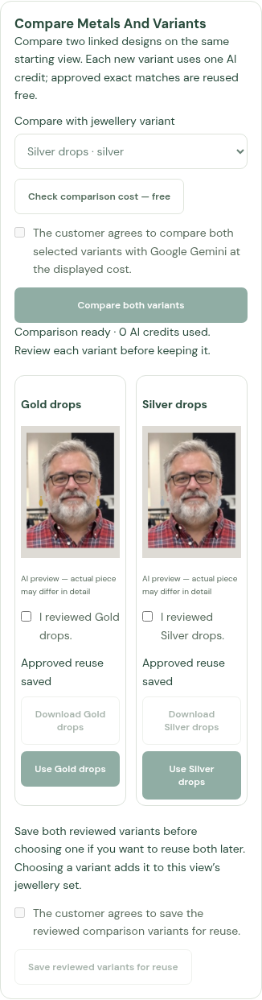
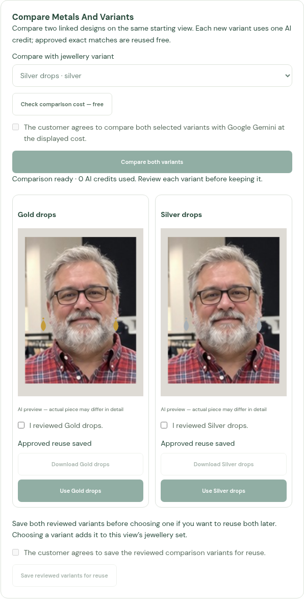
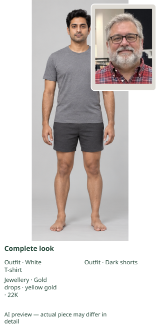
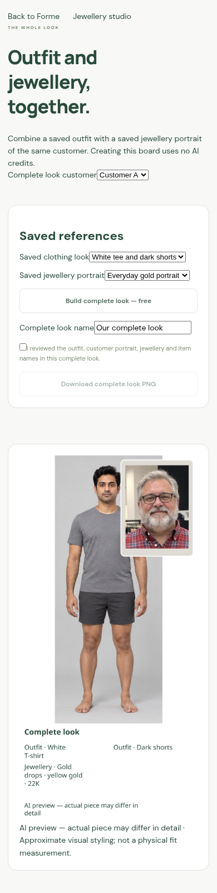
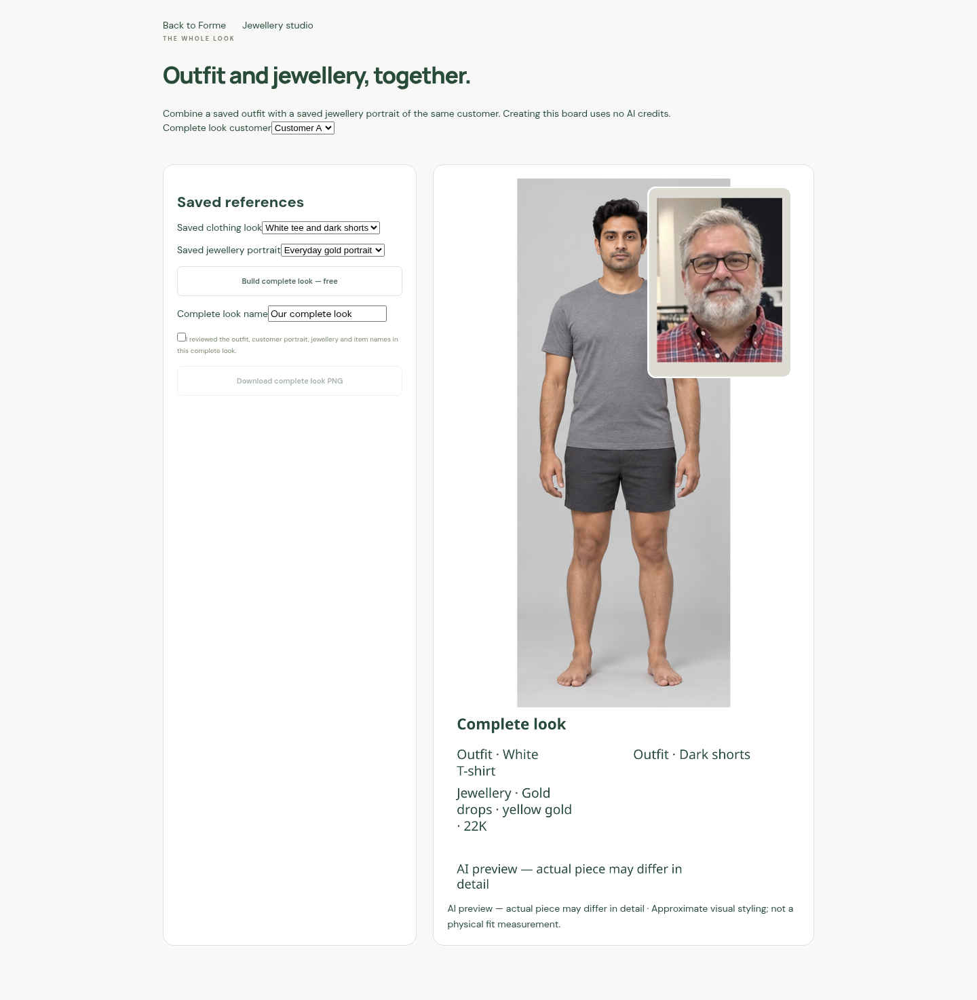

# J10 browser captures

Actual mobile and desktop captures of the web implementation. Test fixtures use
an illustrative standard body, an independent customer-photo portrait fixture,
and dummy gold/silver designs. The compared earring marks are injected test
outputs, not live Gemini generation. The complete board uses the real canvas
preview and Sharp save flow. These images demonstrate the controls, layout,
account ownership and reuse behavior; they do not demonstrate face/body likeness,
live jewellery fidelity or physical fit.

The comparison test links catalogue variants, checks the cost before consent,
executes both requests from one base, approves each result, reruns them for zero
credits and chooses the silver variant. The failure test returns the first paid
image when the second fails, refunds only the second and downloads the first.
The board test saves, downloads, shares and reopens the complete look from the
avatar library with no provider call. Separate cases verify disabled flags and
clearing private images on session expiry. Phone checks use a 390 px viewport.

The board is 1024 px wide, with a 40% portrait inset, a full-body image fitted
without stretching/cropping, rounded white border, wrapped item names and its
preview label. At a 325 px panel width, the 38 px source item text is about 12 px.
Footer height grows with the names. Downloads retain source resolution and share
images do not append a second preview label.

See [workflow, APIs and limits](../../JEWELLERY_COMPARE_COMPLETE.md).

Release validation: **397 backend tests and 129 browser tests passed**, along
with the TypeScript/Vite production build. The final browser suite ran with
restarted processes against a fixed source revision. A production-runtime
staging check using the Dockerfile's copied server and shared modules imported
the app and served HTTP health successfully. No live Gemini request, APK build,
container publication or Lightsail deployment was performed.
