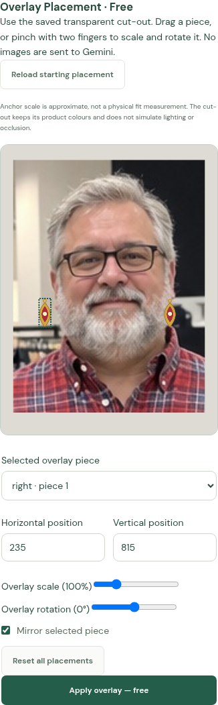
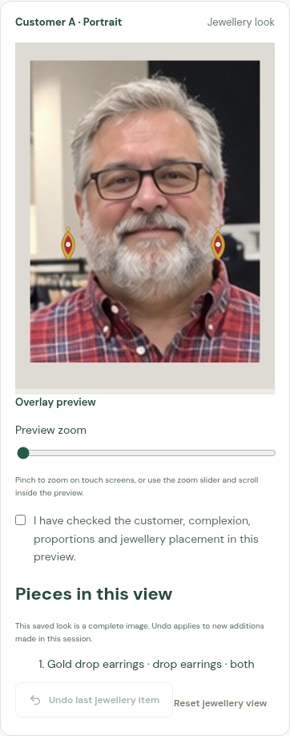
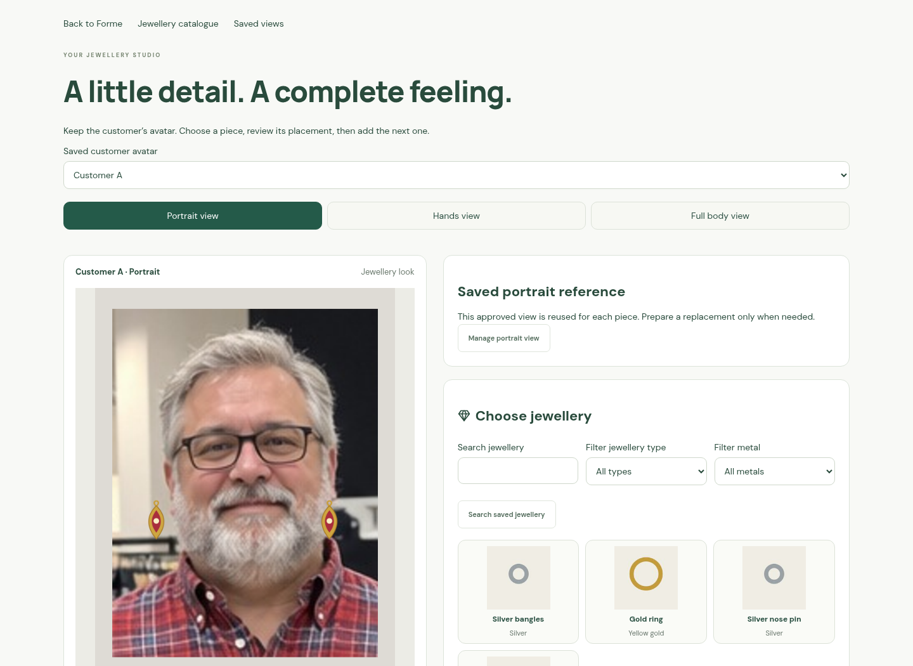

# Jewellery overlay browser captures

Actual J9 mobile and desktop browser captures, using an existing independent
customer-photo fixture and a dummy gold/red transparent earring design. Portrait
anchors are injected fixture coordinates. The jewellery is placed by the real
canvas/Sharp overlay flow; no live AI image generation is used.







The browser test uploads the PNG through the catalogue, loads anchored earrings,
drags, pinches to scale/rotate, resets, applies the full-resolution composite,
reviews, saves, downloads, shares and reopens it. It checks zero requests to the
paid try-on route, no credit change, correct labels and no horizontal overflow at
390 px. A second test expires the session during application and checks that
private previews disappear and late output is ignored.

These fixture captures demonstrate the controls and save/reuse flow. They do
not measure real portrait anchor accuracy or claim realistic lighting, occlusion
or physical product fit. See [the workflow and validation](../../JEWELLERY_OVERLAY.md).

Validation commands:

```sh
npm test
npm run build
npm run test:e2e
```

Backend verification: **387 tests passed**; production TypeScript/Vite build
passed. All checks ran locally against isolated test stores, with no paid API
request or Lightsail deployment.
Browser verification: **125 tests passed**, including native Chromium two-finger
pinch/rotation and late-output/session cleanup. A production-runtime staging
check using the Dockerfile's copied server/shared modules also imported the app
and served HTTP health successfully. The Docker runtime includes the new shared
geometry/label module; no container image or APK was published.
