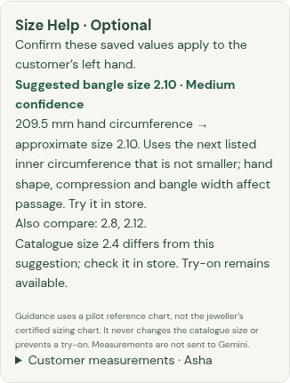
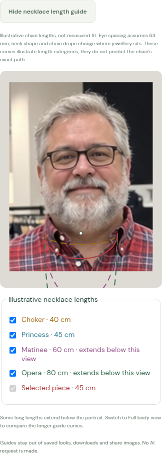
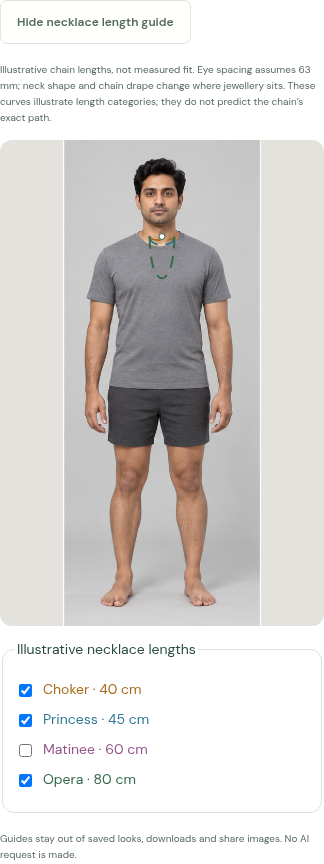
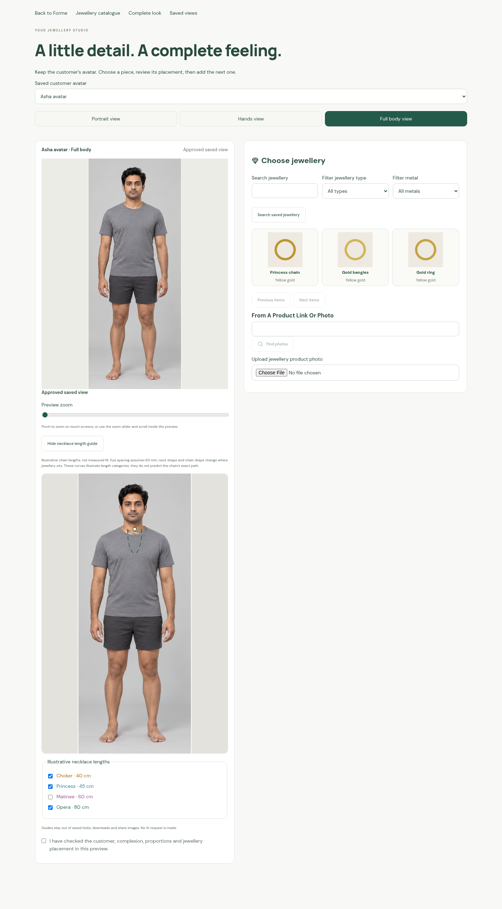

# J11 browser captures

Actual mobile and desktop browser captures at a 390 px phone viewport and a
1440 px desktop viewport. The customer portrait is an independent local photo
fixture and the full body is an illustrative standard avatar. Guide coordinates
are injected fixtures; a separate backend test runs the real shipped local
landmark model. No live Gemini call or image generation is used in these tests.

The browser tests record measurements through the ordinary customer-profile
editor, clear a known ring size, preview a different measured suggestion, check
that the product's try-on button remains enabled, save/reopen the same customer
measurements, and preserve the string `2.10`. Catalogue sizes and credit balance
remain unchanged. Further cases move the portrait's anchor, switch to full body,
toggle guide curves, expire the session during a pending response, and check
that disabled stores show no new inputs.

The diagram's curves illustrate length categories and an approximate scale.
These captures do not demonstrate calibrated fit or accurate necklace drape.
They use the real SVG rendering and account persistence paths. Actual saved
looks and exported/shared images retain their original pixels without guides.

See [workflow, charts and limits](../../JEWELLERY_SIZING.md).

Validation: **407 backend tests and 134 browser tests passed**, together with
the TypeScript/Vite production build. The final browser run also verifies that
a mismatched saved-source hash prevents drawing a guide while try-on remains
enabled. Targeted backend checks reject saving against a changed customer link.
The new shared sizing module was included in a production-runtime staging check;
module imports and HTTP health passed. No live Gemini call, APK build, container
publication or Lightsail deployment was performed.
