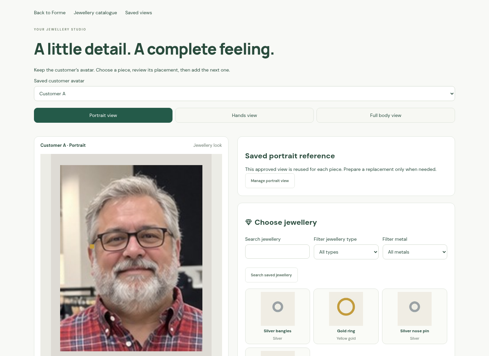
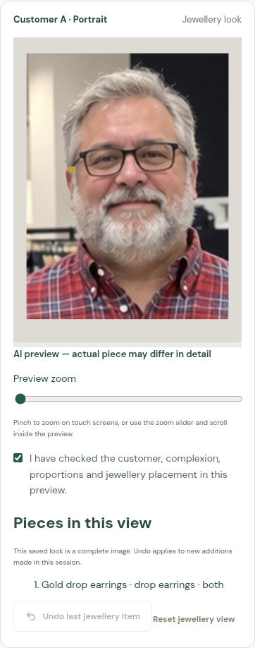

# Jewellery studio screen captures

These are actual desktop and mobile browser captures of J8's jewellery studio.
They use dummy catalogue data and injected image generation. The portrait and
small coloured test overlays verify UI state and reuse; they are not evidence
of live Gemini jewellery placement, product fidelity or likeness.

The browser test creates a portrait, fits earrings and a nose pin, undoes the
last piece, saves/downloads/shares the reviewed look, and reopens it without
another image-generation request. See [the staff workflow](../../JEWELLERY_STUDIO.md).
