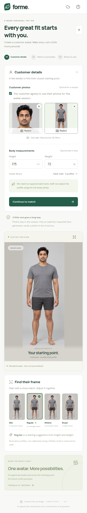
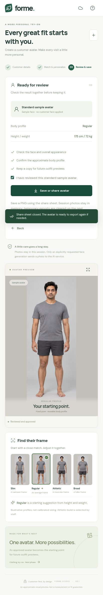
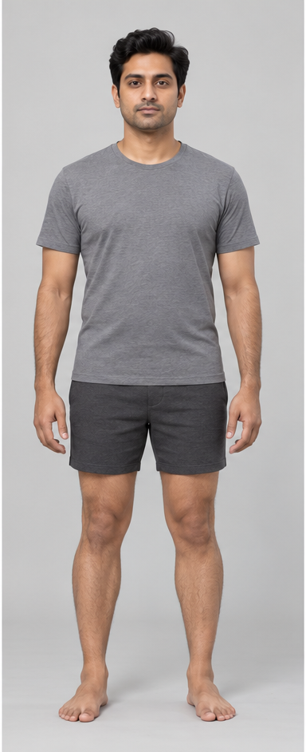

# Testing with different customer photos

> Historical v0.1 report: the screenshots below recorded sample export with customer photos present. Version 0.2 now blocks that flow: customer-photo sessions require a generated avatar before approval/export. The repeatable tests now assert this block and test sample exports only after starting a separate empty session. See [the current generation contract and validation limits](../../GENERATION_SETUP.md).

Re-run on 2026-10-22 with **three independently generated synthetic customers**, replacing the avatar-library crops used in the earlier run. **14 unit/API tests and 27 browser tests passed**, with no skipped tests or retries. This exercises the Level 1 Android interface in Chromium with simulated Capacitor camera, filesystem, and share APIs. The app code and APK did not need changes for this re-run.

**These inputs are different from the avatar. Offline mode still returns a standard sample avatar, not the customer's face. No live face transfer or automatic body analysis was performed.**

## Inputs and coverage

The new photos depict three fictional people: a grey-haired customer with glasses and a red plaid shirt, a bald customer in a blue polo, and a customer with glasses in a green sweater. Their images were generated without referencing the avatar library. Each face input is cropped from that customer's own full-body photo. They are not real customer records, and three people are not a representative validation dataset. A fixed random seed (`20261022`) makes the randomized measurements and photo choices reproducible. Assigned height/weight values are test data, not measurements inferred from the photos.

| Independent customer | Face input | Full-body input | Actual app screenshot | Exported sample |
| --- | --- | --- | --- | --- |
| Red plaid shirt | [JPEG](red-plaid/input-face.jpeg) | [JPEG](red-plaid/input-body.jpeg) | [Photos entered](red-plaid/photos-entered.png) | [Slim PNG](red-plaid/exported-avatar.png) |
| Blue polo shirt | [PNG](input-face.png) | [PNG](input-body.png) | [Photos entered](photos-entered.png) | [Regular PNG](exported-avatar.png) |
| Green sweater | [WebP](green-sweater/input-face.webp) | [WebP](green-sweater/input-body.webp) | [Photos entered](green-sweater/photos-entered.png) | [Athletic PNG](green-sweater/exported-avatar.png) |

  

| Check | Coverage | Result |
| --- | --- | --- |
| End-to-end sessions | 16 height/weight pairs: 3 known recommendations, 2 supported-range boundaries, 11 random pairs | Passed |
| Photo formats | JPEG, PNG, WebP; face and body inputs from 3 independent synthetic people | Passed |
| Large photos | 3000-pixel inputs reduced to at most 1600 pixels | Passed |
| Photo orientation | All 8 WebP EXIF orientations compared with Sharp's independent decoder | Passed |
| Invalid measurements | 10 empty, negative, zero, and out-of-range combinations; recovery after correction | Passed |
| Invalid photos | Unsupported type, corrupt JPEG, 64 × 64 image, and file over 10 MB; existing photo preserved | Passed |
| Manual correction and export | All 4 profiles; approval required; every exported 384 × 942 PNG compared pixel-for-pixel with its selected sample | Passed |
| Session privacy | Consent required, photos cleared on reset/revocation, native cache cleanup requested | Passed |
| AI request count | Zero API requests in all 16 offline sessions | Passed |

Example known recommendations: 175 cm / 55 kg → Slim; 175 cm / 72 kg → Regular; 175 cm / 95 kg → Broad. These verify the current illustrative rule, not real-world sizing accuracy. Athletic is a staff selection.

See [all 16 scenario records](scenarios.json), including customer ID, image format, normalized dimensions, manually selected profile, and export dimensions, and the [run summary](test-summary.json). The avatar library is used only as the expected sample export or a clearly stubbed provider response, never as a customer photo input.

## Bug found and corrected

The earlier avatar-crop run found a WebP orientation issue. The photo pipeline now reads the WebP orientation with bounded metadata parsing, resets the tag before browser decoding to prevent double rotation, and applies the required rotation/mirroring when normalizing the image. The regression test now checks all eight orientations using the independent green-sweater customer's photo. It passes against Sharp's independent decoder. The previously rebuilt Android APK already includes this correction.

## Actual test screenshots and output

The following screenshots are from the running interface at a 412-pixel mobile width with simulated Android APIs. They are not emulator or phone screenshots.

[Face input](input-face.png) · [Full-body input](input-body.png) · [Exported PNG](exported-avatar.png)

The blue-polo full-body input in this example intentionally carries rotation metadata. The interface correctly displays it upright. The exported result is the **Regular standard sample**, with its sample face; it does not resemble the uploaded customer because no AI face merge occurred.

### Photos and measurements entered



### Reviewed and approved



### Exported avatar



## Reproduce

```sh
npm ci
npm test
npm run test:e2e
npm run android:check
```

Only the new photo/data browser tests: `npm run test:e2e -- tests/browser/random-data.spec.js`.

Physical Android camera/gallery/share behavior, live AI face-personalization quality and cost, demographic coverage, and real body-measurement accuracy are **not validated by this run**. Full-body photos remain staff references. The test fixtures were created with Image Gen; the app made no requests to its face-personalization provider.
