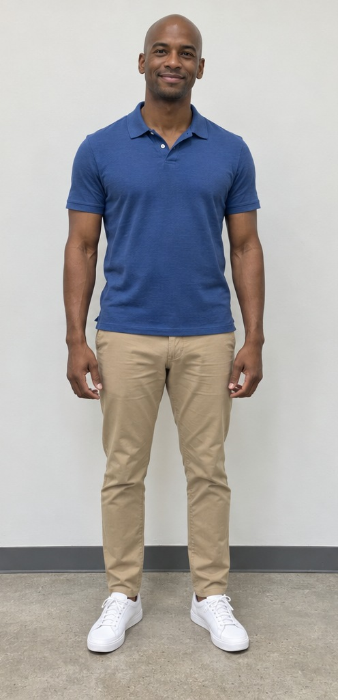
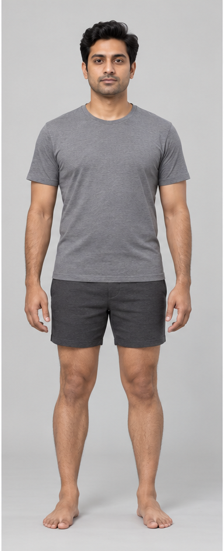
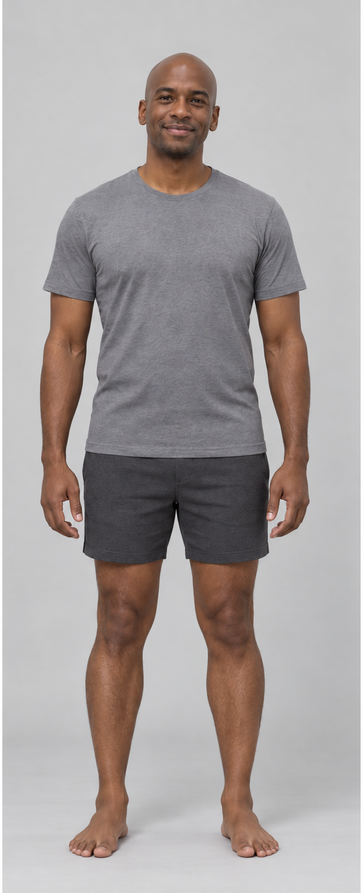

# Sample customer → standard body: separate visual example

**This image was generated with the conversation's Image Gen tool, not by the Android app or its Gemini backend.** The backend has no configured Gemini API key, so live app generation remains untested. This example demonstrates the requested appearance and is not evidence that the app's provider integration, latency or cost has been validated.

## Actual inputs

The customer is the independently generated fictional adult in a blue polo shirt. These customer photos are separate from the avatar library.

| Input | Purpose |
| --- | --- |
| [Customer face photo](../../../tests/fixtures/customers/blue-polo-face.jpg) | Facial features, bald head and primary skin-tone reference |
| [Customer full-body photo](../../../tests/fixtures/customers/blue-polo-body.jpg) | Supporting appearance and visible skin-tone reference |
| [Regular standard template](regular-template.png) | Selected body, pose, grey T-shirt, charcoal shorts and background |

  

## Generated result

[Open the full-resolution PNG](generated-avatar.png).

Generation used all three reference images in one explicit image-tool request. The instructions asked it to apply the customer's face/hair and natural skin tone to every exposed region while retaining the template's body proportions, clothes, pose and framing. No generated output was inserted into the app or represented as a Gemini response.

## Visual inspection

- The output resembles the sample customer's facial features and bald head.
- The template's grey T-shirt and charcoal shorts remain; the customer's blue polo, trousers and sneakers were not copied.
- The face, neck, arms, hands, legs and feet have broadly consistent adapted skin coloration, with lighting variation.
- One full-body person is visible, including both feet, against a neutral background.
- Facial fidelity and skin-tone accuracy were assessed only by visual inspection. No color calibration, identity score, or measured accuracy is claimed.
- Exact template geometry and pixel alignment are not verified. Generative edits can change proportions and fine detail, so this is not proof of garment-overlay compatibility or fit accuracy.

The next verification step is to configure the real backend, run the same three inputs through the app's Gemini provider, and have the customer/staff review face, body and skin tone before approval. See [backend setup](../../GENERATION_SETUP.md).

The original generated PNG is 800 × 1965 pixels. The standard template is 384 × 942 pixels. Neither image encodes calibrated physical dimensions.
